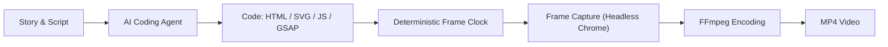
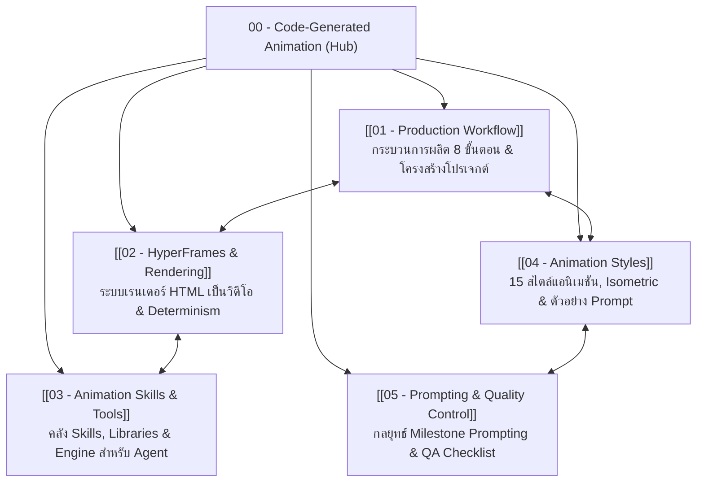

# 00 - Code-Generated Animation

> **Hub & Knowledge Map**: คู่มือการสร้างคลิปแอนิเมชันและโมชันกราฟิกด้วยโค้ด โดยใช้ AI Coding Agent เป็นผู้ช่วยกำกับ เขียนฉาก ควบคุมไทม์ไลน์ ตรวจงาน และเรนเดอร์เป็นไฟล์วิดีโอ  
> **Source Reference**: สรุปและเรียบเรียงจาก [[Learn_Code_Generated_Animation_Video]]

---

## 1. Code-Generated Video คืออะไร

**Code-Generated Video** คือการสร้างภาพและการเคลื่อนไหวด้วยโค้ด (เช่น HTML, CSS, JavaScript, SVG, Canvas 2D หรือ Three.js) แทนการใช้โปรแกรมตัดต่อวิดีโอทั่วไป หรือการสั่งโมเดล Generative AI Video แบบกล่องดำที่ควบคุมรายละเอียดได้ยาก

ในแนวทางนี้ AI Coding Agent (เช่น Claude Code) จะทำหน้าที่เป็นเสมือน "ผู้กำกับและวิศวกรโมชัน":
- เขียนโครงสร้างฉาก (Scene Layout) และวัตถุต่าง ๆ
- วางตำแหน่งตัวละคร แสง และมุมกล้อง
- ควบคุม Timeline และจังหวะการเคลื่อนไหวผ่านโค้ด
- ใช้ระบบเรนเดอร์จับภาพแต่ละเฟรมตามเวลาที่กำหนดอย่างแม่นยำ แล้วนำมาประกอบเป็นไฟล์วิดีโอ (MP4)

### เหมาะกับงานประเภทไหน
1. **งานอธิบายแนวคิด (Explainer Video)** ที่มีลำดับขั้นตอนชัดเจน
2. **Infographic & Data Story** ที่ต้องแสดงข้อมูล แผนภาพ แผนที่ หรือความสัมพันธ์ขององค์ประกอบ
3. **งานที่ต้องการความแม่นยำสูง** ในการควบคุมตำแหน่งวัตถุ ข้อความ และจังหวะภาพ
4. **การผลิตวิดีโอหลายเวอร์ชัน (Scale & Variations)** จาก Design System หรือ Template เดียวกัน
5. **การแก้ไขที่ทำซ้ำได้ (Iterative Editing)** แก้เฉพาะจุดในโค้ดแล้วเรนเดอร์ใหม่ได้ทันที โดยไม่ต้องเริ่มทำใหม่ทั้งหมด

---

## 2. เปรียบเทียบวิธีการผลิตวิดีโอ 4 รูปแบบ

| วิธี | วิธีทำงาน | เหมาะกับ | ข้อจำกัด |
|---|---|---|---|
| **Traditional Editing** | ถ่ายหรือหา Footage แล้วตัดต่อใน Video Editor | สารคดี, สัมภาษณ์, Vlog, งาน Live-action | ต้องมี Footage จริง และใช้เวลาตัดต่อสูง |
| **AI Video Generation** | ป้อน Text Prompt หรือภาพนิ่งให้โมเดลสร้างคลิป | ภาพบรรยากาศ, ฉากสมจริง, ไอเดียที่ต้องการเห็นภาพเร็ว | ควบคุมรายละเอียด ตำแหน่ง และความต่อเนื่องระหว่างช็อตได้จำกัด |
| **Code-Generated Video** | เขียนโค้ดสร้างฉากและไทม์ไลน์ แล้วเรนเดอร์ทีละเฟรม | Explainer, Infographic, Motion Graphic, Data Story, Product Demo | ต้องออกแบบระบบภาพและกำหนดการเคลื่อนไหวอย่างมีตรรกะ |
| **Hybrid Production** | ใช้โค้ดผสมผสานกับ Footage, ภาพนิ่ง, เสียงพากย์ (TTS) หรือ 3D Assets | งานอธิบายที่ต้องมีทั้งหลักฐานจริงและภาพกราฟิกจำลอง | ต้องบริหารจัดการสิทธิ์ไฟล์และความเข้ากันได้ของ Asset |

> [!important] ความเข้าใจที่ถูกต้อง
> Code-Generated Video ไม่จำเป็นต้องวาดทุกสิ่งทุกอย่างด้วยโค้ด 100% เสมอไป เราสามารถนำเสียงพากย์ เสียงดนตรี โลโก้ ภาพถ่าย หรือ 3D Model สำเร็จรูปมาวางเป็นส่วนหนึ่งของ Composition ได้

---

## 3. หลักคิดสำคัญ 7 ข้อ (Core Principles)

ก่อนเริ่มต้นสร้างแอนิเมชันด้วยโค้ด ควรยึดหลักคิด 7 ประการนี้เสมอ:

1. **Story ก่อน Style:** ต้องรู้ว่าจะเล่าเรื่องอะไรให้คนดูเข้าใจ ก่อนเลือกว่าจะวาดภาพสไตล์ไหน
2. **One scene, one main event:** ในหนึ่งช่วงเวลา ควรมีเหตุการณ์หลักเพียงเหตุการณ์เดียวที่คนดูจับใจความได้ชัดเจน อย่าให้ตัวละคร กล้อง และข้อความเคลื่อนไหวแย่งความสนใจพร้อมกัน
3. **Style is a system:** สไตล์ภาพไม่ใช่แค่คำบรรยายความสวยงาม แต่คือกติกาทางภาพและเสียงที่เป็นระบบ (Projection, Palette, Material, Typography, Motion Grammar)
4. **Motion has a purpose:** ทุกการเคลื่อนไหวต้องมีหน้าที่ในการสื่อสาร เช่น บอกทิศทาง อธิบายความสัมพันธ์ หรือดึงสายตา ไม่ใช่ใส่เพื่อตกแต่งให้ดูหวือหวา
5. **Build modularly:** แยกฉาก ตัวละคร และวัตถุเป็น Component ที่นำกลับมาใช้ซ้ำและแก้ไขเฉพาะจุดได้ง่าย
6. **Render deterministically:** ควบคุมการเคลื่อนไหวด้วยไทม์ไลน์ที่คำนวณเวลาแน่นอน ห้ามพึ่งพาเวลาจริงของระบบ เพื่อให้เรนเดอร์ซ้ำแล้วได้ผลลัพธ์เหมือนเดิมทุกเฟรม
7. **Trust the preview, verify the render:** ตรวจสอบความถูกต้องจากภาพเคลื่อนไหวจริงและไฟล์ที่เรนเดอร์ออกมาเสมอ อย่าสันนิษฐานว่าโค้ดทำงานถูกต้องโดยไม่ได้ตรวจสอบ

---

## 4. แผนผังความรู้ (Knowledge Navigation Map)

ชุดความรู้นี้ถูกแบ่งออกเป็น 5 หมวดหมู่หลักตามลำดับการทำงานจริง:

### สรุปสาระสำคัญของแต่ละ Note

| รหัส Note | หัวข้อ | สิ่งที่จะได้เรียนรู้ |
|---|---|---|
| **[[01 - Production Workflow]]** | กระบวนการผลิตจาก Idea สู่ MP4 | ขั้นตอน 8 สเต็ป, วิธีทำ Storyboard, การวางโครงสร้างเรื่อง 60 วินาที, โครงสร้างโปรเจกต์ และ Roadmap 5 ระยะ |
| **[[02 - HyperFrames & Rendering]]** | HyperFrames และการเรนเดอร์ | กลไก Frame-by-frame seeking, กฎเหล็กของ Deterministic Rendering, โครงสร้าง Composition และคำสั่ง CLI |
| **[[03 - Animation Skills & Tools]]** | เครื่องมือและ Skills สำหรับ AI Agent | ความแตกต่างระหว่าง Skill vs Tool, HyperFrames Skills, Lemo-Opuscar, GSAP, ClaudeAnimationBase, pixelfx, Three.js |
| **[[04 - Animation Styles]]** | ระบบสไตล์ภาพและตัวอย่าง Prompt | 15 สไตล์แอนิเมชัน, กฎเจาะลึก Isometric Infographic (Projection, แสงเงา 3 ด้าน, กล้อง), และ 5 Prompt Styles ตัวอย่าง |
| **[[05 - Prompting & Quality Control]]** | การสั่งงานและควบคุมคุณภาพ | โครงสร้าง Master Prompt Template 12 ส่วน, กลยุทธ์ Milestone Prompting (แบ่งทำทีละสเต็ป), และ QA Checklist 4 มิติ |

---

## 5. กรณีศึกษา: THE SECOND SHIFT (AP Thailand)

ในเอกสารชุดนี้ มีการยกกรณีศึกษาจริงจากโปรเจกต์ **THE SECOND SHIFT** ของ AP Thailand:
- **โจทย์หลัก:** ถ่ายทอดภาพชีวิตของคนเมืองที่เดินทางไปทำงาน แต่ระหว่างทางกลับมีงานเล็ก ๆ มากมายที่ต้องคอยจัดการเอง ("อีกกะที่ไม่มีใครจ่าย")
- **ทิศทางที่แนะนำ:** **Isometric Infographic + Character-led Storytelling** เพราะสามารถแสดงเมือง เส้นทางการเดินทาง ปัญหาจุดรอรถ และแนวคิดงานออกแบบแก้ไข (Interventions) ได้อย่างครบถ้วนในโลกทัศน์เดียวกัน
- **คำแนะนำสำคัญ:** เริ่มต้นด้วย HyperFrames + GSAP ควบคู่กับ Isometric Style Guide โดยไม่จำเป็นต้องใช้ 3D ซับซ้อนอย่าง Blender ในระยะแรก เพื่อเน้นการเล่าเรื่องที่เข้าใจง่ายและผลิตได้จริง
