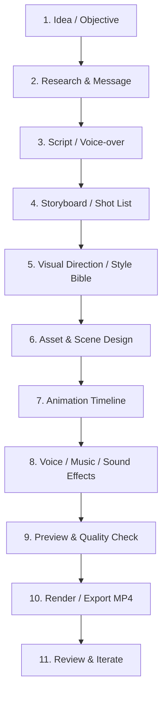
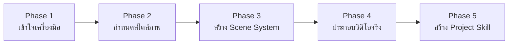

# 01 - Production Workflow

> **กระบวนการผลิตวิดีโอด้วยโค้ดอย่างเป็นระบบ**: ตั้งแต่การตั้งเป้าหมายเนื้อหา การเขียนบท การออกแบบ Storyboard การคัดเลือกเทคโนโลยี ไปจนถึงการเรนเดอร์และส่งมอบผลงาน  
> **Source Reference**: สรุปและเรียบเรียงจาก [[Learn_Code_Generated_Animation_Video]]  
> **Index**: [[00 - Code-Generated Animation]]

---

## 1. แนวคิดหลัก: อย่าเริ่มจากการสั่งเขียนโค้ดทันที

ข้อผิดพลาดที่พบบ่อยที่สุดในการสร้างวิดีโอด้วย AI Coding Agent คือการเปิดโปรเจกต์แล้วสั่งให้โมเดลเขียนโค้ดแอนิเมชันทันทีโดยไม่มีพิมพ์เขียว ผลลัพธ์ที่ได้มักจะเป็นภาพเคลื่อนไหวที่ไม่มีทิศทาง ตัวละครเปลี่ยนหน้าตาไปมา และเนื้อหาไม่ต่อเนื่อง

**กฎทองคำ:** ให้เริ่มต้นจาก **"เรื่องที่ต้องการสื่อสาร" (Story & Message)** เสมอ แล้วค่อยแปลงเรื่องนั้นให้กลายเป็นระบบภาพและคำสั่งโค้ดตามลำดับ



---

## 2. ขั้นตอนการผลิต 8 ขั้นตอน (Step-by-Step)

### Step 1: กำหนดเป้าหมายว่าคนดูต้องเข้าใจอะไร
เริ่มจากประโยคเดียวที่ตอบได้ชัดเจนว่า **เมื่อคลิปนี้จบลง คนดูควรเข้าใจอะไร** อย่าเพิ่งรีบเลือกสไตล์ภาพก่อนรู้แกนเรื่อง

> **ตัวอย่างกรณีศึกษา THE SECOND SHIFT:**
> - **Audience:** คนทำงานในเมืองที่ต้องเดินทางในชีวิตประจำวัน
> - **Objective:** ทำให้คนดูตระหนักว่างานจิปาถะเล็ก ๆ ระหว่างเดินทางคือภาระแฝงในแต่ละวัน
> - **Main Message:** คนเราเดินทางไปทำงาน แต่ระหว่างทางกลับมีงานอีกมากมายที่ต้องคอยจัดการเอง ("อีกกะที่ไม่มีใครจ่าย")
> - **Desired Response:** เข้าใจปัญหาและเห็นความสำคัญของการออกแบบจุดช่วยเหลือ (Interventions)

### Step 2: เขียน Script และ Voice-over
เขียนบทด้วย **"ภาษาพูดจริง"** ไม่ใช่การนำสไลด์หรือบทความวิชาการมาอ่านตรง ๆ

บทพูดที่ดีแต่ละประโยคควรทำหน้าที่อย่างใดอย่างหนึ่งดังนี้:
1. **เปิดประเด็น:** ตั้งคำถามหรือดึงความสนใจทันที
2. **สะท้อนภาพจำ:** ยกเหตุการณ์จริงที่คนดูคุ้นเคย
3. **เชื่อมโยง Insight:** วิเคราะห์ว่าทำไมเหตุการณ์นั้นถึงเป็นปัญหา
4. **นำเสนอทางออก:** แนะนำแนวคิดหรือตัวช่วยแก้ไขปัญหา
5. **ปิดท้าย:** ทิ้งประโยคสรุป (Key Takeaway) ที่จดจำง่าย

> [!tip] การกะเวลาอ่านภาษาไทย
> ควรอ่านออกเสียงจับเวลาจริงเสมอ ไม่ควรใช้การนับจำนวนคำเพียงอย่างเดียว เพราะภาษาไทยมีจังหวะการเว้นวรรคและการออกเสียงที่แตกต่างจากภาษาอังกฤษ

### Step 3: ทำ Storyboard ก่อนเขียนโค้ด
**Storyboard** คือแผนภาพระบุว่าในแต่ละช่วงเวลาคนดูจะเห็นและได้ยินอะไร ไม่ใช่เพียงแค่รายการหัวข้อที่จะพูด

ในแต่ละ Shot ควรตอบคำถามทั้ง 8 มิติต่อไปนี้ให้ครบ:

| ข้อมูลที่ต้องระบุ | คำถามที่ต้องตอบ |
|---|---|
| **Timecode** | ฉากนี้เริ่มต้นวินาทีที่เท่าไร และสิ้นสุดวินาทีที่เท่าไร |
| **Narration** | ช่วงนี้เสียงพากย์กำลังพูดข้อความอะไร |
| **Visual Event** | มีเหตุการณ์อะไรเกิดขึ้นบนหน้าจอ |
| **Subject** | ตัวละครหลักหรือวัตถุที่เป็นจุดโฟกัสคืออะไร |
| **Camera** | มุมกล้องทำอะไร เช่น Static, Pan, Zoom in, Zoom out |
| **Transition** | เชื่อมต่อไปยังฉากถัดไปด้วยเทคนิคใด (เช่น Cut, Slide, Wipe) |
| **On-screen Text** | มีข้อความ Label หรือตัวเลขที่ต้องแสดงบนจอหรือไม่ |
| **Sound** | มีเสียงพากย์ เสียงดนตรี หรือ Sound Effect (SFX) อะไรบ้าง |

> [!important] กฎหนึ่งช่วงเวลา หนึ่งเหตุการณ์หลัก
> ใน 1 Beat ควรกำหนดให้มี **เหตุการณ์หลักเพียงเหตุการณ์เดียวที่อ่านออกได้ทันที** หลีกเลี่ยงการให้กล้องขยับ ตัวละครเคลื่อนที่ ตัวหนังสือเด้ง และวัตถุเบื้องหลังขยับแข่งกันพร้อม ๆ กัน

### Step 4: กำหนด Visual Direction หรือ Style Bible
Style Bible คือข้อตกลงร่วมกันในการออกแบบ เพื่อให้ทุกฉากดูเสมือนอยู่ในจักรวาลเดียวกัน:
- **Art Style:** กำหนดสไตล์หลัก เช่น [[04 - Animation Styles|Isometric Infographic, Flat Vector]]
- **Projection / Camera:** มุมมองและข้อจำกัดของกล้อง (เช่น Fixed Isometric 30 องศา)
- **Palette:** กำหนดสีหลัก (Primary), สีรอง (Secondary), สีเน้น (Accent), สีพื้นหลัง และสีเงา
- **Materials:** พื้นผิววัตถุ เช่น ผิวด้าน (Matte), เนื้อแก้ว (Glass), กระดาษ (Paper)
- **Lighting:** ทิศทางแสงและความนุ่มของเงา
- **Characters:** สัดส่วน รูปร่าง และวิธีการเคลื่อนไหวของตัวละคร
- **Typography:** แบบอักษร ขนาด น้ำหนัก และตำแหน่งของข้อความ
- **Motion Grammar:** กฎการเคลื่อนไหว เช่น การเข้าฉาก การหยุด และการเร่งความเร็ว (Easing)
- **Sound Language:** แนวเสียงดนตรีและประเภทของ Sound Effects

> [!warning] หลีกเลี่ยงคำบรรยายกว้าง ๆ
> อย่าสั่งงานด้วยคำว่า "สวยงาม", "Cinematic", หรือ "ขอแบบพรีเมียม" ให้ระบุรายละเอียดที่เป็นรูปธรรม เช่น *"กล้องมุมมองคงที่ 30 องศา, เงา 3 ระดับ, วัตถุผิวด้าน, สี Amber ใช้เฉพาะจุดเน้นและเส้นทางเดิน"*

### Step 5: เลือกวิธีสร้างภาพและเทคโนโลยี Asset
เลือกเครื่องมือสร้างภาพให้เหมาะสมกับระดับความซับซ้อน ไม่จำเป็นต้องใช้ 3D Engine เสมอไป:

| เทคโนโลยี | เหมาะสำหรับสร้าง | จุดเด่น |
|---|---|---|
| **HTML / CSS** | Layout, Typography, Card UI, การเปลี่ยนฉากพื้นฐาน | จัดข้อความและโครงสร้าง UI สะดวกและคมชัด |
| **SVG** | Icon, Diagram, แผนที่เส้นทาง, ภาพเวกเตอร์ 2D | คมชัดทุกขนาด ย่อขยายได้ไม่แตก และแก้ไขรูปทรงด้วยโค้ดง่าย |
| **Canvas 2D** | Particle effects, การวาดภาพตามฟังก์ชัน (Procedural), 2D Motion | ประสิทธิภาพสูง วาดและควบคุมภาพด้วย JavaScript ได้ละเอียด |
| **Three.js** | ฉาก 3D, โมเดลสามมิติ, ระบบแสงเงา, กล้อง 3D | สร้างฉาก 3D บน Browser ได้โดยตรง |
| **React Three Fiber** | ฉาก 3D แบบ Declarative ในระบบ React | เหมาะกับทีมที่ใช้ React เป็นหลัก |
| **Blender** | 3D Modeling ขั้นสูง, แสงเงาสมจริง | เหมาะกับวัตถุหรือฉากที่ต้องการความประณีตระดับสูง |
| **FFmpeg** | ตัดต่อ, รวมไฟล์, ปรับขนาด, รวมภาพกับเสียง | จัดการแปลงไฟล์และประมวลผลวิดีโอขั้นสุดท้าย |

*(ศึกษาเครื่องมือและปลั๊กอินเพิ่มเติมใน [[03 - Animation Skills & Tools]])*

### Step 6: กำหนด Timeline และ Motion
กำหนดเวลาการเคลื่อนไหวให้แน่นอน โดยคำนวณเป็นเฟรม เช่น **30 FPS (Frames Per Second)** แปลว่า 1 วินาทีมี 30 เฟรม วิดีโอความยาว 60 วินาทีจะมีทั้งหมด 1,800 เฟรม

ในแต่ละช่วงการเคลื่อนไหว ให้แบ่งลำดับเป็น 4 จังหวะ:
- **In:** วัตถุหรือตัวละครเข้าสู่ฉากอย่างไร
- **Action:** การกระทำหรือเหตุการณ์หลักเกิดขึ้นอย่างไร
- **Reaction:** สิ่งรอบข้างหรือตัวละครมีปฏิกิริยาตอบสนองอย่างไร
- **Out:** วัตถุออกจากฉากหรือเปลี่ยนส่งต่อไปยังฉากถัดไปอย่างไร

> **ตัวอย่าง:** รถเมล์เข้าป้าย ไม่ควรโผล่มาเฉย ๆ แต่ให้เส้นทางค่อย ๆ วาดเข้ามา รถวิ่งตามเส้นทาง ตัวละครยกมือส่งสัญญาณ จากนั้นป้ายแสดงสายรถจึงปรากฏขึ้น

### Step 7: ใส่เสียงและประกอบภาพ
เสียงมีหน้าที่เสริมอารมณ์และกำกับจังหวะของภาพ:
- **Voice-over (VO):** กระดูกสันหลังของการเล่าเรื่อง
- **Music:** ควบคุมอารมณ์และ Pace โดยรวมของคลิป
- **Sound Effects (SFX):** เสียงฝีก้าว, เสียงรถ, เสียงป้ายเด้ง, เสียง Transition
- **Captions:** คำบรรยายช่วยให้ดูรู้เรื่องแม้ไม่ได้เปิดเสียง

### Step 8: Preview และตรวจคุณภาพ (Quality Control)
อย่าตรวจดูเพียงแค่เฟรมแรกและเฟรมสุดท้าย ให้ดูความลื่นไหลของการเคลื่อนไหวจริง ตรวจสอบการทับซ้อนของข้อความ และเรนเดอร์ทดสอบด้วยไฟล์ความละเอียดต่ำก่อนเสมอ *(ดู Checklist เต็มใน [[05 - Prompting & Quality Control]])*

---

## 3. ตัวอย่างโครงสร้างเรื่อง 60 วินาที (THE SECOND SHIFT)

โครงสร้างเรื่องนี้ถูกออกแบบให้คนดูเข้าใจปัญหาอย่างรวดเร็ว เห็นแนวทางแก้ไข และเข้าใจกระบวนการทดสอบ โดยไม่ยัดเยียดข้อมูลจนแน่นเกินไป:

| Scene | Timecode | หัวข้อเนื้อหา | เหตุการณ์ในภาพ (Visual Event) |
|:---:|:---:|---|---|
| **01** | 00:00–00:06 | The Second Shift | เมืองจำลอง Isometric ปรากฏ ตัวละครก้าวออกจากบ้าน ข้อความชื่อเรื่องเปิดตัว |
| **02** | 00:06–00:12 | Leaving Home | ตัวละครเตรียมกระเป๋าและเริ่มออกเดินทาง เส้นทางสี Amber เริ่มวาดนำทาง |
| **03** | 00:12–00:18 | The Everyday Journey | ตัวละครเดินผ่านทางเท้า ข้ามถนน เผชิญสภาพแวดล้อมจริง |
| **04** | 00:18–00:24 | Waiting for the Bus | รถเมล์แล่นเข้ามา ตัวละครยืนรอและพยายามโบกส่งสัญญาณ |
| **05** | 00:24–00:30 | The Hidden Tasks | ป้ายภาระแฝงขนาดเล็กเด้งขึ้นรอบตัวละคร แสดงให้เห็นว่านี่คือ "อีกกะที่ต้องทำ" |
| **06** | 00:30–00:36 | Curated Focus | แผนที่เมืองจัดหมวดหมู่ แบ่งแสดงจุดแทรกแซง 3 จุด (Interventions) |
| **07** | 00:36–00:42 | The Sign That Speaks | จุดที่ 1: ป้ายไฟช่วยบอกสายรถเมล์ที่รอ เป็นตัวเอกของแคมเปญ |
| **08** | 00:42–00:48 | Light the Way Home | จุดที่ 2: ทางเดินกลับบ้านที่สว่างและปลอดภัยขึ้นในภาพแนวคิด |
| **09** | 00:48–00:54 | The Homecoming Dock | จุดที่ 3: ทางเข้าคอนโดเปิดแบบ Cutaway เผยจุดวางกระเป๋าและเปลี่ยนรองเท้า |
| **10** | 00:54–01:00 | Prove the Impact | วงจร Observe → Validate → Pilot ปรากฏขึ้น ปิดท้ายด้วยข้อความหลัก |

---

## 4. โครงสร้างโฟลเดอร์โปรเจกต์ที่แนะนำ

เพื่อให้การทำงานร่วมกับ AI Coding Agent ราบรื่น ไม่สูญเสีย Context และง่ายต่อการ Debug แนะนำให้จัดโครงสร้างไฟล์ดังนี้:

```text
the-second-shift/
├── CLAUDE.md                # กติกาโปรเจกต์ คำสั่ง Run/Build/Render ข้อห้ามสำคัญ
├── README.md                # คำอธิบายภาพรวมและคู่มือเริ่มต้น
├── storyboard.md            # รายละเอียดเนื้อเรื่อง เวลา และภาพแต่ละฉาก
├── style-guide.md           # กติกาภาพ สี สัดส่วนตัวละคร มุมกล้อง Motion Rules
├── prompts/                 # รวม Prompts สำหรับใช้งานซ้ำ
│   ├── master-prompt.md     # Prompt ใหญ่คุมทั้งเรื่อง
│   ├── scene-prompts.md     # Prompt แยกสำหรับแต่ละฉาก
│   └── qa-prompt.md         # Prompt สำหรับตรวจรับงาน
├── assets/                  # ไฟล์สื่อทั้งหมด
│   ├── audio/               # เสียงพากย์ (VO)
│   ├── sfx/                 # เสียง Effect ต่าง ๆ
│   ├── music/               # เพลงประกอบ Background Music
│   ├── images/              # ภาพประกอบ/Texture
│   └── fonts/               # ไฟล์ Web Fonts
├── compositions/            # ไฟล์ HTML Compositions สำหรับ HyperFrames
│   ├── index.html           # Master Composition ที่รวมทุกฉาก
│   └── scenes/              # แยกไฟล์แต่ละฉาก
│       ├── scene-01-opening.html
│       ├── scene-02-leaving-home.html
│       ├── scene-03-journey.html
│       └── ...
├── src/                     # โมดูลโค้ดที่นำกลับมาใช้ซ้ำ (Reusable Code)
│   ├── characters/          # โค้ดตัวละครและท่าทาง
│   ├── city-elements/       # อาคาร ถนน ป้าย รถเมล์
│   ├── motion/              # GSAP Helper และฟังก์ชันคำนวณการเคลื่อนที่
│   └── utils/               # ฟังก์ชันแปลงพิกัดและคำนวณเฟรม
├── renders/                 # ไฟล์ที่เรนเดอร์ออกมา
│   ├── previews/            # คลิปตัวอย่างความละเอียดต่ำสำหรับตรวจงาน
│   └── final/               # ไฟล์วิดีโอ MP4 ฉบับสมบูรณ์
└── docs/                    # เอกสารบันทึกการผลิต
    ├── production-notes.md  # บันทึกความคืบหน้าและการตัดสินใจ
    └── qa-checklist.md      # แบบฟอร์มตรวจรับคุณภาพงาน
```

---

## 5. แผนการเรียนรู้และพัฒนา 5 ระยะ (Roadmap)

หากกำลังเริ่มต้นสร้างระบบนี้เป็นครั้งแรก ให้ค่อย ๆ พัฒนาไปตาม 5 ระยะดังนี้:



1. **Phase 1: เข้าใจเครื่องมือ (Understanding Tools)**
   - ติดตั้ง [[02 - HyperFrames & Rendering|HyperFrames]] และทดสอบสภาพแวดล้อม
   - สร้าง Composition สั้น ๆ 5–6 วินาที โดยใช้ HTML/SVG และ GSAP
   - ทดสอบ Preview ในเบราว์เซอร์ และสั่ง Render เป็น MP4 ให้สำเร็จ
2. **Phase 2: กำหนดสไตล์ภาพ (Visual Style Exploration)**
   - ทดลองวาดฉาก Isometric ขนาดเล็ก 1 ฉาก
   - ทดลองสร้างตัวละคร Isometric ที่ขยับท่าทางง่าย ๆ 1 ตัว
   - สรุป Style Guide ที่ระบุค่าสี มุมมอง Projection และสัดส่วนตัวละคร
3. **Phase 3: สร้างระบบชิ้นส่วนฉาก (Scene Component System)**
   - แยกตัวละคร อาคาร ถนน และป้ายบอกทางเป็น Component ที่เรียกใช้ซ้ำได้
   - สร้างฟังก์ชัน Transition ที่ใช้เชื่อมแต่ละฉาก
   - วางระบบ Caption และไทม์ไลน์ให้สอดคล้องกับเสียงพากย์
4. **Phase 4: ประกอบวิดีโอจริง (Production & Integration)**
   - ล็อกเนื้อหา Script และ Storyboard ให้เสร็จสมบูรณ์
   - ทดสอบ Style Test ให้ผ่านเกณฑ์ก่อน
   - ผลิตแอนิเมชันทีละฉากตามลำดับ แล้วนำมารวมเข้า Master Composition
   - ตรวจสอบผ่าน QA Checklist แล้วจึง Render วิดีโอฉบับจริง
5. **Phase 5: สรุปเป็น Custom Skill ประจำโปรเจกต์**
   - เมื่อระบบเสร็จสมบูรณ์ ให้นำกติกา โค้ด และ Style Guide มาสร้างเป็น Custom Skill ของตนเอง (เช่น `/the-second-shift-animation`) เพื่อให้ Agent นำไปใช้ในโปรเจกต์ถัดไปได้อย่างรวดเร็ว
