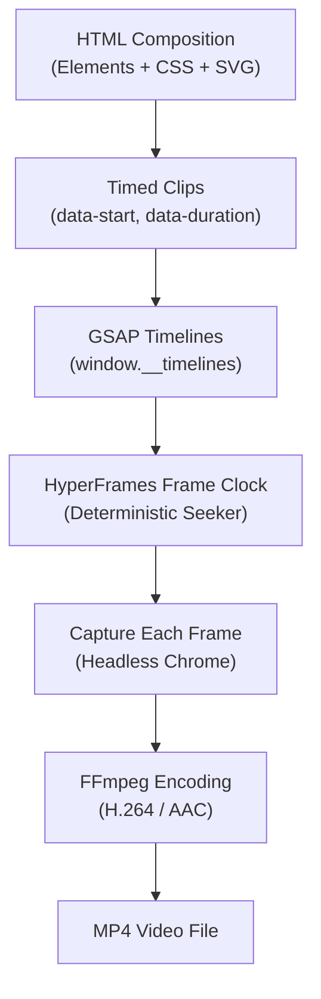

# 02 - HyperFrames & Rendering

> **ระบบเรนเดอร์วิดีโอจากโค้ดเว็บ**: ทำความรู้จักกับ HyperFrames กลไกการเรนเดอร์ทีละเฟรม (Frame-by-frame seeking) หัวใจของความแม่นยำ (Deterministic Rendering) และการใช้งานคำสั่ง CLI  
> **Source Reference**: สรุปและเรียบเรียงจาก [[Learn_Code_Generated_Animation_Video]]  
> **Index**: [[00 - Code-Generated Animation]]

---

## 1. HyperFrames คืออะไร

**HyperFrames** คือเฟรมเวิร์กและชุดเครื่องมือสำหรับสร้าง Video Composition ด้วยเทคโนโลยีเว็บ (HTML, CSS, SVG, JavaScript, Canvas) แล้วเรนเดอร์ออกมาเป็นไฟล์วิดีโอ (MP4) คุณภาพสูง

จุดเด่นของ HyperFrames คือมีชุด **Agent Skills** และ **CLI** ที่ออกแบบมาให้ AI Coding Agent สามารถเขียนไทม์ไลน์ ตรวจสอบโครงสร้างไฟล์ และสั่งเรนเดอร์วิดีโอได้โดยอัตโนมัติ



### การเรนเดอร์ทำงานอย่างไร
HyperFrames **ไม่ได้ใช้วิธีเปิดเว็บแล้วอัดหน้าจอแบบ Real-time** แต่ใช้วิธี **Frame-by-frame Seeking**:
1. ตัวจำลองเวลา (Frame Clock) จะสั่งเลื่อนเวลา (Seek) ไปยังเฟรมที่ต้องการอย่างเจาะจง (เช่น เฟรมที่ 0, 1/30s, 2/30s, ...)
2. Headless Chrome จะจับภาพหน้าจอของเฟรมนั้นเป็นไฟล์ภาพนิ่งความละเอียดสูง
3. ส่งภาพแต่ละเฟรมเข้าสู่กระบวนการ Encode ของ **FFmpeg** เพื่อรวมเป็นไฟล์วิดีโอ MP4 พร้อมแทร็กเสียง

---

## 2. หัวใจสำคัญ: Deterministic Rendering

คำว่า **Deterministic** ในการเรนเดอร์ หมายถึง:  
> *"ไม่ว่าจะสั่งเรนเดอร์กี่ครั้ง บนเครื่องใด หรือเวลาใดก็ตาม หากใช้ไฟล์ Composition และ Assets ชุดเดิม วิดีโอที่ได้ในทุก ๆ เฟรมจะต้องออกมาเหมือนกันทุกประการ 100%"*

หากโค้ดของเราไม่ได้ถูกเขียนให้เป็น Deterministic ผลลัพธ์อาจจะกระตุก แอนิเมชันเร็วหรือช้าไม่เท่ากัน หรือบางชิ้นส่วนอาจหายไปเมื่อเรนเดอร์จริง

### กฎเหล็ก 6 ข้อในการเขียนโค้ดสำหรับ HyperFrames

| ข้อห้าม / ข้อบังคับ | เหตุผลทางเทคนิค | แนวทางที่ถูกต้อง |
|---|---|---|
| **ห้ามใช้ `Date.now()` หรือเวลาของระบบ** | เวลาจริงของคอมพิวเตอร์เดินไปเรื่อย ๆ ทำให้จังหวะในวิดีโอเพี้ยน | ให้คำนวณการเคลื่อนไหวตาม Timecode หรือตัวแปรเวลาของไทม์ไลน์เท่านั้น |
| **ห้ามใช้ `requestAnimationFrame` หรือ `setInterval`** | ฟังก์ชันเหล่านี้ผูกกับรอบการ Refresh ของหน้าจอจริง ไม่สอดคล้องกับการ Seek ทีละเฟรม | ใช้ Paused Timeline ของ GSAP ที่รองรับการ Seek เป็นตัวขับเคลื่อน |
| **หลีกเลี่ยง `Math.random()` ที่ไม่ได้ Seed** | การสุ่มค่าแบบปกติจะให้ผลลัพธ์เปลี่ยนไปทุกครั้งที่รัน | ใช้ค่าคงที่ หรือใช้ฟังก์ชัน Pseudo-random ที่กำหนด Seed เริ่มต้นที่แน่นอน |
| **โหลด Asset ทั้งหมดล่วงหน้า (Preload)** | หากมีการ Fetch รูปภาพหรือเสียงระหว่างกลางไทม์ไลน์ เฟรมนั้นอาจเรนเดอร์ไม่ทัน | โหลดภาพ ฟอนต์ และเสียงให้พร้อมตั้งแต่เริ่มต้นก่อนเริ่มเรนเดอร์ |
| **กำหนดขนาดและ FPS ให้คงที่** | หากไม่ระบุ ค่ามาตรฐานอาจเปลี่ยนไปตามสภาพแวดล้อม | ระบุ `width`, `height`, `fps` และ `duration` ให้ชัดเจนใน Root Element |
| **ลงทะเบียน GSAP Timeline ตาม Contract** | HyperFrames จำเป็นต้องรู้ว่ามี Timeline ใดบ้างเพื่อควบคุมการ Seek | สร้าง Timeline แบบ `paused: true` แล้วบันทึกลงใน `window.__timelines` |

---

## 3. โครงสร้างของ HyperFrames Composition

ในการสร้างฉากวิดีโอด้วย HyperFrames จะประกอบไปด้วยส่วนประกอบมาตรฐานดังนี้:

### 1. Root Composition
เป็น Container หลักที่กำหนดขอบเขต ขนาดภาพ และรหัสของ Composition เช่น:
```html
<div id="main-composition"
     data-composition-id="the-second-shift"
     data-width="1080"
     data-height="1920"
     data-fps="30"
     data-duration="60">
  <!-- Clips will be placed here -->
</div>
```

### 2. Timed Clips
แต่ละ Element ที่ต้องการให้อยู่บนไทม์ไลน์ต้องมีคลาส `clip` พร้อม Attribute ระบุเวลาเริ่มต้นและระยะเวลา:
- `data-start`: เวลาเริ่มต้น (วินาที)
- `data-duration`: ความยาวของคลิป (วินาที)
- `data-track-index`: ลำดับเลเยอร์ (Track) สำหรับจัดการการซ้อนทับ

```html
<div class="clip" data-start="0" data-duration="6" data-track-index="1">
  <!-- Scene 01 Elements -->
</div>
```

### 3. GSAP Timeline Registration
HyperFrames กำหนดให้ไทม์ไลน์การเคลื่อนไหวทั้งหมดต้องถูกสร้างแบบหยุดชั่วคราว (`paused: true`) และลงทะเบียนไว้ที่ `window.__timelines` เพื่อให้ Seeker ควบคุมเวลาได้:

```javascript
const tl = gsap.timeline({ paused: true });

tl.to("#commuter", { x: 500, duration: 4, ease: "power1.inOut" });

// Register to HyperFrames timeline pool
window.__timelines = window.__timelines || [];
window.__timelines.push(tl);
```

### 4. ข้อควรระวัง: `renderAt(timeSeconds)` vs HyperFrames GSAP
> [!note] Custom Canvas / WebGL Renderer
> บางระบบหรือตัวอย่างโค้ดภายนอกอาจมีการสร้างฟังก์ชัน `renderAt(timeSeconds)` เพื่อคำนวณและวาดภาพบน Canvas ณ วินาทีนั้น ๆ โดยตรง  
> **ข้อพึงระวัง:** รูปแบบนี้เป็นเทคนิคเฉพาะสำหรับ Custom Canvas/SVG Renderer แต่**ไม่ใช่ API พื้นฐานของ HyperFrames**  
> หากทำงานบน HyperFrames ควรยึดตามระบบ **Clip Data Attributes** และการลงทะเบียน **GSAP Timelines** เป็นหลัก แล้วเชื่อมต่อการอัปเดต Canvas เข้ากับจังหวะของ GSAP Timeline อย่างถูกต้อง

---

## 4. คำสั่งพื้นฐานของ HyperFrames CLI

### สภาพแวดล้อมที่ต้องเตรียม (Prerequisites)
- **Node.js**: เวอร์ชัน 22 ขึ้นไป
- **FFmpeg**: ติดตั้งในเครื่องพร้อมเรียกใช้จาก Command Line
- **Docker** *(ทางเลือก)*: สำหรับผู้ที่ต้องการสภาพแวดล้อมการเรนเดอร์ที่เหมือนกันทุกเครื่อง

### 1. ติดตั้ง Agent Skill
เพื่อให้ AI Agent เข้าใจคำสั่งและกฎการสร้างไฟล์ของ HyperFrames:
```bash
npx skills add heygen-com/hyperframes
```

### 2. ตรวจสอบความพร้อมของระบบ
```bash
# ตรวจสอบเวอร์ชัน Node และ FFmpeg
node --version
ffmpeg -version

# ให้ HyperFrames ตรวจสอบความสมบูรณ์ของ Dependencies
npx hyperframes doctor
```

### 3. สร้างโปรเจกต์ใหม่ (Scaffold Project)
```bash
npx hyperframes init the-second-shift
cd the-second-shift
```

### 4. เปิดดูภาพตัวอย่างแบบ Real-time (Preview)
คำสั่งนี้จะเปิด Local Web Server พร้อมตัวเล่นวิดีโอและ Scrub bar สำหรับทดสอบจังหวะและภาพ:
```bash
npx hyperframes preview
```

### 5. ตรวจสอบโค้ดก่อนเรนเดอร์ (Lint & Validate)
ก่อนสั่งเรนเดอร์จริง ควรตรวจสอบข้อผิดพลาดเสมอ:
```bash
# ตรวจสอบโครงสร้าง Composition, Data Attributes และการตั้งค่า
npx hyperframes lint

# ตรวจสอบ Runtime Errors, JavaScript Exceptions และ Assets ที่อาจโหลดไม่ติด
npx hyperframes validate
```

### 6. เรนเดอร์เป็นไฟล์วิดีโอ (Render to MP4)
```bash
# เรนเดอร์ปกติบนเครื่อง Local
npx hyperframes render --output the-second-shift.mp4

# เรนเดอร์ผ่าน Docker เพื่อความสม่ำเสมอของสภาพแวดล้อม (Deterministic Guarantee)
npx hyperframes render --docker --output the-second-shift.mp4
```

---

## 5. ความเชื่อมโยงในกระบวนการทำงาน

- **ก่อนการเรนเดอร์:** ออกแบบ Storyboard และเลือกสไตล์ภาพตามคำแนะนำใน [[01 - Production Workflow]] และ [[04 - Animation Styles]]
- **การติดตั้ง Skill เพิ่มเติม:** ศึกษา Skills อื่น ๆ เช่น `/gsap` หรือ `/hyperframes-cli` ได้ที่ [[03 - Animation Skills & Tools]]
- **การตรวจสอบผลลัพธ์:** ปฏิบัติตามแบบฟอร์มตรวจสอบก่อนส่งมอบใน [[05 - Prompting & Quality Control]]
