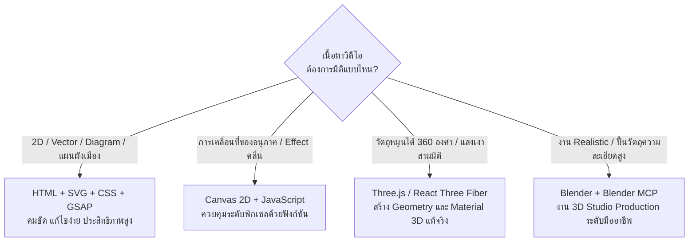

# 03 - Animation Skills & Tools

> **คลังเครื่องมือและทักษะสำหรับ AI Coding Agent**: ทำความเข้าใจความแตกต่างของ Skill และ Tool พร้อมสำรวจ Ecosystem สำคัญ เช่น HyperFrames, Lemo-Opuscar, GSAP, ClaudeAnimationBase และแนวทางการเลือกใช้เทคโนโลยี  
> **Source Reference**: สรุปและเรียบเรียงจาก [[Learn_Code_Generated_Animation_Video]]  
> **Index**: [[00 - Code-Generated Animation]]

---

## 1. Skill คืออะไรในบริบทของ AI Coding Agent

ในการพัฒนาแอนิเมชันด้วยโค้ดร่วมกับ AI เราต้องแยกแยะหน้าที่ขององค์ประกอบต่าง ๆ ออกจากกันอย่างชัดเจน:

| สิ่ง | นิยามและหน้าที่ | ตัวอย่าง |
|---|---|---|
| **Skill** | ชุดคำแนะนำ วิธีการ และขั้นตอนการทำงานที่บันทึกไว้ เพื่อสอนให้ Agent รู้วิธีทำงานเฉพาะด้านตามมาตรฐาน | กฎการเขียน Composition ใน HyperFrames, วิธีจัด Storyboard |
| **Repo / Library** | แหล่งเก็บโค้ด คอมโพเนนต์ ไฟล์ตัวอย่าง หรือคู่มือสไตล์ภาพที่นำมาใช้อ้างอิง | Lemo-Opuscar style guides, ClaudeAnimationBase |
| **Framework / Engine** | ระบบหรือซอฟต์แวร์ที่ใช้สร้าง ควบคุม และประมวลผลภาพให้ออกมาเป็นวิดีโอ | HyperFrames, Three.js, Canvas 2D, FFmpeg |
| **Prompt** | คำสั่งหรือคำขอเฉพาะกิจที่ป้อนให้ Agent ทำงานในแต่ละรอบหรือแต่ละฉาก | "สร้าง Scene 01 ความยาว 6 วินาที โดยใช้สไตล์ Isometric" |
| **Style Guide** | กติกาเชิงภาพและเสียงที่กำหนดว่าผลงานต้องมีหน้าตาและโทนอย่างไร | คู่มือสี, สัดส่วนตัวละคร, กฎ Projection 30 องศา |

> [!tip] ประโยชน์ของ Agent Skill
> Skill ช่วยป้องกันไม่ให้ Agent เดาวิธีการเขียนโค้ดเอาเอง ทำให้โค้ดที่สร้างขึ้นตรงตามโครงสร้างและข้อกำหนดของเอนจินเรนเดอร์ตั้งแต่แรก

---

## 2. คลัง Skills และเครื่องมือที่สำคัญ

ตารางสรุปเครื่องมือและไลบรารีที่เกี่ยวข้องในการผลิตวิดีโอด้วยโค้ด:

| ชื่อเครื่องมือ | ประเภท | วัตถุประสงค์หลัก | ความเกี่ยวข้องกับโปรเจกต์ |
|---|---|---|---|
| **HyperFrames** | Skills + Video Composition Tool | สร้าง HTML Composition, ไทม์ไลน์, พรีวิว และเรนเดอร์ MP4 | **เครื่องมือหลักที่ควรเริ่มศึกษา** |
| **Lemo-Opuscar** | Claude Code Plugin + Style Library | คลังแนวทางการกำกับหนัง, เทคนิค Frame-by-frame และสไตล์ภาพ 66 แบบ | **ใช้ศึกษาคู่มือ Isometric Infographic** |
| **GSAP** | Animation Library + Skill | ควบคุมไทม์ไลน์, การหน่วงเวลา (Easing), ลำดับการเคลื่อนไหว | **ใช้ควบคุมจังหวะและโมชันหลัก** |
| **ClaudeAnimationBase** | Animation Codebase + Guide | เทคนิคการสร้าง Character Animation, ท่าทาง (Acting), อารมณ์ และ Storyboard | **ใช้เมื่อต้องการให้ตัวละครมีบุคลิกชัดเจน** |
| **pixelfx** | Pixel Art Library + Skill | สร้างเอฟเฟกต์ภาพ พร้อมกระบวนการตรวจคุณภาพ (Draft-Render-Review) | **ใช้เป็นต้นแบบกระบวนการ QC** |
| **Three.js** | 3D JavaScript Library | สร้างวัตถุ 3 มิติ, พื้นผิว, แสงเงา และกล้องในเบราว์เซอร์ | ใช้เมื่อจำเป็นต้องมีวัตถุ 3D แท้จริง |
| **Blender MCP** | Blender + Model Context Protocol | ให้ AI Agent เชื่อมต่อและสั่ง Blender ปั้นโมเดล จัดฉาก และเรนเดอร์ | ใช้เมื่อต้องการฉาก 3D รายละเอียดสูงสมจริง |
| **React Three Fiber + Rapier** | React 3D + Physics Engine | สร้างฉาก 3D บน React พร้อมระบบจำลองแรงโน้มถ่วงและการชนกัน | ใช้เมื่อต้องการการเคลื่อนที่ตามหลักฟิสิกส์ |

---

## 3. เจาะลึกเครื่องมือหลัก

### A. HyperFrames (ระบบหลักของโปรเจกต์)
- **Repository:** [github.com/heygen-com/hyperframes](https://github.com/heygen-com/hyperframes)
- **Official Docs:** [hyperframes.app/docs](https://hyperframes.app/docs/)
- **การติดตั้ง Skill:**
  ```bash
  npx skills add heygen-com/hyperframes
  ```

HyperFrames มีชุด Skills ย่อยที่ระบุในเอกสาร:
1. `/hyperframes` — วิธีเขียน HTML Composition, จัดโครงสร้าง DOM, กำหนด Timing, ใส่ Caption และทำ Transition *(แนะนำให้ Agent เรียกใช้ก่อนเริ่มงาน)*
2. `/hyperframes-cli` — การใช้งานคำสั่ง CLI เช่น init, lint, validate, preview, render และ audio transcription
3. `/gsap` — แนะนำวิธีเขียน GSAP Timeline ให้สอดคล้องกับระบบของ HyperFrames
4. `/hyperframes-registry` — ค้นหาและติดตั้ง Blocks หรือ Components สำเร็จรูปจาก Registry
5. `/website-to-hyperframes` — เทคนิคแปลงหน้าเว็บไซต์เป็น Video Composition

*(ศึกษารายละเอียดเชิงลึกของเอนจินได้ใน [[02 - HyperFrames & Rendering]])*

---

### B. Lemo-Opuscar (คลังสไตล์ภาพยนตร์)
- **Repository:** [github.com/lemomo-ai/lemo-opuscar](https://github.com/lemomo-ai/lemo-opuscar)
- **Style Gallery:** [lemomo-ai.github.io/lemo-opuscar](https://lemomo-ai.github.io/lemo-opuscar/)
- **การติดตั้งเป็น Claude Code Plugin:**
  ```bash
  claude plugin marketplace add lemomo-ai/lemo-opuscar
  claude plugin install lemo-opuscar@lemolab
  ```

ระบบของ Lemo-Opuscar มีไฟล์แนวทางสำคัญ 3 ส่วน:
- `DIRECTOR.md` — วิธีการกำกับเนื้อเรื่อง จังหวะของภาพ การเคลื่อนไหวของกล้อง การแสดงของตัวละคร และการตรวจงาน
- `TECHNIQUE.md` — เทคนิคการสร้างภาพทีละเฟรม การจัดการเสียงพากย์ เพลงประกอบ และการมิกซ์เสียง
- `styles/<style>/STYLE.md` — กติกาเฉพาะตัวของแต่ละสไตล์ (มีสไตล์พร้อมใช้กว่า 66 แบบ)

> [!warning] ข้อสังเกตด้านโมเดล AI
> เอกสารของ Lemo-Opuscar ระบุว่าสไตล์ต่าง ๆ ถูกปรับแต่งมาสำหรับ **Claude Opus 5.5** เป็นหลัก หากนำไปใช้กับ Agent หรือ Model อื่น ผลลัพธ์อาจมีความคลาดเคลื่อนและต้องปรับแต่งคำสั่งเพิ่มเติม

---

### C. ClaudeAnimationBase (การออกแบบการแสดงของตัวละคร)
- **Repository:** [github.com/JohnHeibel/ClaudeAnimationBase](https://github.com/JohnHeibel/ClaudeAnimationBase)

หัวใจสำคัญที่ควรนำมาปรับใช้คือ **Workflow 5 ขั้นตอนในการทำ Character Animation**:
1. **Storyboard First:** วางโครงเรื่องและเหตุการณ์ก่อนเริ่มวาดตัวละคร
2. **Key Pose ที่อ่านออก:** ท่าทางหลักของตัวละครต้องสื่อสารชัดเจน แม้หยุดดูเป็นภาพนิ่ง
3. **Thought precedes Action:** ให้สายตาหรือท่าทางของตัวละครสื่อความคิดหรือความลังเลก่อนลงมือกระทำ
4. **Secondary Action:** เพิ่มการเคลื่อนไหวเสริม (เช่น ชายเสื้อขยับ, กระเป๋าแกว่ง, ร่มเอียง) เพื่อให้ดูมีชีวิต แต่ต้องไม่แย่งความสนใจจากกิริยาหลัก
5. **Segment Checking:** ตรวจสอบความถูกต้องของการเคลื่อนไหวเป็นช่วงย่อย ๆ แทนการดูรวดเดียวทั้งเรื่อง

---

### D. pixelfx (กระบวนการตรวจสอบคุณภาพงาน)
- **Repository:** [github.com/patch-gg/pixelfx](https://github.com/patch-gg/pixelfx)

แม้ว่าโปรเจกต์นี้จะไม่ได้ใช้สไตล์ Pixel Art แต่กระบวนการตรวจงานของ pixelfx เป็นแบบอย่างที่ดีมาก:
- ยึดวงจร **`draft → render → inspect → refine`**
- การตรวจแบบ **Contact Sheet** (ดูภาพหลาย ๆ เฟรมเรียงกันในตารางเดียว) เพื่อมองเห็นข้อผิดพลาดของแสงเงาและสัดส่วน
- การตรวจจับปัญหาสายตากระตุกหรือชิ้นส่วนวูบวาบระหว่างเฟรม

---

## 4. แนวทางการเลือก Tech Stack ให้เหมาะสมกับงาน

ในการเริ่มทำวิดีโอ ไม่ควรเลือกใช้เทคโนโลยีที่ซับซ้อนเกินความจำเป็น ให้เลือกตามความต้องการของเนื้อหา:



> **ข้อแนะนำสำหรับ THE SECOND SHIFT:**  
> ควรมุ่งเน้นไปที่ **HyperFrames + GSAP** และประยุกต์ใช้กติกาภาพจาก **Lemo-Opuscar (Isometric Infographic)** ก่อน ยังไม่มีความจำเป็นต้องเริ่มด้วย Three.js หรือ Blender เพราะแกนหลักของงานคือการอธิบาย Journey และ Interventions ไม่ใช่การอวดความสมจริงของ 3D Engine

---

## 5. การสร้าง Custom Skill ประจำโปรเจกต์ (อนาคต)

เมื่อทีมทำงานจนได้ระบบและกติกาภาพที่ลงตัวแล้ว ควรสรุปความรู้ทั้งหมดให้กลายเป็น **Custom Skill** ของตัวเอง (เช่น `/the-second-shift-animation`) โดยภายใน Skill ควรมีข้อมูล:
- วิธีอ่านเอกสาร Brief และ Storyboard ของแคมเปญ
- กติกา Isometric Projection และข้อกำหนด Palette สี
- แผ่นแม่แบบตัวละคร (Character Sheet) และสัดส่วนที่ถูกต้อง
- มาตรฐานการตั้งชื่อไฟล์ Scene และ Assets
- รายการชุดการเคลื่อนไหวสำเร็จรูป (Approved Motion Presets)
- คำสั่ง Preview, Render และเกณฑ์การตรวจ QA

> [!tip] อย่าสร้าง Skill เดียวที่ใหญ่เกินไป
> ควรกระจายออกเป็นโมดูลย่อย เช่น `/storyboard`, `/isometric-scene`, `/hyperframes-production`, และ `/animation-qa` เพื่อให้ Agent โหลดเฉพาะ Context ที่จำเป็นในแต่ละขั้นตอน

---

## 6. ลิงก์อ้างอิงและศึกษาเพิ่มเติม

- **HyperFrames Determinism:** [hyperframes.app/docs/2-concepts/4-determinism](https://hyperframes.app/docs/2-concepts/4-determinism)
- **HyperFrames Prompt Guide:** [hyperframes.app/docs/3-guides/2-prompting](https://hyperframes.app/docs/3-guides/2-prompting)
- **Lemo-Opuscar Isometric Guide:** [github.com/lemomo-ai/lemo-opuscar/tree/main/styles/iso-infographic](https://github.com/lemomo-ai/lemo-opuscar/tree/main/styles/iso-infographic)
- **Claude Animation Guide:** [github.com/JohnHeibel/ClaudeAnimationBase/blob/main/ANIMATION_GUIDE.md](https://github.com/JohnHeibel/ClaudeAnimationBase/blob/main/ANIMATION_GUIDE.md)
- **Claude Code Steering & Skills:** [claude.com/resources/articles/steering-claude-code-skills-hooks-rules-subagents-and-more](https://claude.com/resources/articles/steering-claude-code-skills-hooks-rules-subagents-and-more)
