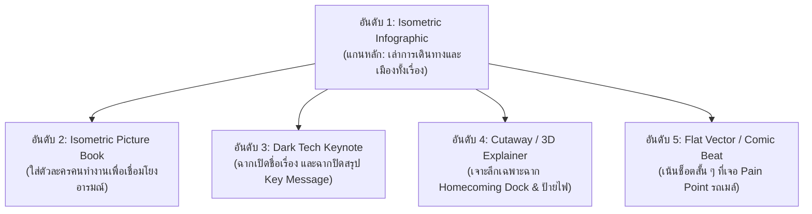
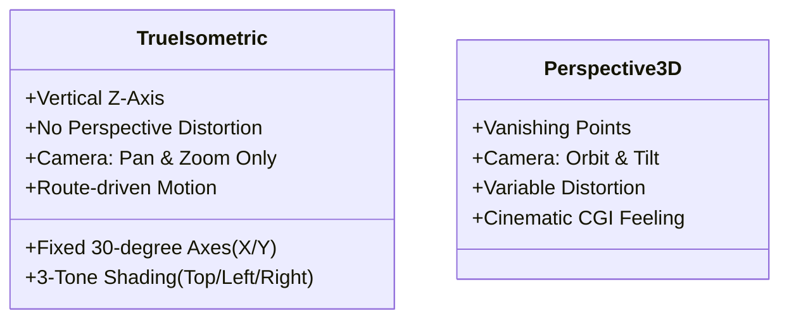

# 04 - Animation Styles

> **ระบบสไตล์ภาพและการกำกับทิศทางศิลป์**: สำรวจ 15 สไตล์แอนิเมชันสำหรับโค้ด เจาะลึกกฎเกณฑ์ของ True Isometric Infographic และคลังตัวอย่าง Prompt สำหรับใช้งานจริง  
> **Source Reference**: สรุปและเรียบเรียงจาก [[Learn_Code_Generated_Animation_Video]]  
> **Index**: [[00 - Code-Generated Animation]]

---

## 1. ภาพรวมสไตล์แอนิเมชัน (Animation Styles Overview)

ในการสั่งงาน AI Coding Agent เพื่อผลิตวิดีโอ การเข้าใจ **"ภาษาภาพ" (Visual Language)** เป็นสิ่งจำเป็นอย่างยิ่ง เพื่อให้ Agent สร้างฉากที่มีความกลมกลืนและตอบสนองเป้าหมายของเนื้อหา

> [!important] ข้อเท็จจริงเกี่ยวกับคลังสไตล์
> รายการสไตล์แอนิเมชันต่าง ๆ มีทั้งที่เป็น **Style Prompt สำเร็จรูป**, **คลังโค้ดตัวอย่าง (Library)**, และ **Prompt ที่เขียนขึ้นเพื่อจำลองสไตล์ (Recreated Prompts)**  
> *ข้อควรระวัง:* สำหรับสไตล์กลุ่มจำลอง (Recreated Prompts) บางส่วนยังไม่ได้ผ่านการทดสอบและยังไม่ยืนยันว่าจะทำซ้ำต้นฉบับได้ตรงกันทั้งหมด จึงควรทดสอบผ่าน Style Test สั้น ๆ เสมอ

### ตารางเปรียบเทียบ 15 สไตล์แอนิเมชันยอดนิยม

| สไตล์ (Style) | ภาษาภาพและเอกลักษณ์ | เหมาะสำหรับ |
|---|---|---|
| **Isometric Infographic** | โลกจำลองสามมิติหลอกตามุมมองคงที่ มีเส้นทาง ป้ายกำกับหมุด และการผ่ามองภายใน (Cutaway) | อธิบายระบบ, การเดินทาง, ลำดับขั้นตอน, แผนผังเมือง |
| **Isometric Picture Book** | เมืองหรือสถานที่แบบ Isometric โดยมีตัวละครเป็นแกนนำเรื่อง | การเล่าเรื่อง (Storytelling) ที่ต้องการความต่อเนื่องของตัวละคร |
| **Flat Vector** | รูปทรง 2 มิติเรียบแบน สีสันสดใส คอนทราสต์ชัด การเคลื่อนไหวฉับไว | คลิปอธิบายเร็ว, สื่อโซเชียลมีเดีย, สรุปใจความสั้น |
| **3D Data Chart** | กราฟิกสถิติที่สร้างขึ้นจากวัตถุ 3D เช่น แท่งกราฟ กล่อง หรือเหรียญ | สรุปข้อมูลตัวเลขที่ต้องการภาพจำที่ทรงพลัง |
| **3D Explainer** | วัตถุ 3 มิติที่สามารถแยกชิ้นส่วน (Exploded view) เพื่อเปิดเผยกลไก | อธิบายโครงสร้างอุปกรณ์ ฮาร์ดแวร์ หรือการทำงานภายใน |
| **Paper-cut** | ภาพซ้อนกันเป็นเลเยอร์กระดาษ มีมิติแสงเงาและเอฟเฟกต์ Parallax | ฉากเปิดเรื่อง (Intro), งานเล่าเรื่องเชิงอารมณ์และบรรยากาศ |
| **CGI Motion** | วัตถุ 3 มิติที่มีพื้นผิวสะท้อนแสง สมจริงตามหลักฟิสิกส์ | วิดีโอแนะนำสินค้า (Product Shot) หรือฉากที่เน้นความงามของวัสดุ |
| **Cartoon Explainer** | ตัวละครการ์ตูนและภาพประกอบลายเส้นที่เป็นมิตร | งานให้ความรู้ สื่อการสอน งานที่ต้องการลดทอนความซีเรียส |
| **Comic Art / Book** | ลายเส้นหมึกหนา จุดสกรีนโทน (Halftone) การแบ่งช่อง และตัวหนังสือ SFX | ฉากที่ต้องการพลัง ความสนุกสนาน จังหวะตื่นเต้น |
| **Chalkboard** | ลายเส้นชอล์กขาวบนกระดานดำที่ค่อย ๆ วาดปรากฏขึ้นทีละเส้น | การสอนทฤษฎี อธิบายสูตร หรือตรรกะเชิงตรรกศาสตร์ |
| **Pixel Art** | ภาพเม็ดพิกเซลและเอฟเฟกต์แบบเกมคลาสสิก ย้อนยุค | สื่อเกม, คอนเทนต์ Retro, งานที่ต้องการลูกเล่นเฉพาะกลุ่ม |
| **Glow Sketch** | เส้นและจุดเรืองแสงนีออนเคลื่อนที่บนพื้นหลังสีเข้ม | แสดงเส้นทางสัญญาณ ข้อมูลดิจิทัล แผนที่โครงข่ายนามธรรม |
| **Blueprint** | ลายเส้นทางวิศวกรรมสีขาวบนตารางกริดสีน้ำเงิน | แสดงโครงสร้างผังเมือง สถาปัตยกรรม แนวคิดการออกแบบ |
| **Data Storytelling** | ตัวเลขและสถิติถูกร้อยเรียงเข้ากับเหตุการณ์จริงอย่างต่อเนื่อง | การนำเสนอผลการวิจัย รายงานประจำปี ข้อมูลที่มีหลักฐานรองรับ |
| **Dark Tech Keynote** | ตัวหนังสือขนาดใหญ่เด่นชัด ผสมผสานรูปทรงเรขาคณิตบนฉากมืด | สไลด์เปิดตัวผลิตภัณฑ์ เน้นย้ำข้อความสำคัญที่หนักแน่น |

---

## 2. การเลือกใช้สไตล์ในกรณีศึกษา THE SECOND SHIFT

สำหรับโปรเจกต์ **THE SECOND SHIFT** มีการจัดลำดับสไตล์ที่เหมาะสมเพื่อใช้ผสมผสานในการเล่าเรื่อง:



1. **อันดับ 1: Isometric Infographic (สไตล์หลัก):** ใช้ครอบคลุมทั้งเรื่อง เพราะช่วยให้เห็นภาพรวมของเมือง ถนน จุดรอรถ และจุดแทรกแซง (Interventions) ในมิติเดียวกัน
2. **อันดับ 2: Isometric Picture Book:** นำมาเสริมเพื่อให้มี "ตัวละครคนทำงาน" เดินเรื่องอย่างต่อเนื่อง ทำให้วิดีโอไม่แห้งแล้งเหมือนแผนที่วิศวกรรม
3. **อันดับ 3: Dark Tech Keynote:** ใช้ใน 6 วินาทีแรกตอนเปิดชื่อแคมเปญ และช่วง 6 วินาทีสุดท้ายเพื่อตอกย้ำประโยค *"อีกกะที่ไม่มีใครจ่าย"*
4. **อันดับ 4: Cutaway Explainer:** ใช้เฉพาะฉากทางเข้าคอนโดมิเนียม เพื่อเปิดให้เห็น 4 โซนย่อยในการวางของและเปลี่ยนรองเท้า
5. **อันดับ 5: Flat Vector / Comic Accent:** ใช้สอดแทรกเพียงช่วงสั้น ๆ เมื่อตัวละครเผชิญปัญหาจุดรอรถ เพื่อกระตุกสายตาคนดู

---

## 3. เจาะลึก True Isometric Infographic

หลายคนมักเข้าใจผิดว่าการสร้างภาพ Isometric คือการใช้กล้อง 3D หมุนไปมาได้อย่างอิสระ แต่ในทางวิชาการและงานกราฟิก **True Isometric** มีกฎเกณฑ์ที่เข้มงวด:



### กฎเกณฑ์ที่ต้องควบคุม (Isometric Rules)
1. **Projection คงที่:** แกน X และ Y ทำมุมเอียงประมาณ 30 องศากับแนวราบ และแกน Z ตั้งฉาก 90 องศาขึ้นตรง ห้ามใช้กล้องที่มี Perspective หรือจุดรวมสายตา (Vanishing Point)
2. **แสงเงา 3 ระดับ (3-Tone Shading):** วัตถุรูปทรงลูกบาศก์ต้องแยกเฉดสีชัดเจน 3 ด้าน:
   - **ด้านบน (Top):** เฉดสว่างที่สุด (Light)
   - **ด้านซ้าย (Left):** เฉดปานกลาง (Mid-tone)
   - **ด้านขวา (Right):** เฉดมืดสุด (Dark / Shadow)
3. **ข้อจำกัดของกล้อง:** อนุญาตให้กล้อง **Pan (เลื่อนซ้ายขวาบนล่าง)** และ **Zoom (ย่อขยาย)** ได้เท่านั้น **ห้ามหมุนกล้อง (Orbit) หรือเอียงมุมก้มเงย (Tilt)** เพราะจะทำให้มิติแบบ Isometric พังทลาย
4. **องค์ประกอบกราฟิกในโลก:** ใช้ Route Lines (เส้นทางเดิน), Label Pins (หมุดปักระบุจุด), Leader Lines (เส้นโยงคำอธิบาย) และ Cutaway (การผ่าเปิดผนัง) เป็นส่วนหนึ่งของฉาก
5. **การเคลื่อนไหวมีเส้นทางนำ (Route-driven Motion):** ให้เส้นทางค่อย ๆ วาดนำสายตาก่อน แล้ววัตถุหรือตัวละครจึงเคลื่อนที่ตาม
6. **การเคลื่อนไหวอย่างประหยัด (Restrained Motion):** ตัวละครใช้รูปทรงเรขาคณิตเรียบง่าย ขยับเท่าที่จำเป็นเพื่อไม่แย่งความสนใจจากข้อมูลบนจอ
7. **การปรากฏของวัตถุ:** ให้เลื่อนเข้ามาตามแกน Isometric หรือขยายตัวขึ้นมาจากพื้น หลีกเลี่ยงการใช้การค่อย ๆ จางโปร่งใส (Opacity Fade) กับวัตถุแท่งทึบมากเกินไป

> [!warning] เมื่อไรที่ไม่ควรเรียกว่า Isometric
> หากต้องการให้กล้องบินวนรอบตึก (Orbit) หรือต้องการมุมมองแบบภาพยนตร์ที่มีความลึกชัดตื้น (Depth of Field) ควรเลือกใช้สไตล์ **3D Cartoon** หรือ **CGI Motion** แทน อย่าบังคับให้สไตล์นั้นเป็น Isometric

---

## 4. คลังตัวอย่าง Prompt Styles (พร้อมใช้งาน)

นำ Templates ภาษาอังกฤษเหล่านี้ไปใช้เป็น Prompt สำหรับสั่งงาน AI Coding Agent ในโปรเจกต์:

### Template A: Isometric Infographic — Everyday Journey
```text
Create a vertical isometric infographic animation showing one commuter's
journey from home to work and back.

Build a coherent miniature city on a floating isometric ground plane:
home, sidewalk, pedestrian crossing, bus stop, bus route and workplace.
Use a fixed true-isometric projection. Do not rotate or tilt the camera.
Allow only controlled pans and zooms that preserve the projection.

A single commuter character travels through the scene.
Draw a route line ahead of the character. The character follows the route
and performs one readable action at each stop.
Use charcoal and deep navy as the base, amber for active routes and
important signals, and restrained cool shadows.
Use clear label pins and short Thai captions.

The viewer should understand the journey without needing to read
paragraphs of text. Keep one main action per beat.
```

### Template B: Character-led Isometric — The Second Shift
```text
Create a short character-led isometric story about a commuter who leaves
home to go to work but must handle many small extra tasks along the way.

Keep the same commuter character across all scenes.
Show the character noticing, deciding and acting. Make the body pose and
movement communicate the problem before adding explanatory text.
Use secondary motion sparingly: bag swing, umbrella movement, short pauses,
small head turns and footstep timing.

The city remains a consistent isometric diorama. Connect scenes through
continuous travel, route lines or matching object positions.
The story should feel human and observant, not like a generic city advert.
```

### Template C: Dark Tech Keynote — Opening / Closing
```text
Create a 6-second dark editorial motion-graphic title sequence.
Use a charcoal background, subtle grain, warm amber highlights and
large precise typography.

Reveal the words THE SECOND SHIFT in stages.
Let small task labels appear around the title as if they are additional
work assigned to the commuter: WAIT FOR THE BUS, FIND SHELTER, WATCH THE ROAD.
Keep every label readable and avoid random floating decoration.
End with the key line: "อีกกะที่ไม่มีใครจ่าย"
```

### Template D: Cutaway Explainer — The Homecoming Dock
```text
Create an isometric cutaway explainer of an apartment entrance designed
for the moment someone arrives home.

Start with the full entrance. Draw a cut line, then move the near wall away
so the viewer can see the interior arrangement.
Reveal four functional zones in sequence:
1. A place to put a bag.
2. A rack for a wet umbrella.
3. A bench for changing shoes.
4. A separated area for wet items.

Use short labels connected to the correct objects.
Show the commuter using the space in the same order.
Do not imply that the design has been implemented or proven effective;
present it as a proposed intervention concept.
```

### Template E: Flat Vector / Comic Beat — Small Pain Point
```text
Create a short flat-vector scene about a commuter waiting for a bus.
Show the commuter trying to make the route number visible to the driver.
Use one strong action and a clear before/after contrast.
Use a brief comic-style accent only when the problem becomes visible,
then return to the campaign's main colour system.
Do not exaggerate the risk or make the commuter behave recklessly.
```

---

## 5. ความเชื่อมโยงในระบบ

- **การสั่งงาน:** นำ Style Prompts ด้านบนไปประกอบเข้ากับ [[05 - Prompting & Quality Control|Master Prompt Template]]
- **การนำไปเขียนโค้ด:** แปลงองค์ประกอบภาพให้กลายเป็นไทม์ไลน์และ Component ใน [[01 - Production Workflow]] และ [[02 - HyperFrames & Rendering]]
