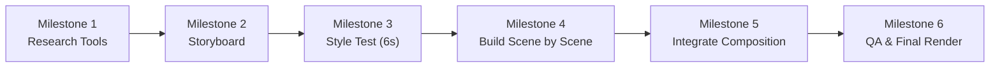

# 05 - Prompting & Quality Control

> **กลยุทธ์การสั่งงาน AI Agent และการควบคุมคุณภาพ**: โครงสร้าง Master Prompt 12 องค์ประกอบ, เทคนิค Milestone-based Prompting (อย่าสั่งทุกอย่างในรอบเดียว), QA Checklist 4 มิติ และ 9 ข้อผิดพลาดที่ต้องระวัง  
> **Source Reference**: สรุปและเรียบเรียงจาก [[Learn_Code_Generated_Animation_Video]]  
> **Index**: [[00 - Code-Generated Animation]]

---

## 1. ปรัชญาการ Prompt: "อย่าสั่งทุกอย่างในครั้งเดียว"

หนึ่งในสาเหตุหลักที่ทำให้การสร้างคลิปแอนิเมชันด้วย AI ล้มเหลว คือการป้อนคำสั่งยาวเหยียดที่สั่งให้สร้างวิดีโอ 60 วินาทีทั้งหมดในรอบเดียว ผลลัพธ์ที่ได้มักจะเป็น:
- โค้ดซับซ้อนเกินไปจนเกิด Runtime Error
- โมเดลสับสน ลืมกฎเกณฑ์ของสไตล์ภาพที่ตกลงกันไว้
- เมื่อมีข้อผิดพลาด จะยากมากที่จะระบุว่าบั๊กเริ่มขึ้นที่วินาทีใด

**แนวทางที่ถูกต้อง:** ให้แบ่งคำสั่งออกเป็นช่วงงานย่อยที่มีจุดเช็กพอยต์ชัดเจน (**Milestone-based Prompting**) เพื่อให้เราสามารถตรวจรับและปรับแก้ได้ทีละส่วนอย่างเป็นระบบ



---

## 2. โครงสร้าง Prompt ที่ดี (Prompt Anatomy)

Prompt ที่สมบูรณ์สำหรับงานแอนิเมชันระดับโปรดักชันควรแบ่งโครงสร้างออกเป็น 12 หัวข้อ เพื่อให้ปรับแต่งเฉพาะจุดได้ง่าย:

1. **Role:** ระบุบทบาทให้ชัดเจน เช่น *Animation Director และ Frontend Motion Engineer*
2. **Objective:** กำหนดสิ่งที่คนดูต้องเข้าใจเมื่อดูจบ
3. **Audience:** ระบุกลุ่มผู้ชมเป้าหมาย
4. **Story & Facts:** แกนเรื่องและข้อเท็จจริง ห้ามโมเดลแต่งตัวเลขหรือผลลัพธ์ขึ้นมาเอง
5. **Duration / Format:** ระบุเวลา (เช่น 60 วินาที), ความละเอียด (1080x1920), และ FPS (30 fps)
6. **Style Reference:** ระบุสไตล์ภาพหลักและแนวทางอ้างอิง ([[04 - Animation Styles|เช่น Isometric Infographic]])
7. **Style Rules:** กฎเกณฑ์เชิงระบบ เช่น มุมกล้อง, พาเลตสี, วัสดุ, ไทโปกราฟี
8. **Storyboard:** รายละเอียดแต่ละฉากตาม Timecode, Action, Camera, Narration
9. **Animation Rules:** กฎการเคลื่อนไหวและลำดับเวลา
10. **Audio:** รายละเอียดแทร็กเสียงพากย์ ดนตรี SFX และคำบรรยาย Caption
11. **Technical Contract:** กติกาทางเทคนิคของเอนจิน เช่น [[02 - HyperFrames & Rendering|HyperFrames Composition & Determinism]]
12. **Deliverables & Verification:** รายการไฟล์ที่ต้องส่งมอบ และขั้นตอนการตรวจรับงานจริง

---

## 3. Master Prompt Template (แม่แบบคำสั่งหลัก)

คัดลอกและปรับแต่ง Template นี้เพื่อใช้เป็นคำสั่งเริ่มต้นในการคุมโปรเจกต์:

```text
Act as an animation director and frontend motion engineer.

PROJECT
Title: [VIDEO TITLE]
Objective: [WHAT THE AUDIENCE MUST UNDERSTAND]
Audience: [TARGET AUDIENCE]
Duration: [60 seconds]
Format: [1080x1920, 30 fps]
Language: Thai narration and captions.

SOURCE OF TRUTH
Use the supplied project brief and storyboard as the source of truth.
Do not invent statistics, real-world outcomes, user research findings,
or claims that are not supported by the supplied material.
If a detail is unknown, omit it or mark it as a placeholder.

VISUAL DIRECTION
Primary style: [ISOMETRIC INFOGRAPHIC]
Secondary style: [DARK TECH KEYNOTE]
Palette: [CHARCOAL / NAVY / AMBER]
Typography: [FONT AND HIERARCHY]
Character: [ONE CONSISTENT COMMUTER CHARACTER]
Environment: [A COHESIVE MINIATURE CITY]

STYLE RULES
- Keep the same character proportions, palette and world design in every scene.
- Preserve the selected camera projection.
- Use clear silhouettes and one dominant visual event per beat.
- Every movement must communicate an action or relationship.
- Labels must point to the correct object and never cover the main action.
- Avoid decorative motion that does not help explain the story.

STORYBOARD
Follow the supplied scene-by-scene storyboard exactly.
For each scene define:
- Start and end time
- Narration
- Main visual event
- Character action and reaction
- Camera movement
- On-screen text
- Transition to the next scene
- Sound cues

IMPLEMENTATION
Use HyperFrames composition conventions and the installed skills.
Use HTML/CSS/SVG/Canvas for vector scenes.
Use Three.js only when actual 3D geometry, materials or lighting are needed.
Drive animation from deterministic timelines, not wall-clock time.
Register GSAP timelines as required by HyperFrames.
Do not use unseeded randomness or late network asset fetching.

AUDIO
Use the supplied voice track if available.
Otherwise create a narration timing plan; do not pretend an audio file exists.
Keep captions synchronized with narration.

QUALITY CONTROL
1. Preview every scene.
2. Inspect frames near the beginning, middle, end and scene boundaries.
3. Check character consistency, text clipping, overlaps, contrast and timing.
4. Watch the full video with audio.
5. Run HyperFrames lint/validation before final render.

DELIVERABLES
- storyboard.md
- style-guide.md
- composition files
- local assets and audio references
- README with preview and render commands
- MP4 only if rendering actually succeeds

Do not claim a render, test or validation succeeded unless it was actually run.
```

---

## 4. กลยุทธ์การสั่งงาน 6 ขั้นตอน (Milestone Prompts)

### Milestone 1: สำรวจสถาปัตยกรรมและเครื่องมือ
สั่งให้ Agent ตรวจสอบสภาพแวดล้อมก่อนลงมือเขียนโค้ด:
```text
Inspect the project and the installed video tools.
Explain the current architecture and identify the smallest working path
to create one six-second scene and render it.
Do not modify files yet.
```

### Milestone 2: ล็อกเนื้อเรื่องและ Storyboard
สร้างพิมพ์เขียวฉากต่อฉากโดยยังไม่เขียนโค้ดแอนิเมชัน:
```text
Create a storyboard for a 60-second video with 10 scenes.
Do not write animation code yet.
For every scene include timecode, voice-over, visual event, camera,
transition, on-screen text and sound cue.
Check that the central message is understandable without narration.
```

### Milestone 3: ทดสอบสไตล์ภาพ (Style Test 6 วินาที)
สร้างตัวอย่างสั้น ๆ 1 ฉาก เพื่อพิสูจน์มุมกล้อง สี และสัดส่วนตัวละคร:
```text
Create one six-second style test using the selected visual direction.
Use placeholder content only.
Focus on projection, palette, character consistency, object scale,
label design and camera movement.
Render a preview and inspect it before building the other scenes.
```

### Milestone 4: สร้างทีละฉาก (Scene-by-Scene)
สั่งเขียนฉากที่ 1 ให้เสร็จ ตรวจพรีวิวให้ผ่านก่อนเริ่มฉากถัดไป:
```text
Implement Scene 01 only.
Keep the implementation modular so the scene can be reused.
Do not build the remaining scenes until this scene passes preview review.
```

### Milestone 5: รวมทุกฉากเข้า Master Composition
นำฉากที่ผ่านการตรวจสอบมาร้อยเรียงเข้าด้วยกัน:
```text
Integrate the approved scenes into the master composition.
Preserve the approved character, palette, projection, typography and timing.
Add transitions only where they help continuity.
```

### Milestone 6: ตรวจสอบคุณภาพและเรนเดอร์ขั้นสุดท้าย
ตรวจสอบข้อผิดพลาดอย่างละเอียดก่อนส่งออกเป็น MP4:
```text
Run lint and validation.
Preview the full composition.
Inspect frame samples around every scene boundary and any complex action.
Report each issue with its timestamp and file location.
Fix the issues, preview again, then render the final MP4.
Report the exact output settings and whether rendering completed.
```

---

## 5. QA Checklist สำหรับงานแอนิเมชัน

ใช้ Checklist 4 มิติต่อไปนี้ในการตรวจรับงานทุกครั้ง:

### 1. ด้านเนื้อเรื่องและการสื่อสาร (Story)
- [ ] คนดูเข้าใจสาระสำคัญ (Main Message) ได้ทันทีเมื่อดูจบ
- [ ] ในแต่ละฉากมีเหตุการณ์หลักเพียงเหตุการณ์เดียวที่โดดเด่นและชัดเจน
- [ ] ภาพสามารถสื่อความหมายได้ด้วยตัวเองโดยไม่ต้องพึ่งพาตัวหนังสือยาวเหยียด
- [ ] ข้อมูล สถิติ และข้อเสนอแนวคิดตรงตามข้อเท็จจริง ไม่มีการโอ้อวดเกินจริง

### 2. ด้านความสม่ำเสมอของภาพ (Visual Consistency)
- [ ] ตัวละครคงสัดส่วนเดิม รูปหน้าเดิม และสีเสื้อผ้าเหมือนเดิมทุกฉาก
- [ ] Palette สีและทิศทางของแสงเงาสม่ำเสมอทั้งเรื่อง
- [ ] มุมกล้อง (Projection) และอัตราส่วนวัตถุ (Scale) ไม่บิดเบี้ยวโดยไม่มีเหตุผล
- [ ] ขนาดฟอนต์ สไตล์ตัวหนังสือ และหมุดปัก (Label Pins) เป็นระบบเดียวกัน
- [ ] ไม่มีวัตถุลอยทับซ้อนกัน หรือชนกันเองโดยไม่ได้ตั้งใจ

### 3. ด้านการเคลื่อนไหว (Motion)
- [ ] การเคลื่อนไหวทุกจุดมีจุดเริ่มต้น (In), การกระทำ (Action), และจุดสิ้นสุด (Out) ที่อ่านออก
- [ ] จังหวะการเคลื่อนไหวสัมพันธ์และพอดีกับเสียงพากย์ (Voice-over)
- [ ] ไม่มีการเคลื่อนไหวของฉากหลังที่ดึงสายตาหรือแย่งความสนใจจากประเด็นหลัก
- [ ] การเปลี่ยนฉาก (Transition) ราบรื่น สมเหตุสมผล และรักษาความต่อเนื่อง
- [ ] เรนเดอร์ซ้ำแล้วได้ผลลัพธ์เหมือนเดิมทุกประการ ([[02 - HyperFrames & Rendering|Deterministic Guarantee]])

### 4. ด้านการส่งมอบและไฟล์ (Delivery)
- [ ] ผ่านการดู Preview แบบ Real-time ตลอดทั้งคลิป
- [ ] ตรวจสอบรอยต่อระหว่างฉาก (Scene Boundary) และเฟรมสำคัญอย่างละเอียด
- [ ] เสียงพากย์ ดนตรี SFX และ Captions แสดงผลตรงตามเวลาและไม่กลบกัน
- [ ] ตรวจสอบความถูกต้องของความยาววิดีโอ, FPS, ขนาด Resolution และคุณภาพเสียง
- [ ] แยกแยะไฟล์ Preview (ความละเอียดต่ำ) และไฟล์ Final Render ไว้อย่างชัดเจน

---

## 6. 9 ข้อผิดพลาดที่พบบ่อย (Common Pitfalls)

| ลำดับ | ข้อผิดพลาด | ผลกระทบ | วิธีแก้ไข |
|:---:|---|---|---|
| 1 | **เริ่มจากเลือก Style ก่อน Story** | ได้ภาพสวยแต่ไม่มีเนื้อเรื่องและคนดูไม่เข้าใจ | กำหนด Message และ Storyboard ให้จบก่อนเลือกภาพ |
| 2 | **เขียน Prompt ยาวแต่ไม่มีโครงสร้าง** | AI สับสน ใส่กราฟิกมั่วจนฉากรก | ใช้ 12-point Prompt Anatomy และแบ่ง Milestone |
| 3 | **ใช้คำว่า Isometric โดยไม่คุม Projection** | บางฉากเป็น Isometric บางฉากกลายเป็น 3D กล้องเบี้ยว | ระบุกฎ Fixed Projection 30 องศา และห้าม Orbit กล้อง |
| 4 | **เปลี่ยนสไตล์ข้ามไปข้ามมา** | แต่ละฉากดูเหมือนมาจากคนละคลิป | บังคับใช้ Style Bible และ Palette ร่วมกันทั้งโปรเจกต์ |
| 5 | **ใช้ Animation เพื่อเป็นของตกแต่ง** | ภาพเคลื่อนไหวไร้ความหมายและดึงสายตาคนดู | ยึดหลัก Motion has a purpose ขยับเฉพาะจุดที่เล่าเรื่อง |
| 6 | **สั่งทำ 60 วินาทีรวดเดียว** | บั๊กกระจายทั้งคลิปและแก้เฉพาะจุดยากมาก | ผลิตทีละฉาก (Scene-by-Scene) แล้วค่อยรวม Master |
| 7 | **ไม่ตรวจเฟรมเรนเดอร์จริง** | พรีวิวในเบราว์เซอร์ดูดี แต่ไฟล์ MP4 ตัวหนังสือแหว่งหรือกระตุก | ตรวจสอบไฟล์ Frame Capture และรัน `lint` / `validate` |
| 8 | **ไม่แยก Style Prompt กับ Technical Prompt** | ได้ภาพถูกต้องแต่โค้ดเรนเดอร์ไม่ผ่าน หรือโค้ดผ่านแต่ภาพไม่ได้เรื่อง | ผสมผสาน Style Rules และ Technical Contracts ใน Prompt |
| 9 | **Agent อ้างว่าเรนเดอร์สำเร็จทั้งที่ไม่ได้รันจริง** | ได้รับรายงานเท็จและงานไม่เสร็จจริง | ตรวจสอบไฟล์ผลลัพธ์ MP4 ในเครื่อง และขอหลักฐาน Terminal Output เสมอ |

---

## 7. ความเชื่อมโยงในระบบ

- **ภาพรวมและสารบัญหลัก:** กลับไปที่ [[00 - Code-Generated Animation]]
- **ขั้นตอนการนำ Storyboard ไปพัฒนา:** อ่านต่อที่ [[01 - Production Workflow]]
- **การตั้งค่าเทคนิคการเรนเดอร์:** ตรวจสอบคำสั่งใน [[02 - HyperFrames & Rendering]]
- **การอ้างอิงสไตล์ภาพและกติกา Projection:** ดูคู่มือใน [[04 - Animation Styles]]
