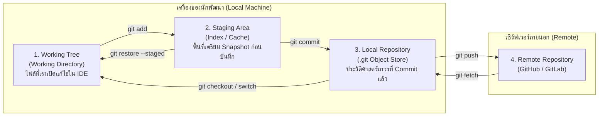
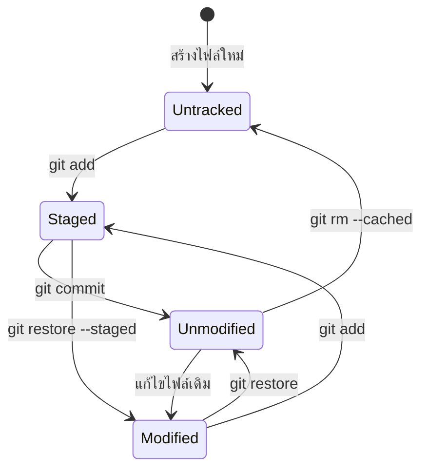

# Git Architecture

เพื่อให้เข้าใจการทำงานของ Git ได้อย่างลึกซึ้ง สิ่งสำคัญที่สุดคือการเข้าใจ **สถาปัตยกรรม 3 พื้นที่ทำงานหลัก (Three-Tree Architecture)** และพื้นที่ส่วนขยายที่เชื่อมต่อไปยังเครือข่าย

---

## 1. สถาปัตยกรรม 3 สถานะของ Git (The Three Sections)

Git จัดการไฟล์ผ่าน 3 โซนหลักภายในเครื่อง Local:

### 1.1 Working Tree (Working Directory)
- คือโฟลเดอร์ทางกายภาพบนฮาร์ดดิสก์ที่คุณมองเห็น เปิดไฟล์ และแก้ไขด้วยโปรแกรม Editor (เช่น VS Code, Obsidian)
- ไฟล์ในส่วนนี้อาจเป็นไฟล์ที่ถูกติดตาม (Tracked) หรือยังไม่ถูกติดตาม (Untracked) ก็ได้
- การแก้ไขในส่วนนี้ยังไม่ถูกบันทึกลงในฐานข้อมูลของ Git จนกว่าจะมีการสั่งคำสั่งเพิ่มเติม

### 1.2 Staging Area (The Index)
- เป็นไฟล์ไบนารีเดี่ยวชื่อ `.git/index`
- ทำหน้าที่เป็น **พื้นที่จัดเตรียม (Staging Area)** หรือพิมพ์เขียวของ Snapshot สำหรับ Commit ถัดไป
- เมื่อคุณพิมพ์ `git add` ข้อมูลไฟล์จะถูกแปลงเป็น Object แล้วเก็บใน Object Store และตำแหน่งอ้างอิงจะถูกจดบันทึกไว้ใน Index ทันที
- **ทำไมต้องมี Staging Area?** เพราะเปิดโอกาสให้นักพัฒนาสามารถคัดเลือกการเปลี่ยนแปลงเฉพาะส่วน (Selective Staging) เพื่อสร้าง Commit ที่มีความหมายชัดเจน (Atomic Commit) แทนที่จะบันทึกทุกไฟล์ที่แก้มือเปื้อนลงไปพร้อมกัน

### 1.3 Local Repository (Git Directory / Object Store)
- คือโฟลเดอร์ที่ซ่อนอยู่ชื่อ `.git` ซึ่งเก็บ Metadata, References, Logs และ Object Database ทั้งหมดของโครงการ
- เมื่อสั่ง `git commit` สิ่งที่อยู่ใน Staging Area จะถูกบันทึกเป็น Commit Object อย่างถาวร มีเลข Hash กำกับ และต่อท้ายประวัติศาสตร์อย่างเป็นทางการ

---

## 2. สถานะของไฟล์ใน Git (File Lifecycle States)

ไฟล์ภายใน Working Directory จะวนเวียนอยู่ใน 4 สถานะหลักตามภาพ:

1. **Untracked (ยังไม่ถูกติดตาม):** ไฟล์ใหม่ที่ Git ยังไม่เคยบันทึกมาก่อนใน Commit ล่าสุด และไม่อยู่ใน Staging Area
2. **Unmodified (ไม่ถูกเปลี่ยนแปลง):** ไฟล์ที่ตรงกันทุกประการกับ Snapshot ใน Commit ล่าสุด
3. **Modified (ถูกแก้ไขแต่ยังไม่ Stage):** ไฟล์เดิมที่ถูก Track แล้ว แต่มีการเปลี่ยนแปลงเนื้อหาใน Working Directory และยังไม่ได้สั่ง `git add`
4. **Staged (เตรียมพร้อมบันทึก):** ไฟล์ที่ถูกบันทึกการเปลี่ยนแปลงปัจจุบันลงใน Staging Area เรียบร้อยแล้ว พร้อมถูกรวมเข้าไปใน Commit ถัดไป

---

## 3. กลไกเชิงลึก: ทำไม Git จึงรวดเร็วและปลอดภัย?

- **Content-Addressable Storage:** ข้อมูลทุกอย่างถูกจัดเก็บตามค่าแฮชของเนื้อหา (Content Hash) หากไฟล์สองไฟล์มีเนื้อหาเหมือนกันทุกตัวอักษร จะถูกเก็บเป็น Object เดียวกันในระบบ ไม่เปลืองพื้นที่
- **Immutable History:** เมื่อ Commit Object ถูกเขียนลง `.git/objects` แล้ว เนื้อหาของมันจะไม่ถูกดัดแปลง (Immutable) หากต้องการแก้ Git จะสร้าง Object ใหม่ขึ้นมาเสมอ
- **Lightweight Branching:** Branch ใน Git ไม่ใช่โฟลเดอร์สำเนาไฟล์ แต่เป็นเพียงไฟล์ข้อความขนาด 41 ไบต์ที่เก็บ Hash ของ Commit ล่าสุดไว้เท่านั้น (ดูรายละเอียดใน [[Git-References-and-HEAD]])

---

## 🔗 โน้ตที่เกี่ยวข้อง
- [[Git-Object-Model]] — รายละเอียดโครงสร้างภายในของ Object 4 ประเภท
- [[Git-Add-and-Staging]] — การทำงานอย่างละเอียดของ `git add`
- [[Git-Commit]] — กลไกการสร้าง Commit Object
- [[Repository-and-Working-Tree]] — โครงสร้างทางกายภาพของโฟลเดอร์ `.git`\n