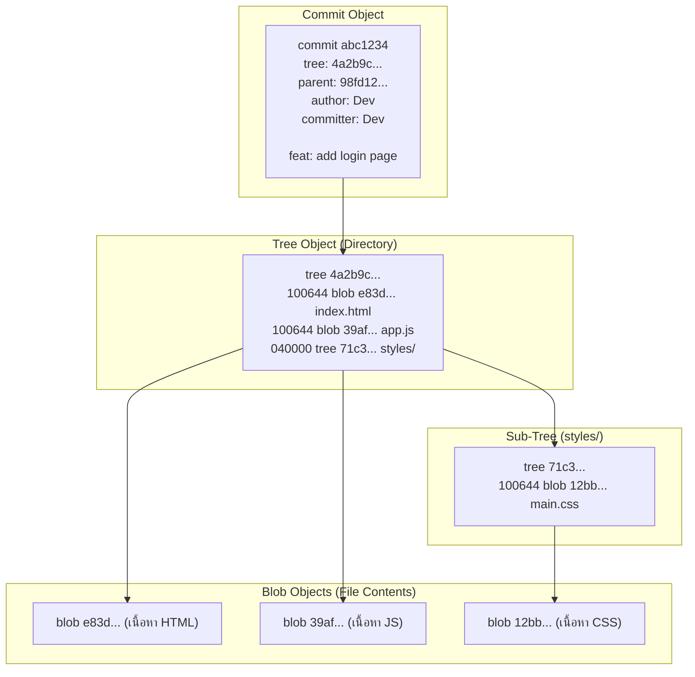

# Git Object Model

หัวใจสำคัญที่ทำให้ Git ทำงานได้อย่างมีประสิทธิภาพและรักษาความสมบูรณ์ของข้อมูลคือ **Git Object Model** ภายในโฟลเดอร์ `.git/objects` ซึ่งทำหน้าที่เป็น **Content-Addressable Key-Value Database**

ค่า Key คือ **SHA-1 (หรือ SHA-256) Hash ขนาด 40 ตัวอักษร** และ Value คือข้อมูลไบนารีที่ถูกบีบอัดด้วย `zlib`

---

## 1. ออบเจกต์พื้นฐาน 4 ประเภท (The 4 Core Objects)

Git จัดเก็บข้อมูลประวัติศาสตร์ทั้งหมดผ่านออบเจกต์เพียง 4 ชนิดเท่านั้น:



### 1.1 Blob (Binary Large Object)
- จัดเก็บ **เฉพาะเนื้อหาของไฟล์ (File Content Only)**
- ไม่เก็บชื่อไฟล์ (File Name), วันที่แก้ไข (Timestamp), หรือสิทธิ์การเข้าถึงไฟล์ (File Permissions)
- หากสร้างไฟล์ 2 ไฟล์ที่มีชื่อต่างกัน แต่อักษรภายในเหมือนกันทุกตัวอักษร ทั้งสองไฟล์จะชี้ไปที่ Blob ตัวเดียวกันบนฮาร์ดดิสก์!

### 1.2 Tree (Directory Listing)
- ทำหน้าที่แทน **ไดเรกทอรี (Directory / Folder)**
- จัดเก็บรายการของ Blob และ Sub-tree อื่นๆ
- เก็บข้อมูลชื่อไฟล์ (File Name), โหมดสิทธิ์ของไฟล์ (e.g. `100644` สำหรับไฟล์ปกติ, `100755` สำหรับไฟล์ Executable, `040000` สำหรับ Subdirectory) และ Hash ชี้ไปยัง Blob หรือ Tree ลูก

### 1.3 Commit (Snapshot & Metadata)
- ทำหน้าที่เป็นบันทึกประวัติศาสตร์ ณ จุดใดจุดหนึ่ง
- ชี้ไปยัง **Root Tree Object** 1 ตัว ซึ่งเป็นภาพสะท้อนของ Root Directory ทั้งโปรเจกต์ ณ เวลาที่ Commit
- เก็บ Hash ของ **Parent Commit(s)** (Commit บรรพบุรุษ ซึ่งอาจมี 0 สำหรับ Root Commit, 1 สำหรับ Normal Commit, หรือ 2 ขึ้นไปสำหรับ Merge Commit)
- เก็บชื่อผู้เขียน (Author), ผู้ทำการบันทึก (Committer), วันเวลาที่บันทึก (Timestamp), และข้อความอธิบาย (Commit Message)

### 1.4 Tag (Annotated Tag)
- ออบเจกต์ที่ทำหน้าที่คล้าย Commit แต่ใช้ตั้งชื่อหมุดหมายสำคัญ (เช่น Release `v1.0.0`)
- ชี้ไปยัง Commit Object และเก็บชื่อผู้สร้าง Tag วันที่ และข้อความกำกับ (ต่างจาก Lightweight Tag ที่เป็นเพียง Pointer ธรรมดา)

---

## 2. วิธีการคำนวณ Object Hash

Git คำนวณค่าแฮชโดยนำ Header มารวมกับเนื้อหาไฟล์ แล้วแฮชด้วย SHA-1:

$$\text{Hash} = \text{SHA-1}(\text{"type size\0content"})$$

ตัวอย่างเช่น ไฟล์ข้อความ `hello.txt` มีเนื้อหา `hello world\n` (ความยาว 12 ไบต์):
1. Git ประกอบสตริง: `blob 12\0hello world\n`
2. นำไปผ่านการแฮช SHA-1 จะได้ค่า: `3b18e512dba79e4c8300dd08aeb37f8e728b8dad`
3. Git จะนำไปเซฟที่พาธ: `.git/objects/3b/18e512dba79e4c8300dd08aeb37f8e728b8dad` (นำ 2 ตัวแรกเป็นชื่อโฟลเดอร์ และ 38 ตัวที่เหลือเป็นชื่อไฟล์)

---

## 3. คำสั่งสำรวจ Git Internals (Plumbing Commands)

เราสามารถใช้ชุดคำสั่งระดับล่าง (Plumbing commands) ตรวจสอบความจริงของ Object ได้:

```bash
# ตรวจสอบประเภทของ Object จากค่า Hash
git cat-file -t 3b18e512dba79e4c8300dd08aeb37f8e728b8dad
# Output: blob

# ตรวจสอบขนาดของ Object
git cat-file -s 3b18e512dba79e4c8300dd08aeb37f8e728b8dad
# Output: 12

# พิมพ์เนื้อหาภายใน Object ออกมาดู
git cat-file -p 3b18e512dba79e4c8300dd08aeb37f8e728b8dad
# Output: hello world
```

> [!tip] Mental Model สำคัญ
> Git ไม่ได้เก็บเฉพาะผลต่าง (Diffs) ระหว่างเวอร์ชัน! ทุก Commit คือการอ้างอิงถึงต้นไม้ทั้งต้น (Full Tree Snapshot) โดยอาศัยการชี้ไปยัง Blob เดิมซ้ำเพื่อประหยัดพื้นที่ ข้อมูลจึงมีความเป็นอิสระสูงและทำงานได้อย่างรวดเร็ว

---

## 🔗 โน้ตที่เกี่ยวข้อง
- [[Git-Architecture]] — สถาปัตยกรรม 3 สถานะของ Git
- [[Git-References-and-HEAD]] — การทำงานของ Pointers และ HEAD
- [[Git-Commit]] — การสร้าง Commit และการประกอบ Tree\n