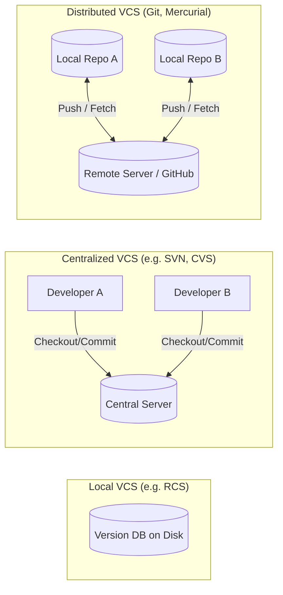

# Git Overview

**Git** คือระบบควบคุมเวอร์ชันแบบกระจายศูนย์ (Distributed Version Control System: DVCS) ที่พัฒนาขึ้นโดย Linus Torvalds ในปี 2005 เพื่อใช้ดูแลโค้ดต้นฉบับของ Linux Kernel โดยมีเป้าหมายหลักคือ **ความเร็ว (Speed)**, **ความถูกต้องของข้อมูล (Data Integrity)**, และ **การรองรับการพัฒนาแบบแตกกิ่งก้านที่ไม่เป็นเชิงเส้น (Non-linear Development)**

---

## 1. ปัญหาที่ Git เข้ามาแก้ไข

ก่อนหน้าที่จะมี Version Control นักพัฒนามักเก็บโค้ดด้วยการคัดลอกโฟลเดอร์ เช่น `project_final`, `project_final_v2`, `project_final_really_final` ซึ่งก่อให้เกิดปัญหา:
1. **ไม่ทราบสาเหตุและที่มา:** ไม่รู้ว่าใครแก้บรรทัดไหน เมื่อไหร่ และทำไมถึงแก้
2. **การทำงานซ้ำซ้อน:** เมื่อทำงานร่วมกัน สมาชิกมักเขียนทับโค้ดของเพื่อนร่วมทีม
3. **การย้อนสถานะทำได้ยาก:** เมื่อเกิด Bug ร้ายแรง ไม่สามารถกู้คืนโค้ดเวอร์ชันที่เสถียรได้อย่างมั่นใจ

ระบบควบคุมเวอร์ชัน (VCS) จึงเกิดขึ้นเพื่อบันทึกประวัติการเปลี่ยนแปลงของไฟล์ในลักษณะ Time-machine

---

## 2. วิวัฒนาการของระบบควบคุมเวอร์ชัน (VCS Evolution)

### 2.1 Centralized Version Control Systems (CVCS)
- เช่น Subversion (SVN), CVS, Perforce
- **จุดเด่น:** มีเซิร์ฟเวอร์กลางตัวเดียวที่เป็น Single Source of Truth
- **จุดอ่อน:** Single Point of Failure หากเซิร์ฟเวอร์ล่มหรือไม่มีการเชื่อมต่อเครือข่าย นักพัฒนาจะไม่สามารถ Commit, ดูประวัติย้อนหลัง หรือแตกกิ่งได้เลย

### 2.2 Distributed Version Control Systems (DVCS)
- เช่น Git, Mercurial
- **จุดเด่น:** นักพัฒนาทุกคนที่โคลน Repository มาจะมี **สำเนาประวัติศาสตร์ทั้งหมด (Full History Mirror)** อยู่ในเครื่อง Local
- สามารถ Commit, แตกกิ่ง (Branch), เปรียบเทียบไฟล์ (Diff), และดูประวัติย้อนหลังได้โดยไม่ต้องพึ่งพาอินเทอร์เน็ต
- เซิร์ฟเวอร์กลาง (เช่น GitHub หรือ GitLab) เป็นเพียงจุดนัดพบในการซิงค์ข้อมูล (Hub for synchronization)

---

## 3. Git vs GitHub: ข้อแตกต่างที่ต้องแยกแยะให้ชัด

| มิติ | Git | GitHub |
| :--- | :--- | :--- |
| **ประเภท** | โปรแกรม Command-Line Tool / Core Engine | แพลตฟอร์ม Cloud Service บนเว็บ |
| **หน้าที่** | จัดการบันทึกประวัติ สาขา และออบเจกต์ในเครื่อง | ให้บริการโฮสต์ Git Repository และเครื่องมือทีม |
| **การทำงาน** | ทำงานบนเครื่อง Local (ออฟไลน์ได้ 100%) | ทำงานบนอินเทอร์เน็ต |
| **ฟีเจอร์เพิ่มเติม** | ไม่มี UI, ไม่มีระบบสิทธิ์ขั้นสูง, ไม่มี Issue | Pull Requests, Issues, Actions (CI/CD), Discussions |
| **คู่แข่ง/ทางเลือก** | Mercurial, SVN, Bazaar | GitLab, Bitbucket, Gitea, Sourceforge |

> [!important] Key Concept
> Git ทำงานได้สมบูรณ์แบบด้วยตัวเองในเครื่องของคุณ แม้จะไม่มีการเชื่อมต่อกับ GitHub เลยก็ตาม GitHub เป็นเพียงบริการภายนอกที่ช่วยให้การทำงานร่วมกับผู้อื่นมีความสะดวกยิ่งขึ้น

---

## 4. ปรัชญาการออกแบบหลักของ Git (Core Design Principles)

1. **Snapshots, Not Differences (ภาพถ่าย ไม่ใช่ผลต่าง):**
   ระบบ VCS ยุคเก่ามักเก็บข้อมูลเป็นไฟล์พื้นฐานและผลต่าง (Delta-based change sets) แต่ Git มองข้อมูลเป็น **Snapshot** ของระบบไฟล์ ณ เวลาหนึ่ง หากไฟล์ใดไม่มีการเปลี่ยนแปลง Git จะไม่บันทึกไฟล์นั้นซ้ำ แต่จะสร้าง Pointer ชี้กลับไปยังไฟล์เดิมในอดีต (ดูรายละเอียดใน [[Git-Object-Model]])
2. **เกือบทุกคำสั่งทำงานในเครื่อง (Local Operations):**
   การคำนวณประวัติ การ Diff หรือการดู Log ดึงข้อมูลจากฐานข้อมูลท้องถิ่นในโฟลเดอร์ `.git` ทำให้ทำงานได้รวดเร็วระดับมิลลิวินาที
3. **ความถูกต้องของข้อมูล (Integrity via Cryptographic Hashing):**
   ทุกเนื้อหาและออบเจกต์ใน Git ถูกคำนวณหาค่าแฮชด้วยอัลกอริทึม SHA-1 (หรือ SHA-256 ในโหมดใหม่) ทำให้ไม่สามารถมีใครแอบแก้ไขเนื้อหาไฟล์หรือข้อมูล Commit ย้อนหลังได้โดยไม่ทำให้ค่าแฮชเปลี่ยน
4. **Git แทบไม่เคยลบข้อมูล (Append-Only Design):**
   การกระทำใน Git เกือบทั้งหมดเป็นการเพิ่มข้อมูลใหม่เข้าสู่ Object Database ดังนั้นข้อมูลที่เคย Commit ไปแล้วจะกู้คืนได้เสมอผ่าน [[Git-Reflog]]

---

## 🔗 โน้ตที่เกี่ยวข้อง
- [[Git-Architecture]] — 3 พื้นที่การทำงานและวงจรชีวิตของข้อมูลใน Git
- [[Git-Object-Model]] — โครงสร้าง Blob, Tree, Commit และ Tag
- [[Repository-and-Working-Tree]] — องค์ประกอบภายในโฟลเดอร์ `.git`\n