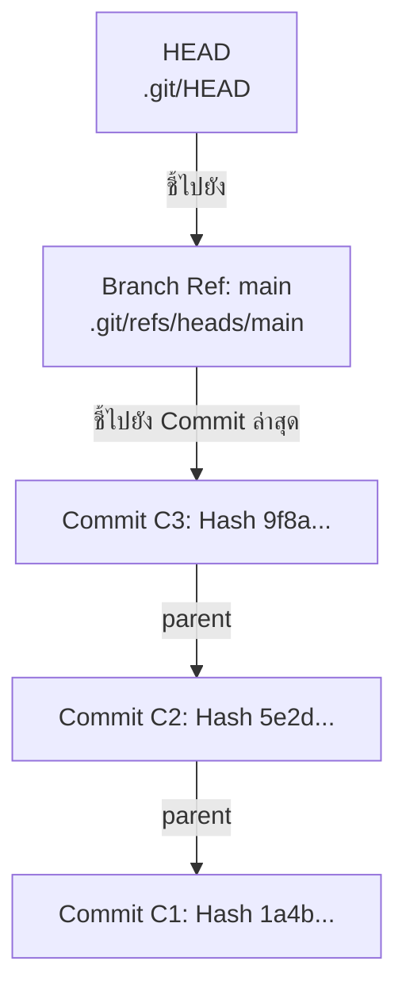
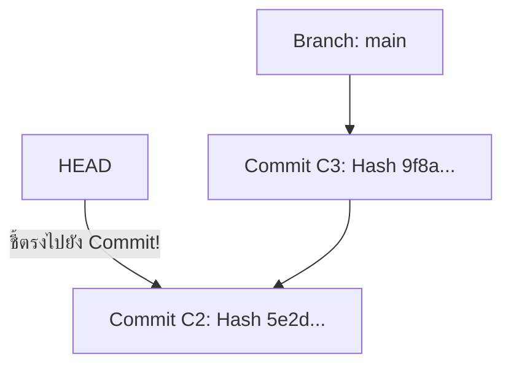

# Git References and HEAD

ในระบบ Git การอ้างอิงถึง Commit ด้วยเลขแฮช 40 ตัวอักษร (เช่น `8f4b23c9...`) นั้นจดจำและพิมพ์ได้ยาก Git จึงสร้างกลไกที่เรียกว่า **References (Refs)** ซึ่งเป็นชื่อที่มนุษย์อ่านเข้าใจง่าย ชี้ไปยัง Commit ต่างๆ ในระบบ

---

## 1. Reference (Ref) คืออะไร?

**Reference** คือไฟล์ข้อความธรรมดา (ขนาดประมาณ 41 ไบต์) ที่เก็บเลข Hash ของ Commit ไว้อยู่ภายใน โดยจัดเก็บอยู่ในโฟลเดอร์ `.git/refs/`

มี 2 ประเภทหลัก:
1. **Local Heads (Branches):** อยู่ใน `.git/refs/heads/` เช่น `.git/refs/heads/main`
2. **Remote-tracking Branches:** อยู่ใน `.git/refs/remotes/` เช่น `.git/refs/remotes/origin/main`
3. **Tags:** อยู่ใน `.git/refs/tags/` เช่น `.git/refs/tags/v1.0.0`

```bash
# ลองดูสิ่งที่อยู่ในไฟล์ branch main
cat .git/refs/heads/main
# Output: a1b2c3d4e5f67890123456789abcdef012345678
```

> [!important] นิยามของ Branch
> ใน Git **Branch ไม่ใช่โฟลเดอร์หรือสำเนาของโปรเจกต์** แต่ Branch เป็นเพียง **Pointer ที่มีชื่อเรียก ซึ่งสามารถเลื่อนไปข้างหน้าได้อัตโนมัติเมื่อมี Commit ใหม่** (Lightweight Movable Pointer)

---

## 2. HEAD คืออะไร?

**HEAD** เป็น **Symbolic Reference** พิเศษที่ทำหน้าที่ระบุว่า:
> *"ขณะนี้ตัวเรา (Working Tree) กำลังยืนอยู่ที่ Commit หรือ Branch ใดในระบบ"*

ไฟล์ของ HEAD อยู่ที่พาธ `.git/HEAD`



ในสถานะปกติ (Normal State):
- `HEAD` จะไม่ชี้ไปยัง Commit โดยตรง แต่จะชี้ไปยังชื่อ Branch ปัจจุบัน (Symbolic Ref)
- ตัวอย่างเนื้อหาในไฟล์ `.git/HEAD`:
  ```text
  ref: refs/heads/main
  ```
- เมื่อคุณทำคำสั่ง `git commit`:
  1. สร้าง Commit Object ใหม่ `C4` โดยตั้งค่า Parent เป็น `C3`
  2. เลื่อน Pointer ของ Branch `main` ให้ไปชี้ที่ `C4`
  3. `HEAD` ยังคงชี้ไปที่ `main` เหมือนเดิม ส่งผลให้คุณอยู่ที่ Commit ใหม่โดยอัตโนมัติ

---

## 3. ภาวะ Detached HEAD (หัวขาด)

เมื่อคุณสั่ง Checkout ไปยัง **Commit Hash** หรือ **Tag** หรือ **Remote Branch** โดยตรง แทนที่จะระบุชื่อ Local Branch:

```bash
git checkout 5e2d3f
# หรือ
git switch --detach 5e2d3f
```



- ในสภาวะนี้ เนื้อหาใน `.git/HEAD` จะเปลี่ยนเป็นเลข Hash ของ Commit โดยตรง ไม่ได้มีคำว่า `ref: refs/heads/...` อีกต่อไป
- หากคุณทำ Commit ใหม่ในขณะที่ Detached HEAD: Commit นั้นจะเกิดขึ้น แต่ไม่มี Branch ใดชี้รักษาตำแหน่งไว้
- หากคุณสลับไปที่ Branch อื่น Commit ใหม่เหล่านั้นจะกลายเป็น **Dangling Commit** และอาจถูกลบด้วย Garbage Collection ในอนาคต
- ศึกษาวิธีแก้ไขอย่างละเอียดใน [[Detached-HEAD]]

---

## 4. สรุปความสัมพันธ์ของลำดับชั้น

$$\text{HEAD} \xrightarrow{\text{มักจะชี้ไปที่}} \text{Branch Reference} \xrightarrow{\text{ชี้ไปที่}} \text{Commit Object} \xrightarrow{\text{ชี้ไปที่}} \text{Tree Object}$$

---

## 🔗 โน้ตที่เกี่ยวข้อง
- [[Git-Object-Model]] — โครงสร้างของ Commit และ Tree
- [[Branch-Concept]] — แนวคิดเชิงลึกเรื่องกิ่งก้านสาขา
- [[Detached-HEAD]] — ปัญหา Detached HEAD และแนวทางป้องกัน
- [[Git-Reflog]] — การตามรอยประวัติการเคลื่อนที่ของ HEAD\n