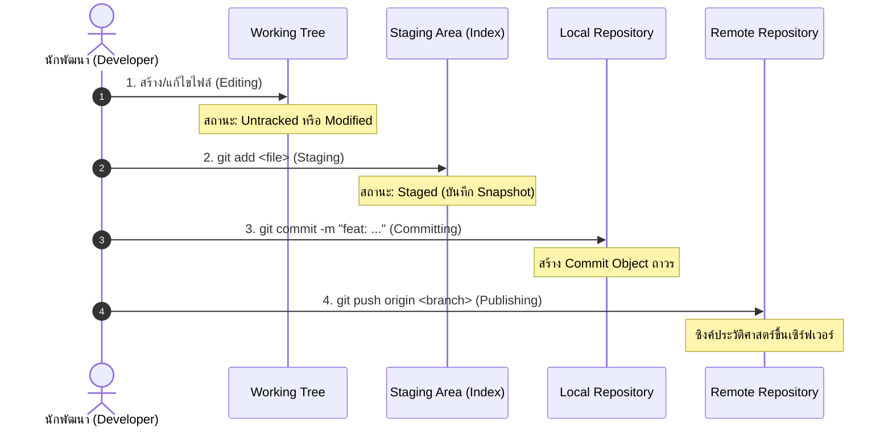

# Git Basic Workflow

การทำงานกับ Git ในชีวิตประจำวันขับเคลื่อนด้วยวงจรชีวิตที่เป็นขั้นเป็นตอน โดยมุ่งเน้นการเปลี่ยนผ่านของสถานะไฟล์จาก Working Directory เข้าสู่ประวัติศาสตร์ถาวร

---

## 1. วงจรชีวิตและขั้นตอนการทำงานพื้นฐาน (The Basic Cycle)



---

## 2. ขั้นตอนอย่างละเอียดในระดับคำสั่ง

### ขั้นที่ 1: ตรวจสอบสถานะก่อนเริ่มงาน
```bash
git status
```
คำสั่งนี้จะบอกให้ทราบว่าเรากำลังยืนอยู่ที่ Branch ใด มีไฟล์ใดถูกเปลี่ยนแปลง (Modified) หรือมีไฟล์ใหม่ที่ยังไม่ได้ถูกติดตาม (Untracked) บ้าง

### ขั้นที่ 2: นำการเปลี่ยนแปลงเข้าสู่ Staging Area
```bash
# เลือกเฉพาะไฟล์ที่เกี่ยวข้อง
git add src/index.js src/style.css
```
การ `git add` ทำให้ไฟล์ถูกบรรจุลงใน Staging Area เพื่อรอเป็นส่วนหนึ่งของ Snapshot ถัดไป

### ขั้นที่ 3: บันทึก Commit ถาวร
```bash
git commit -m "feat(auth): add login form validation"
```
Git จะสร้าง Commit Object ที่ประกอบด้วย Tree ของการเปลี่ยนแปลง ผู้บันทึก วันที่ และ Commit Message

### ขั้นที่ 4: เผยแพร่งานไปยัง Remote
```bash
git push -u origin feature/login
```

---

## 3. กฎทองของ Basic Workflow (Golden Rules)

1. **Commit Early, Commit Often (แต่ต้องมีคุณภาพ):** อย่ารอจนเขียนโค้ดทั้งระบบเสร็จเป็นพันๆ บรรทัดแล้ว Commit ทีเดียว เพราะจะทำให้การทำ Code Review และการย้อนกลับเมื่อมีบั๊กทำได้ยากมาก
2. **Atomic Commits:** หนึ่ง Commit ควรสะท้อนการทำงานเพียงเรื่องเดียว (Single responsibility) เช่น แก้บั๊ก 1 จุด หรือเพิ่มฟังก์ชันย่อย 1 ฟังก์ชัน
3. **ตรวจสอบ Diff ก่อน Add เสมอ:** ใช้ `git diff` เพื่อยืนยันว่าไม่มีโค้ดทดสอบ ชิ้นส่วนขยะ หรือข้อมูลลับ (Secret keys) ติดเข้าไปใน Staging Area

---

## 🔗 โน้ตที่เกี่ยวข้อง
- [[Daily-Git-Commands]] — รวมคำสั่งประจำวันพร้อมตัวอย่าง
- [[Git-Add-and-Staging]] — กลไกการ Snapshot ใน Staging Area
- [[Git-Commit]] — การทำ Atomic Commits\n