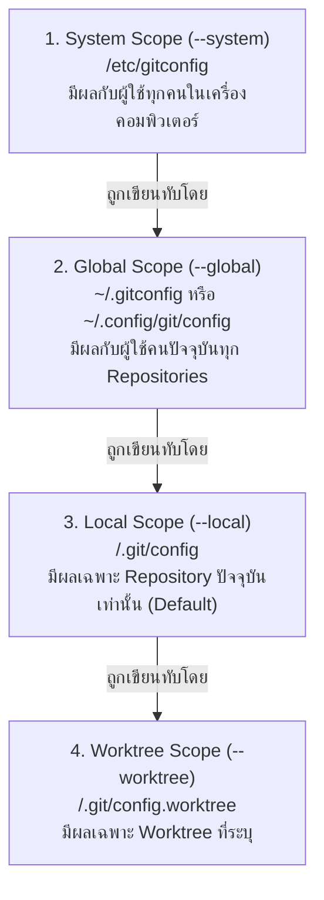

# Git Configuration

การตั้งค่า Git (Git Configuration) ควบคุมพฤติกรรมการทำงาน ตัวตนของผู้เขียน (Identity) เอดิเตอร์เริ่มต้น นโยบายการผสาน (Merge/Rebase) และการแปลงรูปแบบตัวอักษรข้ามระบบปฏิบัติการ

---

## 1. ลำดับชั้นของการตั้งค่า (Configuration Scopes & Priority)

Git ตรวจสอบการตั้งค่าตามลำดับชั้นจากระดับกว้างสุดไปสู่ระดับแคบสุด โดยระดับที่แคบกว่าจะเขียนทับ (Override) ค่าในระดับที่กว้างกว่าเสมอ:



---

## 2. การตั้งค่าตัวตนพื้นฐาน (User Identity)

ก่อนจะเริ่มทำ Commit ครั้งแรก Git กำหนดให้ต้องระบุชื่อและอีเมล ซึ่งจะถูกประทับไว้ใน Metadata ของทุก Commit โดยไม่สามารถแก้ไขย้อนหลังได้โดยไม่เปลี่ยนค่า Hash:

```bash
# ตั้งค่าระดับ Global (แนะนำสำหรับเครื่องส่วนตัว)
git config --global user.name "John Doe"
git config --global user.email "john@example.com"

# ตั้งค่าระดับ Local (สำหรับโปรเจกต์งานบริษัทที่ใช้อีเมลต่างหาก)
cd /path/to/work-project
git config --local user.name "John at Work"
git config --local user.email "john.doe@company.com"
```

---

## 3. การตั้งค่าสำคัญที่แนะนำสำหรับทีมงานมืออาชีพ

```bash
# กำหนด Default Branch เริ่มต้นเป็น main แทน master
git config --global init.defaultBranch main

# กำหนด Editor เริ่มต้น (เช่น VS Code หรือ Nano)
git config --global core.editor "code --wait"

# การจัดการขึ้นบรรทัดใหม่ (Line Endings CRLF vs LF)
# สำหรับ macOS / Linux:
git config --global core.autocrlf input
# สำหรับ Windows:
git config --global core.autocrlf true

# กำหนดให้ git pull ใช้ rebase หรือ fast-forward only เพื่อลด merge commits ขยะ
git config --global pull.rebase true
```

---

## 4. การตรวจสอบและการแก้ไขคอนฟิก

```bash
# แสดงรายการคอนฟิกทั้งหมดพร้อมระบุว่ามาจาก Scope ใด
git config --list --show-origin

# ตรวจสอบค่าเฉพาะคีย์ที่ต้องการ
git config user.email

# ลบค่าคอนฟิกที่ตั้งไว้
git config --global --unset user.email
```

---

## 5. การแก้ปัญหา (Troubleshooting)

### อาการ: Commit บน GitHub แล้วไม่ขึ้นรูปโปรไฟล์ หรือชื่อผู้แต่งไม่ถูกต้อง
- **Cause:** ค่า `user.email` ใน `git config` ไม่ตรงกับอีเมลที่ผูกไว้ในบัญชี GitHub
- **Diagnosis:** รัน `git config user.email` แล้วตรวจสอบใน Settings > Emails ของ GitHub
- **Solution:** แก้ไขด้วย `git config --global user.email "correct_email@example.com"`
- **Prevention:** ตรวจสอบ `git config --show-origin` ทุกครั้งที่ตั้งค่าเครื่องใหม่

---

## 🔗 โน้ตที่เกี่ยวข้อง
- [[Repository-and-Working-Tree]] — ไฟล์ `.git/config`
- [[Git-Commit]] — การนำ Identity ไปประทับใน Commit Object\n