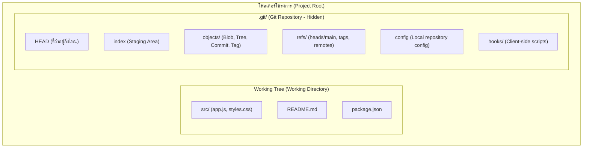

# Repository and Working Tree

เมื่อเราทำงานกับ Git ความเข้าใจเกี่ยวกับโครงสร้างพื้นที่จัดเก็บเป็นบันไดก้าวแรกที่สำคัญที่สุด Git แยกความแตกต่างระหว่าง **พื้นที่ทำงานจริง (Working Tree)** และ **ฐานข้อมูลประวัติศาสตร์ (Git Repository)** อย่างชัดเจน

---

## 1. องค์ประกอบสำคัญ



### 1.1 Working Tree (Working Directory)
- คือพื้นที่จริงบนระบบไฟล์ที่คุณมองเห็นและเปิดด้วย IDE
- บรรจุไฟล์ที่แตกออกมา (Checked out) จาก Object Database ใน Git เพื่อให้มนุษย์หรือโปรแกรมสามารถแก้ไข บิลด์ หรือทดสอบได้
- การเปลี่ยนแปลงใดๆ ที่เกิดขึ้นใน Working Tree (เช่น พิมพ์เพิ่มข้อความ ลบไฟล์) ยังไม่มีผลกับประวัติของ Git จนกว่าจะสั่งคำสั่งนำเข้า Staging Area

### 1.2 Git Directory (`.git/`)
- เป็นโฟลเดอร์ซ่อนที่เก็บฐานข้อมูลและ Metadata ทั้งหมด
- หากคุณลบโฟลเดอร์ `.git/` ทิ้งไป โปรเจกต์จะกลับกลายเป็นโฟลเดอร์ธรรมดาที่สูญเสียประวัติศาสตร์และการแตกกิ่งก้านทั้งหมดทันที
- สมาชิกสำคัญภายใน `.git/`:
  - `HEAD`: ไฟล์ชี้ตำแหน่งปัจจุบันของการทำงาน
  - `index`: ไบนารีไฟล์ทำหน้าที่เป็น Staging Area
  - `objects/`: ฐานข้อมูล Content-addressable storage
  - `refs/`: เก็บ Pointer ของ Branch และ Tag
  - `config`: การตั้งค่าเฉพาะ Repository นี้

---

## 2. Bare Repository vs Non-Bare Repository

| คุณลักษณะ | Non-Bare Repository | Bare Repository |
| :--- | :--- | :--- |
| **โครงสร้าง** | มีทั้ง Working Tree + โฟลเดอร์ `.git/` | มีเฉพาะเนื้อหาข้างใน `.git/` โดยไม่มี Working Tree |
| **การใช้งาน** | ใช้งานในเครื่องของนักพัฒนาสำหรับเขียนโค้ด | ใช้เป็น Central Server (เช่น GitHub Server, Git Server ขององค์กร) |
| **การ Push ใส่** | ไม่แนะนำให้ Push ใส่ Branch ที่ถูก Checkout อยู่ | สามารถ Push โค้ดเข้ามาได้ตลอดเวลาอย่างปลอดภัย |
| **คำสั่งสร้าง** | `git init` หรือ `git clone <url>` | `git init --bare` หรือ `git clone --bare <url>` |

---

## 3. การเริ่มต้นและโคลน Repository

### 3.1 การเริ่มต้นใหม่ด้วย `git init`
```bash
# สร้างโฟลเดอร์โครงการแล้วสั่ง init
mkdir my-project
cd my-project
git init
```
- **การทำงาน:** Git จะสร้างโฟลเดอร์ `.git/` ว่างเปล่าพร้อม Branch เริ่มต้น (มักเป็น `main` หรือ `master` ตามคอนฟิก)
- **เมื่อใดที่ควรใช้:** เมื่อต้องการนำโปรเจกต์ใหม่หรือโฟลเดอร์เดิมที่ยังไม่มี Version Control เข้าสู่ระบบ Git

### 3.2 การโคลนด้วย `git clone`
```bash
# โคลนโปรเจกต์จาก Remote เข้าสู่เครื่อง
git clone https://github.com/example/repo.git
```
- **การทำงาน:** Git จะดาวน์โหลดฐานข้อมูล Object ทั้งหมด ประวัติศาสตร์ทุก Branch และ Checkout ไฟล์ของ Default Branch ลงสู่ Working Tree ให้อัตโนมัติ พร้อมตั้งค่า Remote ชื่อ `origin`

---

## 4. ปัญหาที่พบบ่อย (Troubleshooting)

### อาการ: สั่งคำสั่ง Git แล้วพบข้อผิดพลาด `fatal: not a git repository`
- **Cause:** คำสั่งที่รันไม่ได้อยู่ภายในโฟลเดอร์ที่มี `.git/` หรือ Subdirectory ของมัน
- **Diagnosis:** ตรวจสอบตำแหน่งโฟลเดอร์ปัจจุบันด้วย `pwd` และตรวจหา `.git` ด้วย `ls -la`
- **Solution:** ย้ายเข้าไปในโฟลเดอร์โปรเจกต์ที่ถูกต้องด้วย `cd <path>` หรือสั่ง `git init` หากต้องการสร้างใหม่
- **Prevention:** ตรวจสอบ Terminal prompt หรือสถานะก่อนรันคำสั่ง

---

## 🔗 โน้ตที่เกี่ยวข้อง
- [[Git-Architecture]] — สถาปัตยกรรม 3 พื้นที่ทำงาน
- [[Git-Configuration]] — การตั้งค่าคอนฟิกของระบบและ Repository
- [[Git-Basic-Workflow]] — วงจรชีวิตการทำงานพื้นฐาน\n