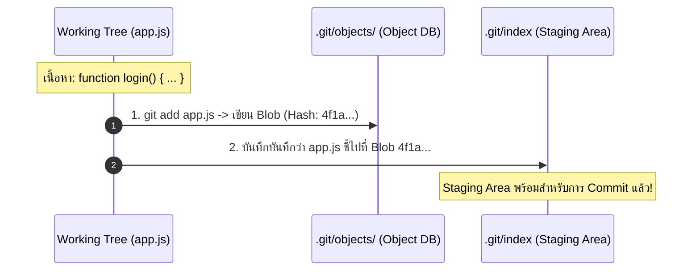

# Git Add and Staging Area

ความเข้าใจผิดที่พบบ่อยที่สุดในหมู่ผู้เริ่มต้นใช้ Git คือคิดว่า `git add` หมายถึงการ *"เพิ่มไฟล์ใหม่เข้า Repository"* แต่ในความเป็นจริง `git add` คือกระบวนการ **บันทึกภาพเสมือน (Snapshot) ของไฟล์ ณ เวลานั้นลงใน Staging Area (Index)**

---

## 1. คำสั่งนี้คืออะไรและทำงานอย่างไรในระดับ Concept?

เมื่อคุณรันคำสั่ง `git add <file>` Git จะกระทำ 2 สิ่งเบื้องหลังทันที:
1. **สร้าง Blob Object:** นำเนื้อหาปัจจุบันของไฟล์มาคำนวณ SHA-1 Hash บีบอัดด้วย zlib และบันทึกลงใน `.git/objects/` ทันที
2. **ปรับปรุงไฟล์ `.git/index`:** บันทึก Mapping ระหว่างชื่อไฟล์ สิทธิ์ และ Hash ของ Blob ตัวใหม่



> [!important] Add คือการถ่าย Snapshot ณ เวลานั้น
> หากคุณสั่ง `git add app.js` แล้วหลังจากนั้นคุณเปิดไฟล์ `app.js` เพื่อพิมพ์แก้ไขเพิ่มเติมต่ออีก 2 บรรทัด โดยไม่ได้สั่ง `git add` ซ้ำ เมื่อคุณสั่ง `git commit` สิ่งที่จะถูกบันทึกเข้า Commit คือ **เนื้อหา ณ จังหวะที่คุณกด `git add` ครั้งแรก** ไม่ใช่เนื้อหาล่าสุดที่คุณเพิ่งพิมพ์ไป!

---

## 2. รูปแบบคำสั่งและการเลือกใช้งาน (Practical Usages)

### 2.1 เพิ่มเป็นรายไฟล์ (แนะนำที่สุด)
```bash
git add src/auth.service.ts
```
ช่วยให้นักพัฒนามีสติและเลือกเฉพาะไฟล์ที่เกี่ยวข้องกับจุดประสงค์ของ Commit นั้นๆ

### 2.2 เพิ่มทุกไฟล์ในไดเรกทอรีปัจจุบัน
```bash
git add .
```
- นำการเปลี่ยนแปลงทั้งหมดในโฟลเดอร์ปัจจุบันและโฟลเดอร์ย่อยเข้า Staging Area
- **ข้อควรระวัง:** อาจเผลอนำไฟล์ชั่วคราว ขยะ หรือ Credential ติดเข้าไปได้หากไม่ได้ตั้งค่า [[Gitignore]] ให้รัดกุม

### 2.3 Interactive Staging (`git add -p` / Patch Mode)
เมื่อคุณแก้ไขไฟล์เดียวไปหลายจุด แต่อยากแบ่งเป็น 2 Commits ย่อย:
```bash
git add -p src/auth.service.ts
```
Git จะแสดงความแตกต่างทีละท่อน (Hunk) และถามคุณว่าจะนำท่อนนี้เข้า Staging ไหม:
- `y` - นำท่อนนี้เข้า Staged
- `n` - ข้ามท่อนนี้ไปก่อน
- `s` - แยกท่อนนี้ให้เล็กลงอีก (Split)

---

## 3. การยกเลิกการ Stage (Unstaging)

หากเผลอสั่ง `git add` ผิดไฟล์และต้องการเอาออกจาก Staging Area โดย **ไม่ลบโค้ดที่พิมพ์ไว้ใน Working Tree**:
```bash
# สำหรับ Git ยุคใหม่ (2.23+)
git restore --staged <file>

# คำสั่งยุคเก่าที่มีพฤติกรรมเทียบเคียง
git reset HEAD <file>
```

---

## 4. ปัญหาที่พบบ่อย (Troubleshooting)

### อาการ: พิมพ์แก้โค้ดไปแล้ว แต่ทำไมตอน Commit ถึงไม่มีโค้ดส่วนใหม่ติดไปด้วย?
- **Cause:** มีการแก้ไขไฟล์หลังจากที่สั่ง `git add` ไปแล้ว ทำให้เนื้อหาใน Working Tree ใหม่กว่าเนื้อหาใน Staging Area
- **Diagnosis:** รัน `git status` จะพบชื่อไฟล์เดียวกันปรากฏอยู่ทั้งในโซน *"Changes to be committed"* และ *"Changes not staged for commit"*
- **Solution:** รัน `git add <file>` ซ้ำอีกครั้งก่อนสั่ง Commit
- **Prevention:** รัน `git status` หรือ `git diff --staged` ตรวจสอบก่อน Commit ทุกครั้ง

---

## 🔗 โน้ตที่เกี่ยวข้อง
- [[Git-Architecture]] — 3 สถานะของ Git
- [[Git-Commit]] — การนำของจาก Staging ไป Commit
- [[Git-Restore]] — การกู้คืนและ Unstaging ไฟล์\n