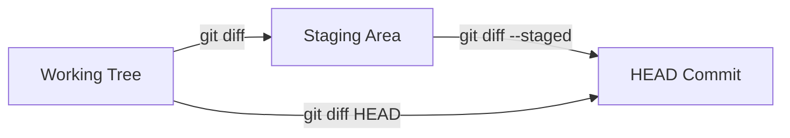

# Git Diff

**Git Diff** คือเครื่องมือวิเคราะห์และตรวจสอบความแตกต่างของโค้ดเนื้อหาแบบบรรทัดต่อบรรทัด เป็นหัวใจสำคัญในการทำ Self-Review ก่อนนำโค้ดเข้าสู่ระบบ

---

## 1. ขอบเขตการเปรียบเทียบของ Git Diff

การรัน `git diff` จะให้ผลลัพธ์ต่างกันอย่างสิ้นเชิงขึ้นอยู่กับพารามิเตอร์ที่ระบุ:



1. **`git diff` (Unstaged Diff):**
   - เปรียบเทียบ: **Working Tree vs Staging Area**
   - ตอบคำถาม: *"ตั้งแต่สั่ง `git add` ครั้งล่าสุด เราพิมพ์อะไรเพิ่มหรือลบอะไรไปบ้างในโค้ด?"*
2. **`git diff --staged` หรือ `git diff --cached` (Staged Diff):**
   - เปรียบเทียบ: **Staging Area vs HEAD**
   - ตอบคำถาม: *"สิ่งที่เราเตรียมจะกดบันทึกใน Commit ถัดไป มีอะไรบ้าง?"*
3. **`git diff HEAD`:**
   - เปรียบเทียบ: **Working Tree ทั้งหมด vs HEAD**
   - รวบรวมทุกการเปลี่ยนแปลงทั้งที่ Stage แล้วและยังไม่ Stage

---

## 2. วิธีการอ่านผลลัพธ์ Unified Diff Format

เมื่อสั่ง `git diff` ตัวอย่างผลลัพธ์จะปรากฏดังนี้:

```diff
diff --git a/src/math.js b/src/math.js
index 83a21b..49cd1e 100644
--- a/src/math.js
+++ b/src/math.js
@@ -10,6 +10,8 @@ function add(a, b) {
     return a + b;
 }

+function multiply(a, b) {
+    return a * b;
+}
```

- `--- a/src/math.js`: ตัวแทนของไฟล์ต้นทาง (เดิม)
- `+++ b/src/math.js`: ตัวแทนของไฟล์ปลายทาง (ใหม่)
- `@@ -10,6 +10,8 @@`: Hunk Header บ่งบอกว่าเดิมไฟล์เริ่มต้นที่บรรทัด 10 แสดง 6 บรรทัด และไฟล์ใหม่เริ่มต้นที่บรรทัด 10 แสดง 8 บรรทัด
- เครื่องหมาย `+` สีเขียว: บรรทัดที่ถูกเพิ่มเข้ามาใหม่
- เครื่องหมาย `-` สีแดง: บรรทัดที่ถูกลบทิ้งไป

---

## 3. คำสั่งเปรียบเทียบขั้นสูง

```bash
# เปรียบเทียบระหว่าง 2 กิ่ง (Branch A vs Branch B)
git diff main feature/payment

# ดูเฉพาะสถิติสรุปจำนวนบรรทัดที่เปลี่ยนไป ไม่ดูเนื้อหาละเอียด
git diff --stat

# เปรียบเทียบเฉพาะไฟล์ที่กำหนด
git diff src/config.json
```

---

## 🔗 โน้ตที่เกี่ยวข้อง
- [[Daily-Git-Commands]] — คำสั่งประจำวัน
- [[Git-Add-and-Staging]] — การคัดเลือกการเปลี่ยนแปลง
- [[Git-Show-and-Blame]] — การดู Diff ของ Commit เก่าในอดีต\n