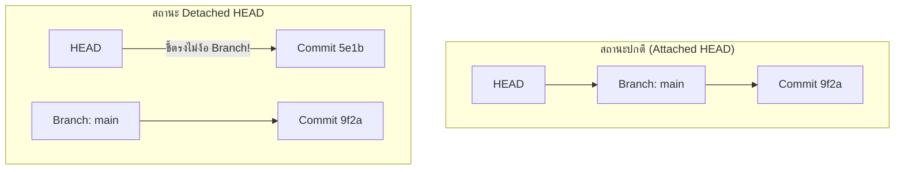

# Detached HEAD

**Detached HEAD (สภาวะหัวขาด)** คือสถานะพิเศษใน Git ที่ตัวชี้ **HEAD ชี้ตรงไปยัง Commit Object ใด Commit Object หนึ่งโดยตรง แทนที่จะชี้ไปยังชื่อของ Branch**

---

## 1. สาเหตุของการเกิด Detached HEAD



สาเหตุที่ทำให้ตกอยู่ในสถานะนี้:
1. สั่ง Checkout ไปยังเลข Commit Hash เจาะจง: `git checkout 5e1b3c`
2. สั่ง Checkout ไปยัง Tag: `git checkout v1.0.0`
3. สั่ง Checkout ไปยัง Remote Branch โดยตรง: `git checkout origin/main`
4. ทำการ Interactive Rebase หรือ Submodule Update

---

## 2. ทำไมถึงอันตรายหากไม่เข้าใจ?

ในขณะที่อยู่ในสถานะ Detached HEAD คุณสามารถเปิดดูโค้ด ทดสอบ รันระบบ หรือแม้กระทั่งเขียนโค้ดแล้วสั่ง `git commit` ได้ตามปกติ

**แต่ความเสี่ยงจะเกิดขึ้นเมื่อคุณสลับออกจากจุดนี้:**
- หากคุณ Commit เพิ่ม 2 ครั้ง (ได้ Commit `X` และ `Y`)
- จากนั้นคุณสั่ง `git switch main`
- ตัวชี้ `HEAD` จะย้ายกลับไปชี้ที่ `main` ทันที
- **ผลลัพธ์:** Commit `X` และ `Y` จะไม่มี Branch ใดๆ ชี้รักษาไว้เลย กลายเป็น **Orphan/Dangling Commits** และจะมองไม่เห็นใน `git log` ปกติ หากปล่อยไว้นาน Git Garbage Collection (`git gc`) จะลบออบเจกต์เหล่านี้ทิ้งอย่างถาวร!

---

## 3. วิธีการรับมือและแก้ไข (How to Fix)

### กรณีที่ 1: แค่เข้ามาส่องโค้ดเก่าเฉยๆ ไม่ได้ต้องการแก้อะไร
เพียงแค่สลับกลับไปยัง Branch หลักของคุณ:
```bash
git switch main
```

### กรณีที่ 2: เผลอเขียนโค้ดและ Commit ไปแล้ว และต้องการเก็บงานนั้นไว้!
ให้สร้าง Branch ใหม่มารับรอง Commit ปัจจุบันไว้ทันทีก่อนสลับกิ่ง:
```bash
# สร้าง Branch ใหม่ ณ ตำแหน่งปัจจุบันเพื่อรักษา Commit ไว้
git switch -c feature/my-rescued-work

# ตอนนี้ Commit ของคุณจะปลอดภัยและมี Branch feature/my-rescued-work ชี้เรียบร้อยแล้ว
```

### กรณีที่ 3: สลับกิ่งหนีออกมาแล้ว งานหายไปแล้ว!
ไม่ต้องตกใจ! ตราบใดที่เพิ่งเกิดขึ้นไม่นาน ข้อมูลยังอยู่ใน Object Database ให้ใช้ [[Git-Reflog]] ค้นหาเลข Hash:
```bash
# 1. ส่องประวัติการเคลื่อนที่ของ HEAD
git reflog

# จะพบรายการ เช่น HEAD@{1}: commit: my important changes (hash: e4d2a1)

# 2. กู้คืนด้วยการสร้าง Branch ชี้ไปที่ Hash นั้น
git branch recovery-branch e4d2a1
```

---

## 🔗 โน้ตที่เกี่ยวข้อง
- [[Git-References-and-HEAD]] — กลไกของ Symbolic References
- [[Git-Reflog]] — เครื่องมือกู้ชีพประวัติศาสตร์
- [[Branch-Commands]] — คำสั่งสลับและสร้าง Branch\n