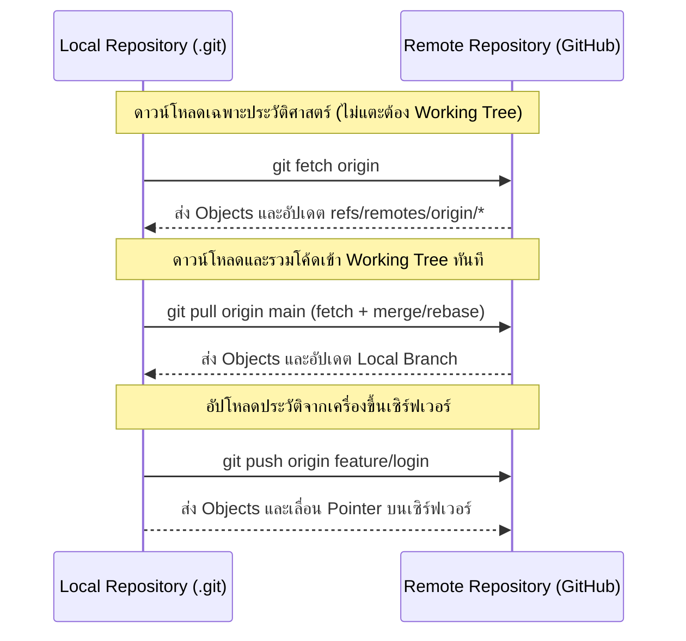

# Remote Repository

**Remote Repository** คือสำเนาของโปรเจกต์ Git ที่ถูกโฮสต์อยู่บนเครือข่ายอินเทอร์เน็ตหรือเซิร์ฟเวอร์ภายในองค์กร (เช่น GitHub, GitLab, Bitbucket หรือ Bare Git Server ภายใน) ทำหน้าที่เป็นจุดศูนย์กลางในการแลกเปลี่ยนประวัติศาสตร์ของโค้ดระหว่างสมาชิกในทีม

---

## 1. คำว่า `origin` คืออะไร?

เมื่อคุณสั่ง `git clone <url>` Git จะทำสิ่งพิเศษให้อัตโนมัติ:
1. สร้างโฟลเดอร์โครงการในเครื่องของคุณ
2. ตั้งชื่อ Alias (นามแฝง) สำหรับ URL ของ Remote ที่โคลนมาว่า **`origin`**
3. สร้าง Remote-tracking Branches เพื่อจดจำสถานะของเซิร์ฟเวอร์

> [!note] origin ไม่ใช่คำสั่งพิเศษ
> `origin` เป็นเพียงชื่อตัวแปรเริ่มต้น (Default Name) ที่ Git นิยมใช้ หากต้องการตั้งชื่ออื่น เช่น `upstream`, `backup`, หรือ `production` ก็สามารถทำได้ตามต้องการ

---

## 2. คำสั่งจัดการ Remote ในทางปฏิบัติ

### 2.1 ตรวจสอบ Remote ที่เชื่อมต่ออยู่
```bash
git remote -v
```
**ตัวอย่างผลลัพธ์:**
```text
origin  https://github.com/myorg/project.git (fetch)
origin  https://github.com/myorg/project.git (push)
```

### 2.2 เพิ่ม Remote ใหม่
มักใช้เมื่อเริ่มต้นโปรเจกต์ด้วย `git init` ในเครื่อง แล้วต้องการผูกเข้ากับ Repository ที่เพิ่งสร้างบน GitHub:
```bash
git remote add origin https://github.com/myorg/project.git
```

หรือเมื่อทำการ Fork โปรเจกต์ Open-source แล้วต้องการผูก Remote ไปยังโปรเจกต์ต้นฉบับ:
```bash
git remote add upstream https://github.com/original-author/project.git
```

### 2.3 เปลี่ยนแปลง URL หรือชื่อของ Remote
```bash
# เปลี่ยน URL (เช่น ย้ายจาก HTTPS ไป SSH)
git remote set-url origin git@github.com:myorg/project.git

# เปลี่ยนชื่อ Remote
git remote rename origin old-origin

# ลบการเชื่อมต่อ Remote
git remote remove old-origin
```

---

## 3. สถาปัตยกรรมการซิงค์ข้อมูล (Synchronization Architecture)



---

## 🔗 โน้ตที่เกี่ยวข้อง
- [[Fetch-Pull-Push]] — เปรียบเทียบ Fetch, Pull และ Push อย่างละเอียด
- [[Upstream-and-Tracking-Branch]] — ความสัมพันธ์ของ Tracking Branch\n