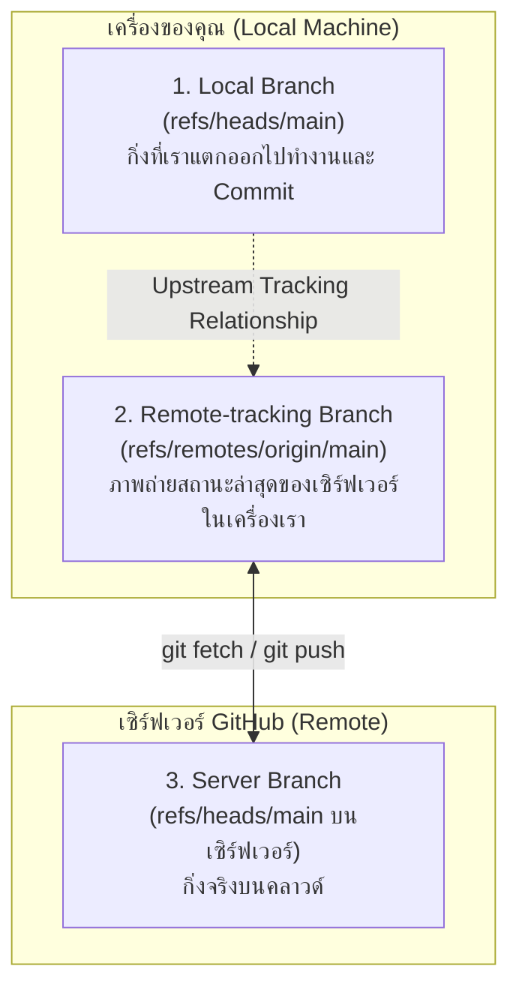

# Upstream and Tracking Branch

ความเข้าใจเรื่องความเชื่อมโยงระหว่าง **Local Branch**, **Remote-tracking Branch**, และ **Upstream** เป็นกุญแจสำคัญที่ทำให้คำสั่งสั้นๆ อย่าง `git push` หรือ `git pull` รู้ว่าจะต้องคุยกับกิ่งใดบนเซิร์ฟเวอร์

---

## 1. 3 ประเภทของ Branch ในบริบท Remote



1. **Local Branch (`main`):** กิ่งที่คุณมีสิทธิ์เขียน สลับไปทำงาน และ Commit โค้ดลงไป
2. **Remote-tracking Branch (`origin/main`):** ตัวแทนของกิ่งบนเซิร์ฟเวอร์ที่ถูกแคชไว้ในเครื่องคุณ คุณไม่สามารถ Checkout ไปพิมพ์โค้ดแก้ตรงๆ ได้ มันจะขยับก็ต่อเมื่อมีคำสั่ง `fetch`, `pull`, หรือ `push`
3. **Upstream Branch:** ความสัมพันธ์ที่ผูกไว้ (Binding) บอกให้ Git รู้ว่า Local Branch นี้ เป็นคู่แฝดของ Remote-tracking Branch ตัวไหน

---

## 2. การตั้งค่า Upstream (`-u` หรือ `--set-upstream`)

เมื่อคุณสร้าง Branch ใหม่ในเครื่อง เช่น `feature/dashboard` ทางเซิร์ฟเวอร์ยังไม่มี Branch นี้ และยังไม่มีการผูก Tracking

```bash
# เมื่อต้องการ Push ครั้งแรก
git push -u origin feature/dashboard
```
- ธง `-u` (ย่อมาจาก `--set-upstream`) สั่งให้ Git จำว่า:
  > *"ต่อไปนี้ กิ่ง `feature/dashboard` ในเครื่อง ให้เชื่อมโยงกับกิ่ง `feature/dashboard` บน Remote `origin` นะ"*
- หลังจากนี้ เมื่อยืนอยู่บนกิ่งนี้ คุณสามารถพิมพ์สั้นๆ แค่:
  - `git push`
  - `git pull`
  - `git status` (จะแสดงด้วยว่าเรา Ahead หรือ Behind เซิร์ฟเวอร์กี่ Commit)

---

## 3. การตรวจสอบและการเปลี่ยน Upstream

```bash
# ตรวจสอบ Tracking relationship ของทุกกิ่ง
git branch -vv

# ตัวอย่าง Output:
# * main                8f3a12 [origin/main: ahead 1] feat: new home
#   feature/login       2b9c01 [origin/feature/login] fix: validation
#   experiment          1102ff [no upstream] add test

# ตั้งค่า Upstream ย้อนหลังสำหรับกิ่งที่ไม่ได้ใส่ -u แต่แรก
git branch -u origin/main
```

---

## 🔗 โน้ตที่เกี่ยวข้อง
- [[Remote-Repository]] — ภาพรวมของ Remote
- [[Fetch-Pull-Push]] — คำสั่งซิงค์ข้อมูล\n