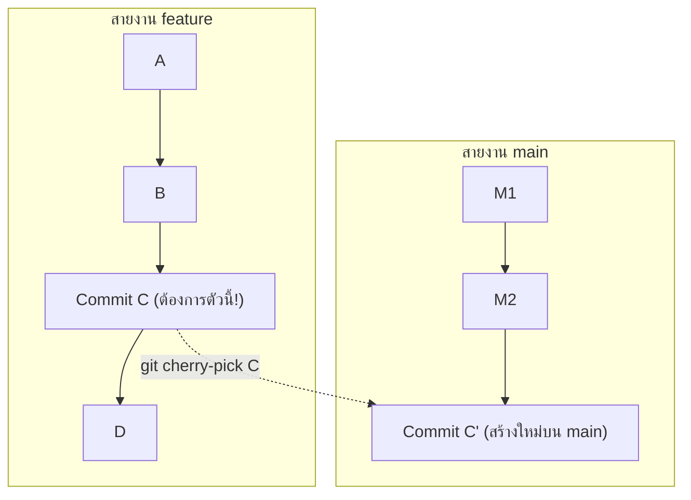

# Git Cherry Pick

**`git cherry-pick`** คือคำสั่งในการเลือกหยิบเฉพาะ **Commit ตัวใดตัวหนึ่งที่เจาะจง** จากกิ่งอื่น มาประยุกต์ใช้กับ Branch ปัจจุบัน โดยไม่ต้องรวม (Merge) กิ่งนั้นมาทั้งสาย

---

## 1. คำสั่งนี้คืออะไรและทำงานอย่างไร?

แทนที่จะนำประวัติศาสตร์ทั้งหมดมา Git จะคำนวณเฉพาะผลต่าง (Patch) ของ Commit ที่ระบุ แล้วนำมา Commit ซ้ำลงบนกิ่งปัจจุบันของคุณ ทำให้ได้ Commit ใหม่ที่มีข้อความเดิม แต่ค่า SHA Hash ใหม่



---

## 2. สถานการณ์ที่ควรใช้ (Use Cases)

1. **Hotfix สำหรับ Production:** มีการแก้บั๊กด่วนบนกิ่งทดสอบ แต่ต้องการดึงเฉพาะการแก้จุดนี้ลงสู่กิ่ง `production` ทันทีโดยไม่นำฟีเจอร์อื่นๆ ที่ยังไม่เสร็จติดไปด้วย
2. **Commit ผิด Branch:** เผลอเขียนโค้ดและ Commit ลงบนกิ่ง `main` แทนที่จะเป็น `feature` สามารถสลับไปกิ่ง `feature` แล้ว cherry-pick commit นั้นมา จากนั้นค่อยไป reset บน `main`
3. **กู้คืนงานจากกิ่งที่ถูกทิ้ง:** ต้องการกู้คืนตรรกะโค้ดบางชิ้นจากการทดลองเก่าที่ล้มเลิกไปแล้ว

---

## 3. ตัวอย่างการใช้งานจริง

```bash
# 1. ย้ายไปยังกิ่งปลายทางที่ต้องการนำโค้ดมาลง
git switch main

# 2. หยิบเฉพาะ Commit hash ที่ต้องการ
git cherry-pick 8f3a9d1

# หรือหยิบแบบไม่ให้ Commit อัตโนมัติ (นำมาใส่ Staging Area ไว้ตรวจก่อน)
git cherry-pick -n 8f3a9d1
```

> [!warning] ความเสี่ยงของ Duplicate Commits
> หากคุณ Cherry-pick Commit จาก `feature` มาลง `main` บ่อยๆ เมื่อถึงวันที่ต้อง Merge `feature` เข้า `main` ทั้งหมด Git อาจสับสนหรือเกิดข้อขัดแย้งซ้ำซ้อน เพราะมีการเปลี่ยนแปลงซ้ำกันแต่ค่า Hash ต่างกัน ควรใช้เท่าที่จำเป็น

---

## 🔗 โน้ตที่เกี่ยวข้อง
- [[Git-Merge]] — การรวมกิ่งตามปกติ
- [[Git-Rebase]] — การย้ายประวัติทั้งสาย\n