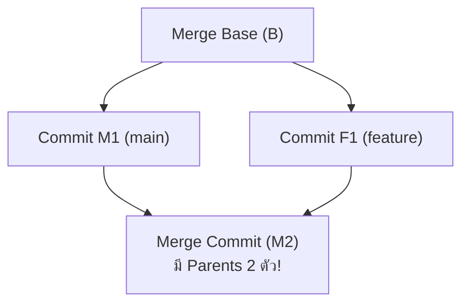

# Git Merge

**Git Merge** คือคำสั่งที่ใช้ในการรวมประวัติศาสตร์และโค้ดจาก Branch หนึ่ง (Source) เข้าสู่อีก Branch หนึ่ง (Target) โดยยังคงรักษาประวัติความเป็นมาเดิมไว้อย่างครบถ้วน

---

## 1. กลไกการ Merge 2 รูปแบบ

### 1.1 Fast-Forward Merge
เกิดขึ้นเมื่อ Branch ปลายทางไม่มี Commit ใหม่เกิดขึ้นเลยนับตั้งแต่จุดที่แตกกิ่งออกไป:
- Git เพียงแค่เลื่อนตัวชี้ของ Branch ปัจจุบันไปที่ Commit ปลายทาง
- ไม่เกิด Commit ใหม่ขึ้นในระบบ

```mermaid
graph LR
    subgraph ก่อน Merge
        A --> B["Commit B (main)"] --> C --> D["Commit D (feature)"]
    end
    subgraph หลัง Fast-forward
        A2 --> B2 --> C2 --> D2["Commit D (main, feature)"]
    end
```

### 1.2 Three-Way Merge (True Merge)
เกิดขึ้นเมื่อทั้งสองกิ่งต่างมี Commit ใหม่เกิดขึ้นแยกจากกัน (Diverged History):
- Git จำเป็นต้องหา **Merge Base** (จุดบรรพบุรุษร่วมกันจุดล่าสุด)
- นำการเปลี่ยนแปลงจาก 3 จุดมาคำนวณ: **Merge Base + ปลายกิ่ง Main + ปลายกิ่ง Feature**
- สร้าง Commit พิเศษขึ้นมาตัวหนึ่งเรียกว่า **Merge Commit** ซึ่งมี Parent ชี้กลับไป 2 ตัวพร้อมกัน!



---

## 2. ไวยากรณ์และการใช้งาน

```bash
# 1. ย้ายไปยังกิ่งที่ต้องการรับโค้ดเข้ามา (Target Branch)
git switch main

# 2. ทำการ Merge กิ่งฟีเจอร์เข้ามา
git merge feature/user-profile
```

### การบังคับสร้าง Merge Commit เสมอ (`--no-ff`):
แม้ว่าประวัติจะสามารถทำ Fast-Forward ได้ แต่นักพัฒนาหลายทีมเลือกที่จะใส่ธง `--no-ff`:
```bash
git merge --no-ff feature/user-profile -m "merge: feature/user-profile into main"
```
- **เหตุผล:** เพื่อคงหลักฐานทางประวัติศาสตร์ไว้ชัดเจนว่าฟีเจอร์นี้ถูกสร้างเป็นกลุ่มก้อน และรวมเข้ามา ณ จุดใด สะดวกต่อการ Rollback ในอนาคต

---

## 3. การยกเลิกการ Merge ขณะเกิดข้อขัดแย้ง

หากสั่ง Merge แล้วเกิด Conflict แล้วต้องการยกเลิกเพื่อกลับไปตั้งหลัก:
```bash
git merge --abort
```
คำสั่งนี้จะพา Working Tree และ Staging Area ย้อนกลับไปสู่สถานะก่อนพิมพ์ `git merge` ทันที 100%

---

## 🔗 โน้ตที่เกี่ยวข้อง
- [[Git-Rebase]] — การผสานโค้ดด้วยการ Rebase
- [[Merge-vs-Rebase]] — ตารางเปรียบเทียบข้อดีข้อเสีย
- [[Merge-Conflict]] — การรับมือข้อขัดแย้งขณะ Merge\n