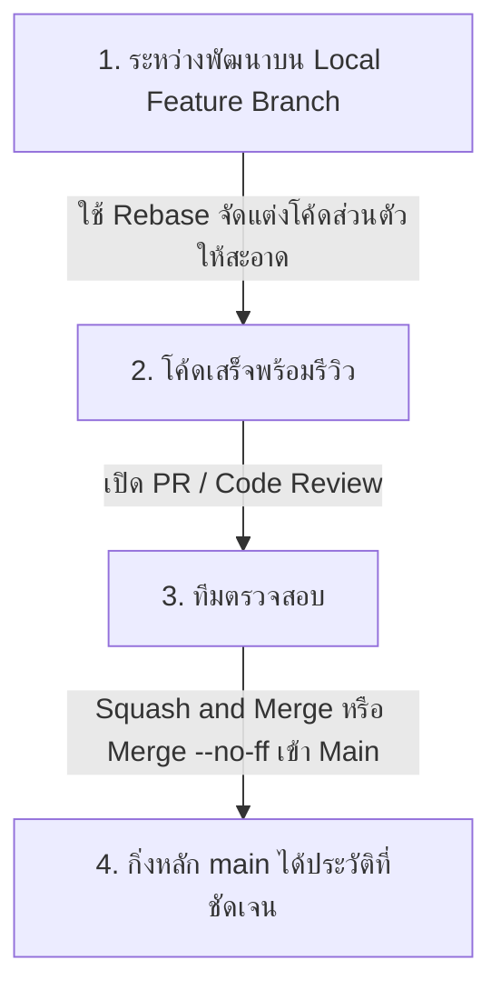

# Merge vs Rebase: การเปรียบเทียบเชิงลึก

หนึ่งในการถกเถียงที่ยาวนานที่สุดในชุมชนวิศวกรรมซอฟต์แวร์คือ **"ควรใช้ Merge หรือ Rebase ดีกว่ากัน?"** ทั้งสองคำสั่งมีจุดประสงค์เดียวกันคือการรวมโค้ด แต่มีปรัชญาและผลกระทบต่อประวัติศาสตร์ของโปรเจกต์ที่ต่างกันอย่างสิ้นเชิง

---

## 1. ตารางเปรียบเทียบคุณลักษณะ

| มิติ | Git Merge | Git Rebase |
| :--- | :--- | :--- |
| **Commit Graph** | ไม่เป็นเส้นตรง (Non-linear) มีทางแยกและทางบรรจบ | เรียบตรงเป็นเส้นเดียว (Linear History) |
| **Commit Hashes** | คงเดิมทุกตัวอักษร + เพิ่ม Merge Commit ใหม่ 1 ตัว | Commit บน Feature Branch ถูกเขียนใหม่ (New Hashes) |
| **ความบริสุทธิ์ของประวัติ** | บันทึกความจริงตามกาลเวลาที่เกิดขึ้นจริง 100% | ประวัติศาสตร์ถูกจัดแต่งใหม่เพื่อให้อ่านง่าย |
| **การแก้ Conflict** | แก้เพียงครั้งเดียวตอนสร้าง Merge Commit | อาจต้องแก้หลายรอบ (แก้ทีละ Commit ที่กำลัง Replay) |
| **ความปลอดภัย** | ปลอดภัย ไม่มีความเสี่ยงเรื่องประวัติแตกแถว | อันตรายมากหากทำบน Public/Shared Branch |
| **การย้อนสถานะ (Revert)** | ย้อนทั้งฟีเจอร์ได้ง่ายผ่านการ revert merge commit ตัวเดียว | ต้องย้อนทีละ Commit หรือกู้ผ่าน reflog |

---

## 2. ทัศนะทางปรัชญา (Two Philosophical Views)

1. **ประวัติศาสตร์คือบันทึกความจริง (History as Historical Record):**
   - กลุ่มนี้เชื่อว่า Git Log ควรบันทึกทุกสิ่งที่เกิดขึ้นจริง ไม่ว่าโค้ดจะสะเปะสะปะ มีการลองผิดลองถูก หรือมีทางแยกอย่างไร
   - **เครื่องมือที่ชอบ:** `git merge --no-ff`
2. **ประวัติศาสตร์คือเรื่องเล่าที่ขัดเกลาแล้ว (History as a Story):**
   - กลุ่มนี้เชื่อว่า Git Log คือเอกสารคู่มือของโปรเจกต์ ควรสะอาด อ่านง่าย กระชับ และเป็นเส้นตรง เพื่อให้คนรุ่นหลังหรือ `git bisect` ตรวจสอบหาบั๊กได้ง่าย
   - **เครื่องมือที่ชอบ:** `git rebase -i` และ Fast-Forward Merge

---

## 3. Best Practice Workflow ที่แนะนำสำหรับทีมสมัยใหม่

สูตรสำเร็จที่ทีมวิศวกรรมส่วนใหญ่ใช้งานจริง:

- **กฎข้อ 1:** ใช้ `rebase` สำหรับการซิงค์โค้ดจาก `main` เข้ามายัง Local Feature Branch ของเรา เพื่อให้โค้ดของเราสดใหม่อยู่เสมอบนฐานล่าสุด
- **กฎข้อ 2:** ใช้ `merge` หรือ `Squash and Merge` บน GitHub ตอนที่นำโค้ดจาก PR รวมเข้ากิ่ง `main` ถาวร

---

## 🔗 โน้ตที่เกี่ยวข้อง
- [[Git-Merge]] — รายละเอียดกลไก Merge
- [[Git-Rebase]] — รายละเอียดกลไก Rebase
- [[GitHub-Merge-Strategies]] — กลยุทธ์การ Merge บน GitHub (Squash vs Rebase)\n