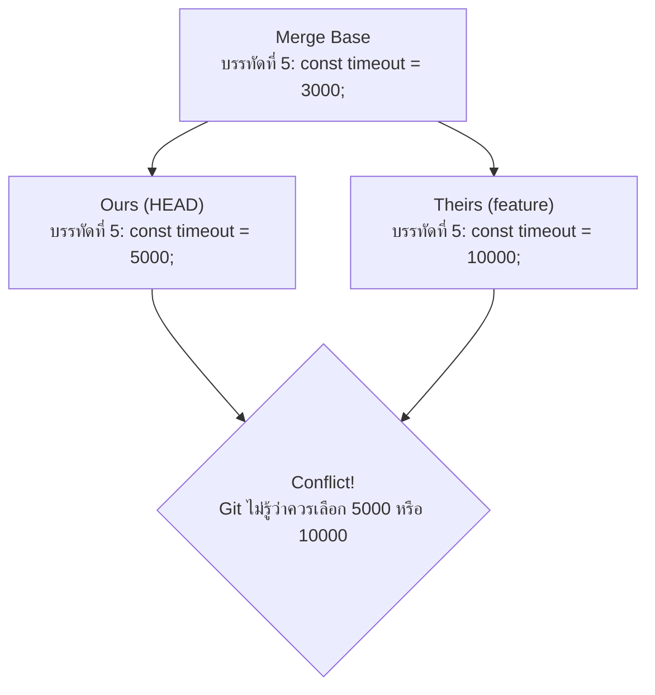

# Merge Conflict

**Merge Conflict (ข้อขัดแย้งในการผสานโค้ด)** เป็นเหตุการณ์ปกติในกระบวนการพัฒนาซอฟต์แวร์ เกิดขึ้นเมื่อ Git ไม่สามารถตัดสินใจได้โดยอัตโนมัติว่าควรเก็บโค้ดชุดใดไว้ เมื่อมีการเปลี่ยนแปลงที่ขัดแย้งกันในไฟล์เดียวกันและบรรทัดเดียวกัน

---

## 1. ข้อขัดแย้งเกิดขึ้นได้อย่างไร? (The Anatomy of a Conflict)

ในการทำ Three-Way Merge Git จะนำ **3 จุด** มาเปรียบเทียบกันเสมอ:
1. **Merge Base:** จุดบรรพบุรุษร่วมกันก่อนที่ทั้งสองกิ่งจะแยกจากกัน
2. **Current Branch (Ours / HEAD):** กิ่งที่เรากำลังยืนอยู่
3. **Incoming Branch (Theirs):** กิ่งที่เรากำลังจะดึงเข้ามาผสาน



- **กรณีที่ไม่เกิด Conflict:** หากฝั่ง Ours แก้ไขบรรทัดที่ 5 แต่ฝั่ง Theirs ไม่ได้แก้บรรทัดที่ 5 (ยังเหมือน Base) Git จะเลือกเวอร์ชันของ Ours ให้อัตโนมัติอย่างราบรื่น
- **กรณีที่เกิด Conflict:** เมื่อ **ทั้งสองฝั่งทำการแก้ไขบรรทัดเดียวกัน (หรือบริเวณเดียวกัน) ให้มีค่าต่างจาก Base ทั้งคู่** Git จะยอมแพ้และส่งมอบการตัดสินใจให้มนุษย์เป็นผู้ชี้ขาด

---

## 2. การถอดรหัส Conflict Markers

เมื่อเกิด Conflict Git จะแทรกสัญลักษณ์พิเศษลงในเนื้อหาของไฟล์นั้นโดยตรง:

```text
<<<<<<< HEAD
const API_URL = "https://api.production.example.com";
=======
const API_URL = "https://api.v2.staging.example.com";
>>>>>>> feature/new-api-endpoint
```

สัญลักษณ์ทั้ง 3 ตัวมีความหมายดังนี้:
1. `<<<<<<< HEAD` (Start Marker): จุดเริ่มต้นของโค้ดที่มีอยู่ในกิ่งปัจจุบันของเรา (Ours)
2. `=======` (Separator Marker): เส้นแบ่งคั่นระหว่างโค้ดสองฝั่ง
3. `>>>>>>> feature/new-api-endpoint` (End Marker): จุดสิ้นสุดของโค้ดที่มาจากกิ่งปลายทางที่เราดึงเข้ามา (Theirs)

---

## 3. ตัวอย่างการแก้ปัญหาแบบ Step-by-Step

### ขั้นที่ 1: ตรวจสอบรายชื่อไฟล์ที่ชนกัน
```bash
git status
```
Git จะแจ้งสถานะ `both modified: src/config.js` ภายใต้หัวข้อ `Unmerged paths`

### ขั้นที่ 2: เปิดไฟล์และตัดสินใจเลือกเนื้อหา
เปิดไฟล์ `src/config.js` ในเอดิเตอร์ คุณมี 3 ทางเลือก:
- **เลือกเอาของ Ours:** ลบฝั่ง Theirs และลบ Markers ทิ้งทั้งหมด
- **เลือกเอาของ Theirs:** ลบฝั่ง Ours และลบ Markers ทิ้งทั้งหมด
- **รวมจุดเด่นของทั้งสองฝั่ง (Synthesize):** เขียนโค้ดขึ้นมาใหม่ที่ตอบโจทย์ทั้งคู่

**ตัวอย่างเนื้อหาไฟล์หลังแก้เสร็จ (ต้องไม่มี Marker หลงเหลืออยู่เด็ดขาด):**
```javascript
const API_URL = process.env.NODE_ENV === 'production' 
    ? "https://api.production.example.com" 
    : "https://api.v2.staging.example.com";
```

### ขั้นที่ 3: ทดสอบโค้ด
รัน Unit Tests หรือเปิดระบบเพื่อยืนยันว่าการรวมโค้ดไม่ได้ทำลายระบบ:
```bash
npm test
```

### ขั้นที่ 4: มาร์กไฟล์ว่าแก้เสร็จแล้วและเดินหน้าต่อ
```bash
# บอก Git ว่าไฟล์นี้แก้เสร็จแล้วโดยการสั่ง add
git add src/config.js

# ทำการ Commit จบขั้นตอนการ Merge
git merge --continue
# หรือ git commit
```

---

## 🔗 โน้ตที่เกี่ยวข้อง
- [[Conflict-Resolution-Workflow]] — เวิร์กโฟลว์การบริหารข้อขัดแย้งในระดับทีม
- [[Git-Merge]] — ทฤษฎี Three-way merge
- [[Git-Rebase]] — การแก้ Conflict ระหว่าง Rebase\n