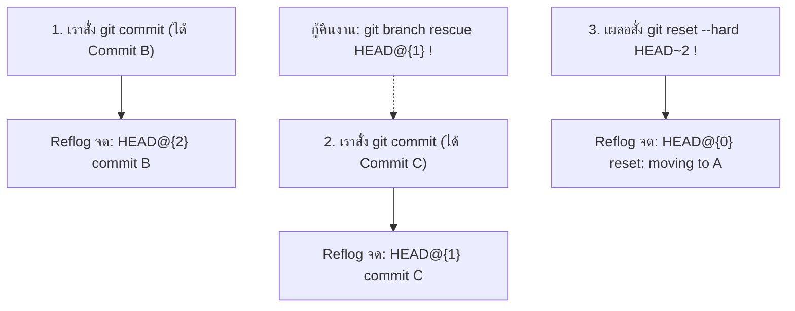

# Git Reflog

**`git reflog` (Reference Logs)** คือ "กล่องดำบันทึกการบิน (Flight Data Recorder)" หรือตาข่ายนิรภัยของ Git ที่คอยจดบันทึก **ทุกการเคลื่อนไหวของตัวชี้ `HEAD` และ Branch Reference** ในเครื่อง Local ของคุณ ไม่ว่าจะเป็นการ Commit, Checkout, Reset, Rebase, หรือ Merge

---

## 1. คำสั่งนี้ทำงานอย่างไร?

ในขณะที่ `git log` แสดงเฉพาะ Commit ที่ยังคงผูกโยงอยู่กับสายประวัติศาสตร์ปัจจุบัน แต่ `git reflog` จะแสดง **ทุกลำดับการก้าวเดิน** แม้ว่า Commit นั้นจะถูกตัดขาด (Orphaned) หรือหลุดหายไปจากการสั่ง `git reset --hard` ก็ตาม!



> [!important] ขอบเขตของ Reflog
> Reflog ถูกบันทึกไว้ในเครื่อง Local ของคุณเท่านั้น (โฟลเดอร์ `.git/logs/`) จะไม่ถูกส่งข้ามเครือข่ายเมื่อคุณสั่ง `push` และข้อมูลมีอายุประมาณ 30-90 วันก่อนจะถูก Git Garbage Collection ล้างทิ้ง

---

## 2. ขั้นตอนการกู้ชีพงานที่หายไป (Disaster Recovery Workflow)

### สถานการณ์จำลอง:
เผลอรันคำสั่งมรณะ `git reset --hard HEAD~3` ทำให้ Commit สำคัญ 3 ตัวและงานที่ทำมาทั้งวันหายวับไปกับตา!

### ขั้นตอนการกู้คืน:
```bash
# ขั้นที่ 1: เปิดดูกล่องดำ Reflog
git reflog
```

**ตัวอย่างหน้าจอที่พบ:**
```text
9f2b1a0 (HEAD -> main) HEAD@{0}: reset: moving to HEAD~3
e41c8d2 HEAD@{1}: commit: feat(checkout): complete payment gateway
b82a71e HEAD@{2}: commit: feat(cart): add voucher calculation
c123456 HEAD@{3}: commit: fix: database migration script
```

### ขั้นที่ 2: สร้าง Branch ใหม่ไปคว้ารหัส Commit ก่อนเกิดเหตุ
จากบันทึก เราเห็นว่าก่อนที่จะเกิดการ Reset ตำแหน่งที่ถูกต้องคือ `HEAD@{1}` (หรือ hash `e41c8d2`):
```bash
# กู้คืนทั้งกิ่งกลับมาด้วยการสร้าง Branch ชี้ไปที่ Hash นั้น
git branch my-rescued-branch e41c8d2

# หรือขยับ main กลับมารับด้วย hard reset ไปยังจุดปลอดภัยนั้น
git reset --hard HEAD@{1}
```
**ผลลัพธ์:** งานทั้งหมดที่คิดว่าหายไปจะกลับคืนมาครบถ้วนสมบูรณ์ 100%!

---

## 🔗 โน้ตที่เกี่ยวข้อง
- [[Git-Reset]] — คำสั่ง Reset
- [[Detached-HEAD]] — การกู้คืน Commit จาก Detached HEAD
- [[Undo-Command-Comparison]] — สรุปตารางเปรียบเทียบคำสั่ง\n