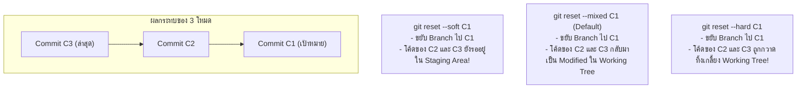

# Git Reset

**`git reset`** เป็นหนึ่งในคำสั่งที่ทรงพลังที่สุดใน Git ใช้สำหรับ **ขยับถอยหลังตัวชี้ของ Branch ไปยัง Commit ในอดีต** พร้อมทั้งควบคุมสถานะของ Staging Area และ Working Tree ได้ตามต้องการ

---

## 1. สามโหมดวิกฤตของ Git Reset: Soft vs Mixed vs Hard

พฤติกรรมของ `git reset <commit>` ขึ้นอยู่กับธง (Flag) 3 ตัวนี้เป็นหลัก:

| โหมด | ย้าย Branch Pointer | อัปเดต Staging Area | แตะต้อง Working Tree | ระดับความเสี่ยง |
| :--- | :---: | :---: | :---: | :---: |
| **`--soft`** | ✅ ขยับถอยหลัง | ❌ คงเดิม (เป็น Staged) | ❌ ไม่แตะ (โค้ดอยู่ครบ) | 🟢 ปลอดภัยมาก |
| **`--mixed`** (Default) | ✅ ขยับถอยหลัง | ✅ ล้างของออก (เป็น Unstaged) | ❌ ไม่แตะ (โค้ดอยู่ครบ) | 🟡 ปลอดภัย |
| **`--hard`** | ✅ ขยับถอยหลัง | ✅ ล้างของออก | ✅ **ลบทิ้งทับด้วย Commit เก่า!** | 🔴 **อันตรายสูงสุด!** |



---

## 2. การประยุกต์ใช้งานในสถานการณ์จริง

### 2.1 ใช้ `--soft` เพื่อรวมหลาย Commit เข้าด้วยกัน (Squash Locally)
หากคุณ Commit ยิบย่อยไว้ 3 ครั้ง และอยากรวบยอดเป็น Commit สะอาดๆ เพียงอันเดียวก่อน Push:
```bash
# ถอยหลัง 3 Commit โดยโค้ดยังคงอยู่ใน Staging Area
git reset --soft HEAD~3
git commit -m "feat(auth): complete OAuth login implementation"
```

### 2.2 ใช้ `--mixed` เพื่อยกเลิก Commit และแบ่งจัดไฟล์ใหม่
หากเผลอ Commit รวมไฟล์ที่ไม่ควรอยู่ด้วยกัน:
```bash
git reset HEAD~1
# ไฟล์ทั้งหมดจะกลับมาเป็น Unstaged ใน Working Tree จากนั้นค่อยทยอย git add ทีละชุด
```

### 2.3 ใช้ `--hard` เพื่อทิ้งความล้มเหลว
เมื่อเขียนโค้ดทดลองแล้วพังยับเยิน และต้องการให้ทุกอย่างกลับสู่สถานะของ Commit ล่าสุดแบบเกลี้ยงสะอาด:
```bash
git reset --hard HEAD
```

---

## 3. คำเตือนระดับวิกฤต: อันตรายของ Reset และ Force Push

> [!caution] กฎความปลอดภัย
> 1. **ห้ามใช้ `git reset --hard` หากมีงานที่ยังไม่ได้ Commit ค้างอยู่ใน Working Tree** เพราะการเปลี่ยนแปลงเหล่านั้นจะสูญหายอย่างถาวรและไม่สามารถกู้ผ่าน Reflog ได้!
> 2. **ห้าม reset ถอยหลังแล้วทำ `git push --force` บน Shared/Public Branch (เช่น `main`)** เพราะจะทำลายประวัติการทำงานของสมาชิกทุกคนในทีม หากจำเป็นต้องย้อนโค้ดที่ Push ไปแล้ว ให้ใช้ [[Git-Revert]] แทนเสมอ

---

## 🔗 โน้ตที่เกี่ยวข้อง
- [[Git-Restore]] — การคืนค่าไฟล์เฉพาะจุด
- [[Git-Revert]] — การย้อนประวัติศาสตร์อย่างปลอดภัย
- [[Git-Reflog]] — การกู้คืน Commit ที่หลุดหายจากการ Reset
- [[Undo-Command-Comparison]] — ตารางสรุปภาพรวม\n