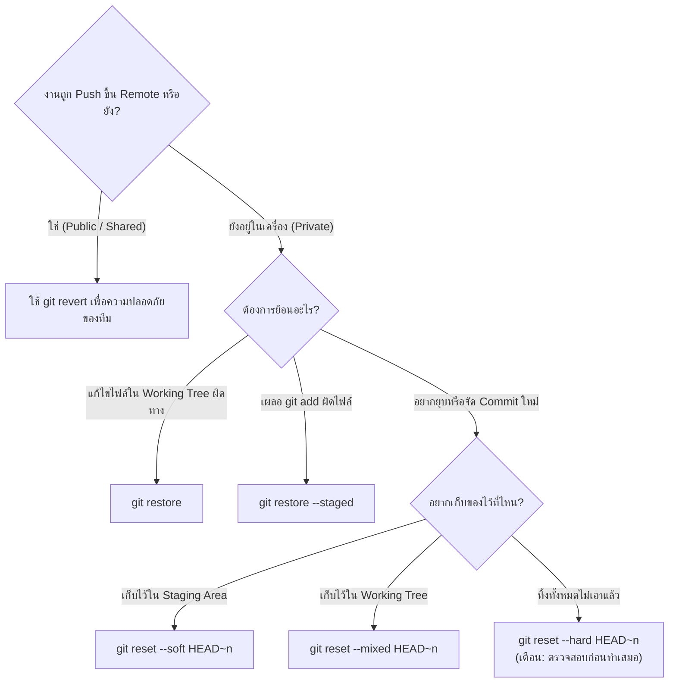

# Undo Command Comparison: คู่มือเลือกคำสั่งย้อนการทำงาน

ตารางสรุปเปรียบเทียบคำสั่งในตระกูล **Undo, Reset, และ Recovery** เพื่อให้นักพัฒนาสามารถเลือกเครื่องมือที่ถูกต้องตามระดับความเสี่ยงและเป้าหมายที่ต้องการ

---

## 1. ตารางเปรียบเทียบผลกระทบต่อ 3 พื้นที่ทำงาน

| คำสั่ง | ผลต่อ Working Tree | ผลต่อ Staging Area (Index) | ผลต่อ Commit History (DAG) | สภาพแวดล้อมที่เหมาะสม |
| :--- | :--- | :--- | :--- | :--- |
| `git restore <file>` | **ทิ้งการแก้ทับด้วย Index** | ไม่เปลี่ยน | ไม่เปลี่ยน | Local (ไฟล์ยังไม่ Staged) |
| `git restore --staged <file>` | ไม่เปลี่ยน | **เอาออกจาก Staged** | ไม่เปลี่ยน | Local (Unstaging) |
| `git reset --soft <commit>` | ไม่เปลี่ยน | **ไม่เปลี่ยน (คงเป็น Staged)** | **ขยับ Branch ถอยหลัง** | Local (รวม Commit ก่อน Push) |
| `git reset --mixed <commit>` | ไม่เปลี่ยน | **ล้างของออก (เป็น Unstaged)** | **ขยับ Branch ถอยหลัง** | Local (แกะ Commit มาจัดใหม่) |
| `git reset --hard <commit>` | **ล้างทิ้งทับด้วย Commit เก่า** | **ล้างทิ้งทับด้วย Commit เก่า** | **ขยับ Branch ถอยหลัง** | Local (ทิ้งการทดลองที่พัง) |
| `git revert <commit>` | **เปลี่ยนตาม Inverted Patch** | **นำเข้า Staged และบันทึก** | **สร้าง Commit ใหม่ก้าวไปข้างหน้า** | **Public / Shared Branches** |
| `git reflog` | ไม่เปลี่ยน (Read-only) | ไม่เปลี่ยน (Read-only) | ไม่เปลี่ยน (เปิดทางให้กู้คืน) | Emergency Recovery |

---

## 2. Decision Tree: เลือกใช้คำสั่งไหนดี?

---

## 🔗 โน้ตที่เกี่ยวข้อง
- [[Git-Restore]] — คืนค่าระดับไฟล์
- [[Git-Reset]] — ถอยหลังประวัติ
- [[Git-Revert]] — ยกเลิกด้วยการเดินหน้า
- [[Git-Reflog]] — กู้ชีพประวัติศาสตร์\n