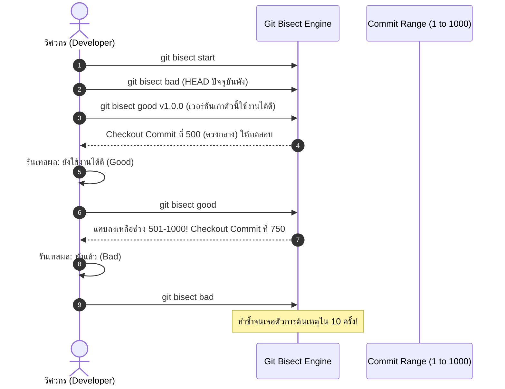

# Git Bisect

**`git bisect`** คือเครื่องมือทรงพลังขั้นเทพสำหรับ Debugging ที่ใช้ **อัลกอริทึมการค้นหาแบบทวิภาค (Binary Search)** เพื่อหาว่า **Commit ใดในประวัติศาสตร์ที่เป็นจุดเริ่มต้นทำให้เกิด Regression Bug** จาก Commit นับร้อยหรือนับพันตัวได้อย่างรวดเร็ว

---

## 1. หลักการทำงาน: พลังของ Binary Search ($O(\log n)$)

หากโปรเจกต์ของคุณมี Commit ห่างกัน 1,000 Commits การไล่ตรวจทีละ Commit จะต้องทดสอบถึง 1,000 ครั้ง! แต่ด้วย `git bisect`:
$$\lceil \log_2(1000) \rceil \approx 10 \text{ ขั้นตอนเท่านั้น!}$$



---

## 2. ขั้นตอนการใช้งานจริงทีละสเต็ป (Manual Bisect)

```bash
# 1. เริ่มต้นเข้าสู่โหมด Bisect
git bisect start

# 2. ระบุว่า Commit ปัจจุบันมีบั๊ก (Bad)
git bisect bad

# 3. ระบุ Commit ในอดีตที่เรารู้แน่ชัดว่ายังปกติดี (Good)
git bisect good v2.1.0

# 4. Git จะพาเรากระโดดไป Commit กึ่งกลางอัตโนมัติ ให้ทำการทดสอบระบบ
npm test
# หากเทสผ่าน: พิมพ์ git bisect good
# หากเทสพัง: พิมพ์ git bisect bad

# 5. เมื่อ Git หา Commit ต้นเหตุพบ จะแสดงผลแจ้ง Hash และรายละเอียดทั้งหมด
# 6. ออกจากโหมด Bisect และพากลับสู่กิ่งเดิม
git bisect reset
```

---

## 3. ขั้นสุดยอด: รัน Bisect อัตโนมัติ 100% ด้วย Script (`git bisect run`)

หากคุณมีสคริปต์ Unit Test หรือคำสั่งที่ส่งค่า Exit Code (`0` = ผ่าน/Good, ค่าอื่น = พัง/Bad) คุณสามารถปล่อยให้ Git ทำงานเองได้แบบอัตโนมัติโดยไม่ต้องคอยนั่งกดทีละรอบ:

```bash
git bisect start HEAD v2.1.0
git bisect run npm test
```
Git จะวนรัน Binary Search, Checkout แต่ละจุด, รัน `npm test`, และสรุปผล Commit ที่ทำให้เกิดบั๊กตัวแรกออกมาให้ทันทีภายในไม่กี่วินาที!

---

## 🔗 โน้ตที่เกี่ยวข้อง
- [[Git-Log]] — การสืบค้นประวัติ
- [[Git-Show-and-Blame]] — การตรวจสอบรายละเอียดของ Commit\n