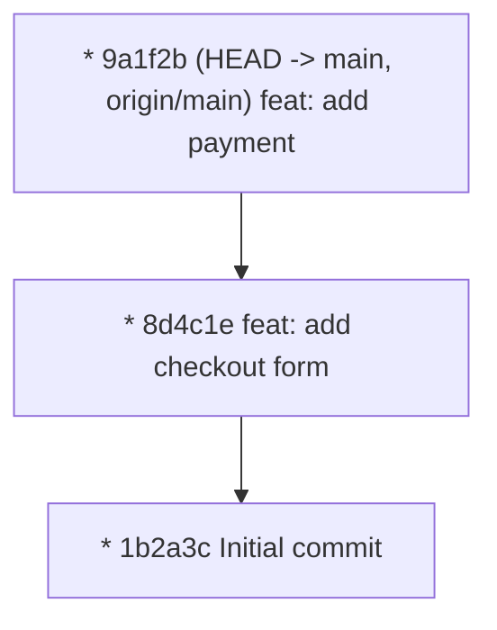

# Git Log

**`git log`** คือคำสั่งหลักในการสำรวจ ไต่สวน และแสดงผลเส้นทางประวัติศาสตร์ (Commit Graph DAG) ของโปรเจกต์ Git

---

## 1. คำสั่งพื้นฐานและตัวเลือกการแสดงผลยอดนิยม

### 1.1 แสดงประวัติแบบกระชับ (Oneline) พร้อมแผนภาพกิ่ง (Graph)
คำสั่งยอดฮิตที่วิศวกรซอฟต์แวร์ทุกคนต้องเซฟเป็น Alias:
```bash
git log --oneline --graph --decorate --all -n 20
```
- `--oneline`: บีบให้ Commit 1 ตัวแสดงผลใน 1 บรรทัด (แสดง Short Hash + Title)
- `--graph`: วาดเส้นกิ่งก้านสาขาของประวัติศาสตร์ด้วยตัวอักษร ASCII
- `--decorate`: แสดงป้ายกำกับชื่อ Branch, HEAD, และ Tags ที่ชี้อยู่
- `--all`: แสดงประวัติของทุก Branch ไม่ใช่เฉพาะ Branch ที่เรายืนอยู่
- `-n 20`: แสดงเฉพาะ 20 รายการล่าสุด



---

## 2. การค้นหาและกรองประวัติขั้นสูง (Filtering Logs)

### 2.1 กรองตามชื่อผู้เขียน (Author)
```bash
git log --author="John"
```

### 2.2 กรองตามช่วงเวลา (Time-based)
```bash
git log --since="2 weeks ago" --until="yesterday"
```

### 2.3 กรองตามเนื้อหา Commit Message (Grep)
```bash
git log --grep="CVE-" --grep="security"
```

### 2.4 Pickaxe Search (`-S`): ค้นหาว่าใครเป็นคนพิมพ์โค้ดคำนี้เป็นคนแรก!
ค้นหา Commit ที่มีการ **เพิ่มหรือลบสตริงคำที่กำหนด** ในเนื้อไฟล์:
```bash
git log -S "PAYMENT_API_SECRET_KEY" -p
```
คำสั่งนี้จะสแกนประวัติทั้งโปรเจกต์ และพิมพ์ Commit ที่มีโค้ดคำนี้ปรากฏหรือหายไป พร้อมแสดงผลต่าง Diff ทันที

---

## 🔗 โน้ตที่เกี่ยวข้อง
- [[Git-Show-and-Blame]] — การตรวจดูรายละเอียดของ Commit
- [[Git-Bisect]] — การใช้ Binary Search หา Commit ต้นตอบั๊ก\n