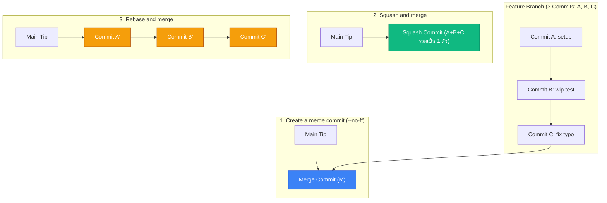

# GitHub Merge Strategies: 3 รูปแบบการผสาน PR

เมื่อ Pull Request ได้รับการอนุมัติและพร้อมรวมเข้าสู่กิ่งหลัก GitHub จะมีปุ่มเขียวขนาดใหญ่ให้เลือก 3 กลยุทธ์การ Merge แต่ละตัวเลือกจะส่งผลต่อหน้าตาของ Git Graph บนกิ่ง `main` ต่างกันอย่างสิ้นเชิง

---

## 1. เปรียบเทียบ 3 ตัวเลือก

| กลยุทธ์ | พฤติกรรมของ Commit บนกิ่ง `main` | จุดเด่น | จุดด้อย | เมื่อใดควรใช้ |
| :--- | :--- | :--- | :--- | :--- |
| **1. Create a merge commit** | เก็บ Commit เดิมทั้งหมด + สร้าง Merge Commit ใหม่ 1 ตัว | เห็นประวัติการแตกกิ่งชัดเจน สามารถย้อน (Revert) ทั้งกิ่งได้ในทีเดียว | กิ่งก้านสาขารกเป็นใยแมงมุม (Non-linear) กราฟอ่านยาก | โปรเจกต์ขนาดใหญ่ที่ต้องการหลักฐานประวัติศาสตร์สมบูรณ์ |
| **2. Squash and merge** | รวม Commit ย่อยทั้งหมดเข้าเป็น **Commit ใหม่ 1 ตัวเพียงตัวเดียว** | ประวัติบน `main` สะอาดมาก ทุก 1 Commit แทน 1 ฟีเจอร์ที่สมบูรณ์ | สูญเสียประวัติการแก้ไขยิบย่อยภายในกิ่งฟีเจอร์ | **แนะนำมากที่สุดสำหรับทีมส่วนใหญ่** ที่ทำ Feature Branch |
| **3. Rebase and merge** | นำ Commit แต่ละตัวไปต่อท้าย `main` เรียงเป็นเส้นตรง (Hash เปลี่ยน) | ประวัติเป็นเส้นตรง และยังเห็น Commit ย่อยแต่ละตัว | หาก Commit ย่อยในฟีเจอร์มี Commit ขยะ (เช่น "wip", "fix typo") ขยะจะขึ้นไปรกบน `main` | ทีมที่ทุกคนขัดเกลา Commit ให้สะอาดด้วย Interactive Rebase แล้ว |

---

## 2. นโยบายที่องค์กรชั้นนำเลือกใช้

ส่วนใหญ่องค์กรสมัยใหม่มักตั้งค่าใน Repository Settings:
- **เปิดใช้เฉพาะ:** `Allow Squash merging`
- **ปิด:** `Allow Rebase merging` และ `Allow Merge commits`
เพื่อให้กิ่ง `main` มีลักษณะประวัติแบบ **1 PR = 1 Atomic Commit** เสมอ ทำให้ง่ายต่อการ Release, Rollback และการสืบค้นย้อนหลัง

---

## 🔗 โน้ตที่เกี่ยวข้อง
- [[Pull-Request-Workflow]] — กระบวนการ PR
- [[Git-Merge]] — ทฤษฎี Merge
- [[Git-Rebase]] — ทฤษฎี Rebase\n