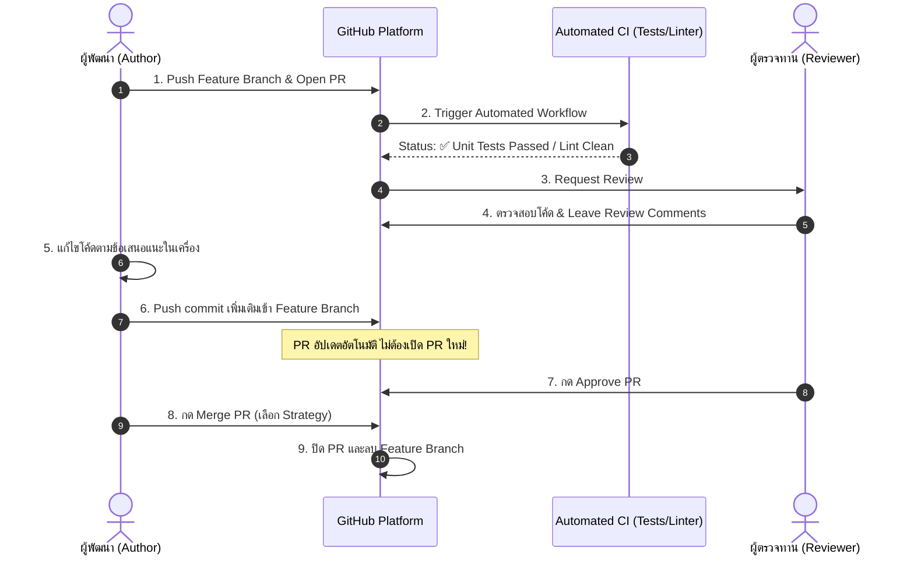

# Pull Request Workflow

**Pull Request (PR)** หรือใน GitLab เรียกว่า **Merge Request (MR)** คือกลไกการทำงานร่วมกันบนแพลตฟอร์มอย่าง GitHub ซึ่งทำหน้าที่เป็นเวทีในการส่งมอบโค้ด ตรวจทานคุณภาพ (Code Review) และทดสอบความเข้ากันได้ผ่านระบบอัตโนมัติ (CI/CD) ก่อนที่โค้ดจะถูกรวมเข้าสู่สายงานหลักของทีม

---

## 1. จุดตัดที่สำคัญ: PR ไม่ใช่ Git Merge Strategy!

> [!important] ความเข้าใจที่ถูกต้องเกี่ยวกับ PR
> - **Git CLI ตัวแม่ไม่มีคำสั่ง `git pull-request`:** PR เป็นฟีเจอร์ระดับแพลตฟอร์ม (GitHub/GitLab) ที่สร้างขึ้นมาครอบ Git อีกชั้นหนึ่ง
> - **PR คือกระบวนการ (Process & Governance):** เป็นขั้นตอนการขออนุญาต ตรวจสอบ นิติกรรมสัญญา และสนทนาแลกเปลี่ยน
> - **Merge Strategy คือกลไกทางเทคนิค (Technical Execution):** เมื่อ PR ได้รับการอนุมัติ (Approved) แล้ว แพลตฟอร์มจะเปิดให้เราเลือกกลยุทธ์ทางเทคนิคของ Git ว่าจะรวมโค้ดเข้าไปด้วยวิธีใด (Create Merge Commit, Squash and Merge, หรือ Rebase and Merge — ดูรายละเอียดใน [[GitHub-Merge-Strategies]])

---

## 2. แผนภาพวงจรชีวิตของ Pull Request (PR Lifecycle)



---

## 3. ขั้นตอนการปฏิบัติงานระดับคำสั่ง

```bash
# 1. แตกกิ่งและเขียนฟีเจอร์
git switch -c feature/payment-gateway
# ... เขียนโค้ดและ commit ...

# 2. Push ขึ้นเซิร์ฟเวอร์
git push -u origin feature/payment-gateway

# 3. เปิดเว็บ GitHub ไปที่ Repository จะมีปุ่ม "Compare & pull request" เด้งขึ้นมา
# ให้เขียน Title และ Description ตาม PR Template

# 4. เมื่อ Reviewer ขอให้แก้โค้ด:
# ให้แก้ไขโค้ดบนเครื่องของคุณในกิ่งเดิม แล้ว Commit และ Push ซ้ำ
git add src/payment.js
git commit -m "refactor(payment): handle timeout exception per review feedback"
git push origin feature/payment-gateway
# ระบบ GitHub จะดึง Commit นี้เข้าไปแสดงใน PR เดิมทันที!
```

---

## 🔗 โน้ตที่เกี่ยวข้อง
- [[Code-Review]] — แนวทางปฏิบัติที่ดีในการรีวิวโค้ด
- [[GitHub-Merge-Strategies]] — เปรียบเทียบ 3 กลยุทธ์ในการกด Merge บน GitHub
- [[Branching-Strategy]] — การวางกิ่งก้านสาขาในระดับองค์กร\n