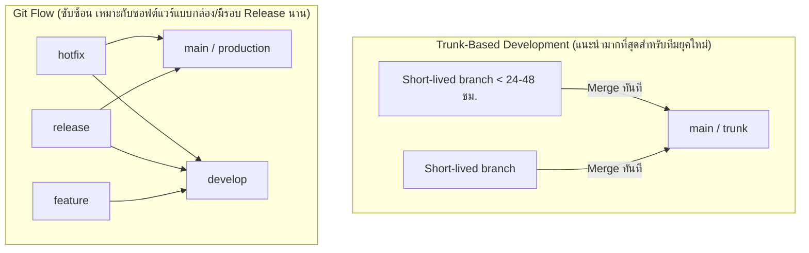

# Branching Strategy: กลยุทธ์การแตกกิ่งในระดับทีม

กลยุทธ์การแตกกิ่ง (Branching Strategy) กำหนดกฎระเบียบและเส้นทางการไหลของโค้ดตั้งแต่เครื่องของนักพัฒนาไปจนถึงเซิร์ฟเวอร์ Production

---

## 1. เปรียบเทียบ 3 กลยุทธ์ยอดนิยมในอุตสาหกรรม

### 1.1 Trunk-Based Development (TBD)
- **แนวคิด:** มีกิ่งหลักเพียงกิ่งเดียวคือ `main` (Trunk) ทุกคนแตกกิ่งฟีเจอร์ที่มีอายุสั้นมากๆ (ไม่เกิน 1-2 วัน) แล้วรวมกลับเข้ามายัง `main` อย่างสม่ำเสมอ
- **จุดเด่น:** ลดปัญหา Merge Hell ได้เกือบ 100%, รอบส่งมอบเร็วมาก, ผสานกับระบบ CI/CD ได้แนบแน่นที่สุด
- **สิ่งที่ต้องมี:** ชุด Automated Tests ที่ครอบคลุม และการใช้ Feature Flags สำหรับซ่อนฟีเจอร์ที่ยังทำไม่เสร็จ

### 1.2 GitHub Flow
- แตกกิ่งจาก `main` $\rightarrow$ Commit โค้ด $\rightarrow$ เปิด Pull Request $\rightarrow$ Review & Test $\rightarrow$ Merge เข้า `main` $\rightarrow$ Deploy สู่ Production ทันที

### 1.3 Git Flow
- เหมาะสำหรับระบบที่มีรอบการปล่อยเวอร์ชันตามรอบกำหนดชัดเจน (เช่น ซอฟต์แวร์บนมือถือ, Firmware) มีกิ่งแยกย่อยชัดเจนระหว่าง `develop`, `release`, `hotfix`, และ `main` แต่มีค่าใช้จ่ายในการบริหารสูงและซับซ้อน

---

## 2. กฎการตั้งชื่อกิ่งมาตรฐาน (Branch Naming Conventions)

รูปแบบแนะนำ: `<type>/<ticket-id>-<short-description>`

- `feature/PROJ-101-user-authentication`
- `fix/PROJ-204-cart-total-calculation`
- `refactor/PROJ-305-clean-database-queries`
- `chore/PROJ-401-upgrade-typescript-5`

---

## 🔗 โน้ตที่เกี่ยวข้อง
- [[Parallel-Development-Concept]] — พื้นฐานการพัฒนาคู่ขนาน
- [[Integration-and-Coordination]] — การลดความเสี่ยงในการประสานโค้ด
- [[Worktree-with-AI-Agents]] — การประยุกต์ใช้กิ่งกับ AI Agents\n