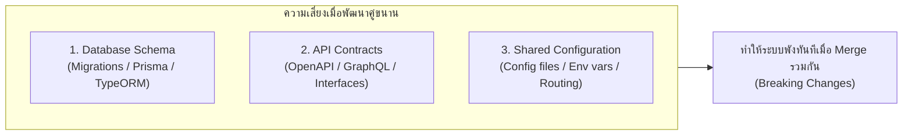
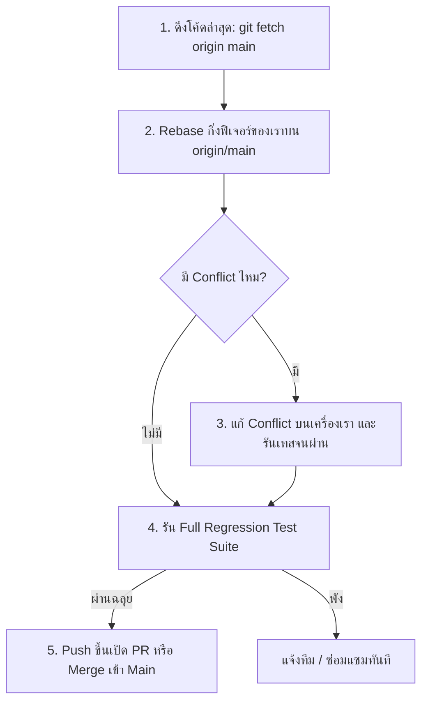

# Integration and Coordination: การบริหารจุดเชื่อมต่อระหว่างงาน

เมื่อหลายฝ่ายทำงานคู่ขนานกัน การสื่อสารและการวางข้อตกลงเรื่อง **Shared Contracts** มีความสำคัญยิ่งกว่าทักษะการพิมพ์คำสั่ง Git เสียอีก

---

## 1. 3 จุดเปราะบางที่มีความเสี่ยงสูงสุด (Top 3 Fragile Touchpoints)

### 1.1 การจัดการ Database Migrations ชนกัน
หาก Agent A สร้าง Migration `005_add_users.sql` และ Agent B สร้าง Migration `005_add_orders.sql` เมื่อรวมเข้า `main` ระบบ Migration Runner จะสับสนเพราะเลขเวอร์ชันซ้ำกัน
- **แนวทางแก้ไข:** กำหนดให้ใช้ Timestamp ในชื่อ Migration หรือให้ผู้รวมงาน (Integrator) เป็นผู้เรียงลำดับ Migration ใหม่ก่อน Merge

### 1.2 การออกแบบ API-First & Contract-First
- ก่อนที่ Developer/Agent จะเริ่มเขียนโค้ด ให้ตกลงโครงสร้าง Interface หรือ OpenAPI Spec กลางร่วมกันให้เสร็จสิ้นก่อน
- เมื่อ Contract ชัดเจน ฝั่ง Frontend สามารถเขียน Mock Data รอได้ทันทีโดยไม่ต้องรอให้ Backend เขียนเสร็จ

---

## 2. พิธีกรรมการผสานโค้ดอย่างปลอดภัย (Safe Integration Protocol)

> [!tip] กฎเหล็ก: ผู้ผลักโค้ดเป็นผู้รับผิดชอบการ Rebase
> ก่อนที่คุณจะกดส่งมอบงานเข้ากิ่ง `main` คุณต้องเป็นฝ่าย Rebase ดึงการเปลี่ยนแปลงของผู้อื่นที่ Merge เข้า `main` ไปก่อนหน้า มาผ่านการทดสอบในเครื่องของคุณให้เรียบร้อยก่อนเสมอ เพื่อป้องกันไม่ให้กิ่งหลักของทีมพัง

---

## 🔗 โน้ตที่เกี่ยวข้อง
- [[Parallel-Development-Concept]] — แนวคิดการพัฒนาคู่ขนาน
- [[Conflict-Resolution-Workflow]] — ขั้นตอนการแก้ Conflict
- [[Worktree-with-AI-Agents]] — การประยุกต์ใช้กับ AI Agents\n