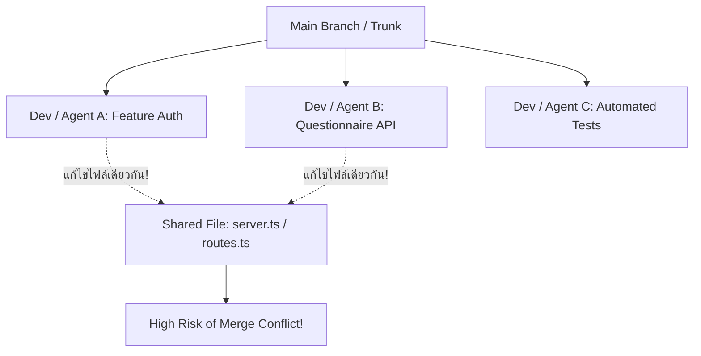

# Parallel Development Concept

**Parallel Development (การพัฒนาแบบคู่ขนาน)** คือแนวปฏิบัติทางวิศวกรรมซอฟต์แวร์ที่เปิดให้ผู้พัฒนาหลายคน (หรือหลาย AI Coding Agents) สามารถเขียนโค้ด พัฒนาฟีเจอร์ และแก้ไขระบบพร้อมๆ กันบนฐานโค้ดชุดเดียวกันได้อย่างมีประสิทธิภาพ โดยลดความเสี่ยงจากการชนกันของโค้ดให้น้อยที่สุด

---

## 1. ความท้าทายหลักของการทำงานแบบคู่ขนาน

เมื่อหลายคนแยกย้ายกันทำงานพร้อมกันบนกิ่งของตัวเอง ปัญหาที่มักเกิดขึ้นตามธรรมชาติคือ:
1. **Shared File Conflicts:** มีไฟล์ยอดนิยม (เช่น `routes.ts`, `schema.prisma`, `app.module.ts`) ที่ทุกคนต้องเข้าไปเพิ่มบรรทัดใหม่
2. **Interface & Contract Drift:** ฝั่ง Backend มีการเปลี่ยนชื่อฟิลด์หรือประเภทข้อมูลใน API โดยที่ฝั่ง Frontend ไม่ทราบล่วงหน้า
3. **Integration Shock:** แต่ละคนทำฟีเจอร์ของตนเองผ่านฉลุยในเครื่อง แต่พอนำมารวมกันใน `main` ตอนท้าย ระบบกลับคอมไพล์ไม่ผ่านหรือทำงานขัดแย้งกัน

---

## 2. หลักการแบ่งขอบเขตงาน (Task Boundary Definition)

เพื่อลดความเสี่ยงจากการทำงานคู่ขนาน ทีมวิศวกรต้องกำหนด **Task Boundaries** อย่างรัดกุม:

1. **สถาปัตยกรรมแบบ Modular:** ออกแบบโค้ดแยกตาม Domain / Feature Folder เช่น:
   - `modules/auth/` $\rightarrow$ จัดการเฉพาะ Developer A
   - `modules/questionnaire/` $\rightarrow$ จัดการเฉพาะ Developer B
2. **ห้ามแตะไฟล์นอกขอบเขต (Strict Ownership):** กำหนดขอบเขตให้ชัดเจนว่าฟีเจอร์นี้อนุญาตให้แตะไฟล์ใดได้บ้าง หากจำเป็นต้องแตะไฟล์ส่วนกลาง ให้คุยเพื่อทำข้อตกลงก่อน
3. **Short-lived Feature Branches:** กิ่งฟีเจอร์ควรมีอายุสั้นที่สุด (เช่น ไม่เกิน 1-2 วัน) ยิ่งเปิดกิ่งไว้นาน ความเสี่ยงที่ประวัติจะแยกห่างจาก `main` ยิ่งสูงขึ้นแบบทวีคูณ

---

## 🔗 โน้ตที่เกี่ยวข้อง
- [[Branching-Strategy]] — รูปแบบการจัดสายงานในทีม
- [[Integration-and-Coordination]] — การบริหารจุดเชื่อมต่อระหว่างงาน
- [[Worktree-with-AI-Agents]] — การประยุกต์ใช้กับ AI Coding Agents\n