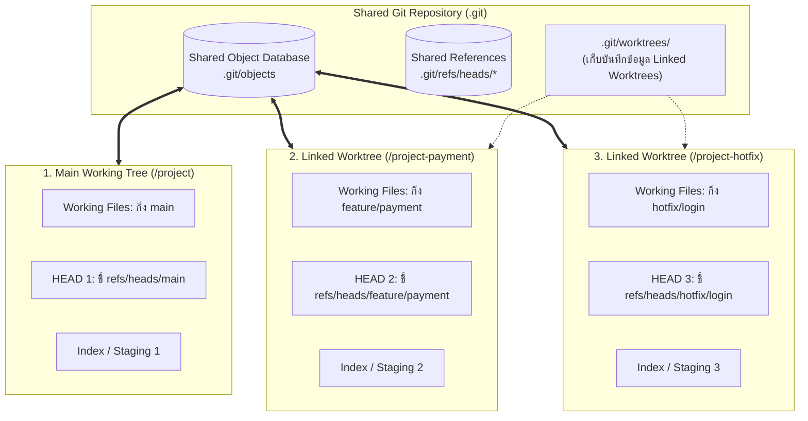

# Git Worktree Concept

**Git Worktree** คือฟีเจอร์ระดับสถาปัตยกรรมของ Git ที่อนุญาตให้นักพัฒนาสามารถ **เปิดโฟลเดอร์ทำงานจริง (Working Tree) ได้หลายโฟลเดอร์พร้อมๆ กัน โดยเชื่อมโยงกลับมายัง Git Repository (`.git`) และฐานข้อมูล Object เดียวกัน**

---

## 1. ปัญหาดั้งเดิมของการสลับกิ่ง (Context Switching Nightmare)

ใน Git แบบดั้งเดิม 1 Repository จะมี Working Directory เพียงโฟลเดอร์เดียว:
- หากคุณกำลังเขียนฟีเจอร์ใหญ่บนกิ่ง `feature/payment` และมีไฟล์แก้ค้างไว้มากมาย
- ทันใดนั้นมีแจ้งเตือน Production พังด่วน ต้องแก้ Hotfix บนกิ่ง `main` ทันที!
- **สิ่งที่คุณต้องทำในอดีต:**
  1. ต้องสั่ง `git stash` เพื่อเก็บงานที่ยังไม่เสร็จ
  2. สั่ง `git switch main`
  3. ติดตั้ง Dependencies ใหม่ หรือรอโปรเจกต์ Re-compile
  4. แก้งาน Hotfix และ Commit
  5. สลับกลับมา `git switch feature/payment`
  6. สั่ง `git stash pop` และลุ้นว่าจะเกิด Stash Conflict หรือไม่
กระบวนการนี้ทำให้เสียสมาธิ เปลืองเวลา และเสี่ยงต่อความผิดพลาดสูงมาก

---

## 2. สถาปัตยกรรมของ Git Worktree (Under the Hood)

Git Worktree เข้ามาแก้ปัญหานี้โดยอนุญาตให้คุณเปิดโฟลเดอร์ทำงานคู่ขนานได้ทันที:

### ความจริงเชิงสถาปัตยกรรมที่สำคัญยิ่ง:
1. **ใช้ Object Database ร่วมกัน (Shared Object Database):**
   - ทุก Worktree ใช้ `.git/objects` เดียวกัน ดังนั้น Commit ที่เกิดขึ้นใน Worktree หนึ่ง จะมองเห็นได้จากทุก Worktree ในเครื่องทันทีโดยไม่ต้องสั่ง Push หรือ Fetch เลย!
   - ไม่เปลืองพื้นที่ดิสก์ในการเก็บประวัติศาสตร์ซ้ำซ้อน
2. **แยก Working Directory, Index และ HEAD อิสระ:**
   - แต่ละ Worktree มีโฟลเดอร์กายภาพแยกต่างหากบนดิสก์
   - แต่ละ Worktree มี **`HEAD` เป็นของตนเอง** (ชี้คนละกิ่งกัน)
   - แต่ละ Worktree มี **Staging Area (`index`) เป็นของตนเอง**
3. **ข้อจำกัดของ Git:**
   - **ห้าม Checkout กิ่งเดียวกันในมากกว่า 1 Worktree พร้อมกันเด็ดขาด!** Git จะบล็อกคำสั่งนี้ทันที เพื่อป้องกันไม่ให้ Index และสถานะของไฟล์ชนกัน

---

## 🔗 โน้ตที่เกี่ยวข้อง
- [[Worktree-Commands]] — คู่มือคำสั่งจัดการ Worktree
- [[Worktree-vs-Clone]] — เปรียบเทียบ Worktree กับการ Clone แบบดั้งเดิม
- [[Worktree-with-AI-Agents]] — การจัดเวิร์กโฟลว์ให้ AI Agents ทำงานคู่ขนาน\n