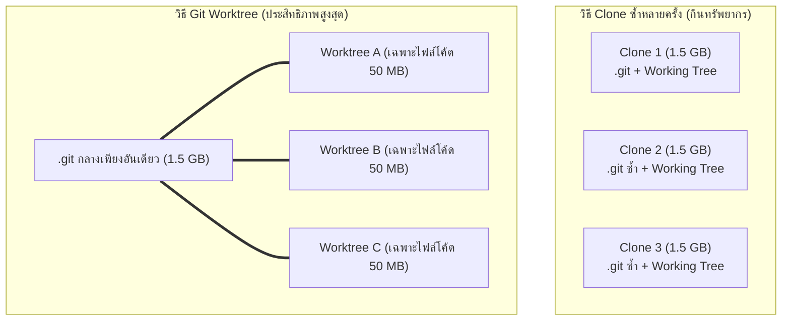

# Worktree vs Clone: เปรียบเทียบเชิงประสิทธิภาพและสถาปัตยกรรม

เมื่อต้องการทำงานหลายกิ่งพร้อมกันในเครื่องคอมพิวเตอร์ นักพัฒนาหลายคนมักใช้วิธี `git clone` โปรเจกต์ลงมาใหม่อีกโฟลเดอร์หนึ่ง แต่นั่นเป็นวิธีที่มีต้นทุนสูงกว่าการใช้ **Git Worktree** อย่างมหาศาล

---

## 1. ตารางเปรียบเทียบเชิงลึก

| คุณลักษณะ | Git Worktree | Multiple Git Clones |
| :--- | :--- | :--- |
| **พื้นที่ดิสก์ (Disk Space)** | **ประหยัดสูงสุด** — แชร์ Object Database (`.git`) ร่วมกัน ไม่กินพื้นที่ซ้ำซ้อน | **เปลืองดิสก์มหาศาล** — ประวัติศาสตร์และกิ่งทั้งหมดถูกดาวน์โหลดซ้ำ |
| **ความเร็วในการสร้าง** | **เสี้ยววินาที (< 1 วินาที)** — ดึงไฟล์จาก Local DB ทันที | ช้าตามขนาดโปรเจกต์และเน็ตเวิร์ก (หลายนาที) |
| **การมองเห็น Commit ข้ามกิ่ง** | **เห็นทันที 100%** — Commit ใน Worktree หนึ่ง กิ่งอื่นมองเห็น Hash ทันที | ไม่เห็นจนกว่าจะ Push ขึ้น Remote และสั่ง Pull ข้ามโฟลเดอร์ |
| **การจัดการคอนฟิก** | แชร์คอนฟิกและ Remote กลางร่วมกัน | ต้องตั้งค่า Local Config, SSH, และ Remotes ซ้ำใหม่ |
| **ความเข้ากันได้** | กิ่งเดียวกันเปิดซ้ำพร้อมกันไม่ได้ (Safety guard) | สามารถ Checkout กิ่งเดียวกันซ้ำได้ (แต่เสี่ยง Push ชนกันเอง) |

---

## 2. สรุปคำแนะนำในการเลือกใช้งาน

- **ใช้ Git Worktree เมื่อ:**
  - ต้องการทำงานแบบคู่ขนานหลายฟีเจอร์ในโปรเจกต์เดียวกัน
  - สลับไปแก้ Hotfix ด่วนโดยไม่อยากสลับกิ่ง
  - **สร้างสภาพแวดล้อมจำลอง (Sandbox) ให้ AI Coding Agents หลายตัวรันพร้อมกัน**
- **ใช้ Git Clone ใหม่เมื่อ:**
  - ต้องการทดสอบการติดตั้งแบบ Clean Slate ตั้งแต่ต้นจริงๆ ที่ไม่ยุ่งเกี่ยวกับคอนฟิกใดๆ
  - ต้องการสิทธิ์การเข้าถึงคนละ Account (เช่น บัญชีส่วนตัว vs บัญชีบริษัท)

---

## 🔗 โน้ตที่เกี่ยวข้อง
- [[Worktree-Concept]] — สถาปัตยกรรม Worktree
- [[Worktree-Commands]] — คำสั่งจัดการ Worktree
- [[Worktree-with-AI-Agents]] — ใช้งานร่วมกับ AI Agents\n