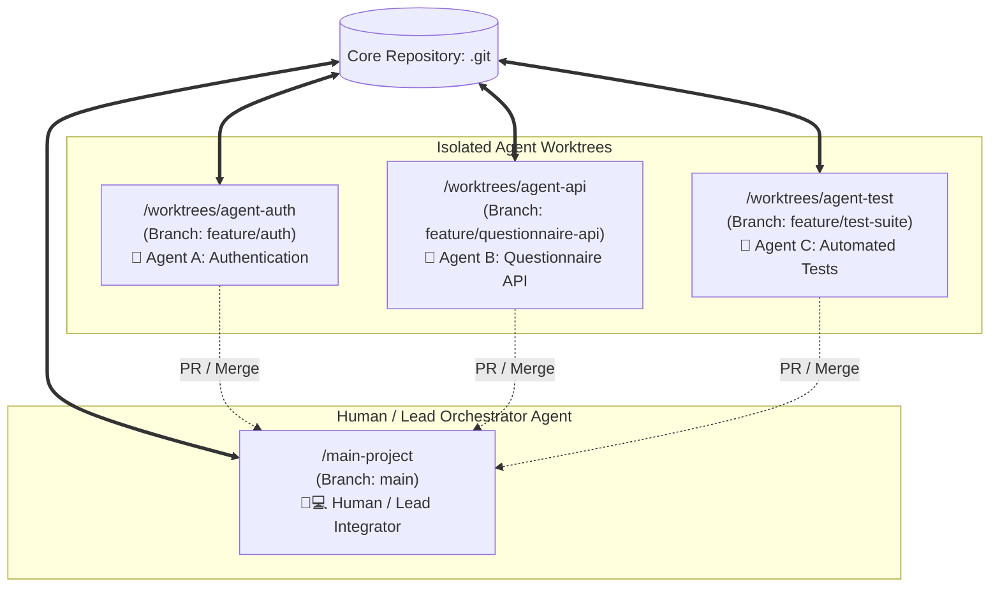

# Git Worktree with AI Coding Agents

ในยุคของ **Autonomous AI Coding Agents** (เช่น Antigravity, Claude Engineer, Codex, Aider) การให้ AI Agent ตัวเดียวเขียนโค้ดทั้งระบบอาจช้าและมีข้อจำกัดด้าน Context Window การทำงานแบบ **Multi-Agent Parallel Development** จึงกลายเป็นมาตรฐานใหม่ โดยมี **Git Worktree ทำหน้าที่เป็นกลไกการแยกสภาพแวดล้อม (Isolation Sandbox)** ที่สมบูรณ์แบบที่สุด

---

## 1. สถาปัตยกรรมระบบ Multi-Agent ผ่าน Git Worktree



---

## 2. ข้อได้เปรียบของการใช้ Worktree กับ AI Agents

1. **การแยกบริบทสมบูรณ์ (Zero File Contamination):** แต่ละ Agent ทำงานอยู่ในโฟลเดอร์ของตนเองอย่างเป็นอิสระ ไม่มีทางที่ Agent A จะเผลอแก้ไขไฟล์ที่ Agent B กำลังพิมพ์อยู่
2. **ประหยัด I/O และแคช:** คอมไพเลอร์, ลินเตอร์ หรือ Language Server ในแต่ละ Worktree สามารถรันพร้อมกันได้โดยไม่แย่งล็อกไฟล์
3. **การเข้าถึงฐานข้อมูล Commit ทันที:** เมื่อ Agent A ทำ Commit โค้ดเสร็จ Commit นั้นจะปรากฏในฐานข้อมูล `.git` กลางทันที ทำให้ Lead Integrator หรือ Agent ตัวอื่นสามารถ `cherry-pick` หรือ `merge` ได้ทันทีโดยไม่ต้องผ่านเน็ตเวิร์ก

---

## 3. ตัวอย่างสถานการณ์จำลอง: การสร้างระบบ Questionnaire Platform

### บทบาทหน้าที่ของแต่ละ Agent:
- **Lead Agent / Human:** วางโครงสร้างสถาปัตยกรรม, ออกแบบ Database Schema และสร้าง Worktree ให้ Agent แต่ละตัว
- **Agent A (Auth Module):** รับผิดชอบ `src/modules/auth/`, จัดการ JWT, OAuth และ Password Hashing
- **Agent B (Questionnaire API):** รับผิดชอบ `src/modules/questionnaire/`, จัดการแบบสอบถาม CRUD
- **Agent C (E2E Testing):** รับผิดชอบ `tests/e2e/`, เขียนชุดทดสอบ Playwright / Vitest

### คำสั่งจัดตั้งสภาพแวดล้อม:
```bash
# 1. ที่โฟลเดอร์หลัก วางข้อตกลงและ commit API spec
git switch main

# 2. แตก Worktree ให้ Agent A
git worktree add ../worktrees/agent-auth -b feature/auth

# 3. แตก Worktree ให้ Agent B
git worktree add ../worktrees/agent-api -b feature/questionnaire-api

# 4. แตก Worktree ให้ Agent C
git worktree add ../worktrees/agent-test -b feature/test-suite
```

---

## 4. การจัดการความเสี่ยงและแนวทางควบคุม (Risk Management)

| ความเสี่ยง | สาเหตุ | แนวทางแก้ไขและป้องกัน |
| :--- | :--- | :--- |
| **Shared File Collision** | Agent แก้ไขไฟล์คอนฟิกรวม เช่น `src/app.module.ts` พร้อมกัน | กำหนดกฎ (Rule Prompt) ห้าม Agent แก้ไขไฟล์นอก Directory ตัวเอง |
| **API Contract Mismatch** | Agent B ทำ API Response ไม่ตรงกับที่ Agent C เขียนดักไว้ | สั่งให้ Lead Agent เขียน `types/api.ts` ให้เสร็จบน `main` ก่อนแตก Worktree |
| **Database Migration Clashes** | สอง Agent สร้างไฟล์ Migration ชื่อซ้ำกัน | ให้เฉพาะ Lead Agent หรือมอบหมายให้ Agent ฝั่ง Backend เป็นคนทำ Migration เพียงผู้เดียว |

---

## 5. เวิร์กโฟลว์การรวมผลงาน (Integration Workflow)

เมื่อทุก Agent ทำงานเสร็จและรันเทสใน Worktree ของตนเองผ่านฉลุย:

```bash
# 1. กลับมาที่ Main Workspace
cd /Users/dev/main-project
git switch main

# 2. รวมงานของ Agent A (Auth)
git merge --no-ff feature/auth -m "feat(auth): integrate authentication module from Agent A"

# 3. รวมงานของ Agent B (API)
git merge --no-ff feature/questionnaire-api -m "feat(api): integrate questionnaire api from Agent B"

# 4. รวมงานของ Agent C และรันการทดสอบร่วม
git merge --no-ff feature/test-suite -m "test: integrate e2e test suite from Agent C"
npm run test:all

# 5. ทำความสะอาด Worktree เมื่อผ่านการตรวจสอบ
git worktree remove ../worktrees/agent-auth
git worktree remove ../worktrees/agent-api
git worktree remove ../worktrees/agent-test
git worktree prune
```

---

## 🔗 โน้ตที่เกี่ยวข้อง
- [[Worktree-Concept]] — สถาปัตยกรรม Worktree
- [[Worktree-Commands]] — รวมคำสั่ง Worktree
- [[Parallel-Development-Concept]] — หลักการพัฒนาคู่ขนาน
- [[Integration-and-Coordination]] — การบริหารจุดประสานงาน\n