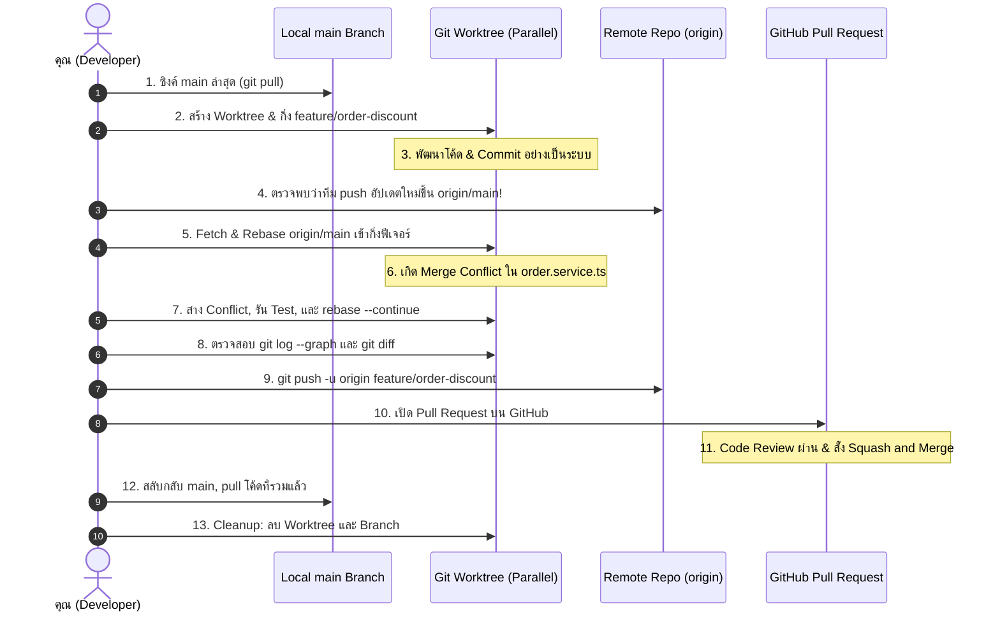

# End-to-End Git Workflow: โครงการจำลองสถานการณ์จริง

บทเรียน Capstone นี้เชื่อมโยงองค์ความรู้ Git ทั้งหมด (Sections 01–11) เข้าด้วยกันเป็น **End-to-End Simulation** จำลองการทำงานจริงในทีมวิศวกรรม ตั้งแต่การเริ่มต้นแตกฟีเจอร์ การใช้ Worktree การผสานโค้ด การแก้ปัญหาข้อขัดแย้ง ไปจนถึงการส่งมอบผ่าน Pull Request

> [!important] สถานะของบทเรียน: กำลังดำเนินการ (In Progress)
> เอกสารชุดนี้เป็นพิมพ์เขียวการเรียนรู้และคู่มือจำลองปฏิบัติการจริง ผู้เรียนอยู่ระหว่างการศึกษาและลงมือปฏิบัติตามขั้นตอนจำลอง

---

## 1. แผนภาพลำดับขั้นตอนการปฏิบัติการจำลอง (Simulation Pipeline)



---

## 2. คู่มือปฏิบัติการทีละขั้นตอน (Step-by-Step Simulation Guide)

### ขั้นที่ 1: ตระเตรียมฐานกิ่งหลักให้สดใหม่
เริ่มต้นจาก Main Working Tree ตรวจสอบให้มั่นใจว่ากิ่ง `main` ซิงค์กับรีโมตล่าสุด
```bash
git switch main
git pull origin main
```

### ขั้นที่ 2: สร้าง Worktree สำหรับพัฒนาแบบคู่ขนาน
แทนที่จะสลับกิ่งในโฟลเดอร์เดิม ให้สร้าง Linked Worktree ออกไปภายนอก:
```bash
git worktree add ../project-discount -b feature/order-discount
cd ../project-discount
```

### ขั้นที่ 3: พัฒนาและบันทึก Commit แบบ Atomic
ทำการแก้ไขไฟล์และบันทึก Commit:
```bash
# แก้ไขไฟล์ src/order.service.ts
git status
git add src/order.service.ts
git commit -m "feat(order): calculate seasonal discount vouchers"
```

### ขั้นที่ 4: ตรวจสอบและซิงค์ความเปลี่ยนแปลงของทีม
จำลองว่าเพื่อนร่วมทีมได้รวมโค้ดใหม่เข้าสู่ `origin/main`:
```bash
git fetch origin main
# ตรวจสอบว่ามีกี่ Commit ที่เราตามหลังอยู่
git log HEAD..origin/main --oneline
```

### ขั้นที่ 5: นำการเปลี่ยนแปลงล่าสุดมารองเป็นฐาน (Rebase)
```bash
git rebase origin/main
```

### ขั้นที่ 6: จัดการข้อขัดแย้ง (Merge Conflict Resolution)
หากพบ Conflict Markers:
```text
<<<<<<< HEAD (โค้ดของเพื่อนบน main)
const TAX_RATE = 0.07;
=======
const TAX_RATE = 0.08;
>>>>>>> feat(order): calculate seasonal discount vouchers
```
- เปิดไฟล์ ตัดสินใจเลือกอัตราภาษีที่ถูกต้องตาม Business Requirement
- ลบ Markers ออกให้หมด แล้วสั่ง:
```bash
git add src/order.service.ts
git rebase --continue
```

### ขั้นที่ 7: ตรวจทานประวัติและ Diff ก่อนส่งมอบ
```bash
# ตรวจสอบว่าประวัติศาสตร์เป็นเส้นตรงสะอาด
git log --oneline --graph -n 5

# ตรวจสอบ Diff รวมทั้งหมดเทียบกับ main
git diff origin/main
```

### ขั้นที่ 8: Push ขึ้นเซิร์ฟเวอร์และเปิด Pull Request
```bash
git push -u origin feature/order-discount
```
เปิดบราวเซอร์เพื่อทำ Code Review บน GitHub เมื่อผ่านการตรวจ ให้เลือก **Squash and Merge**

### ขั้นที่ 9: ทำความสะอาดสภาพแวดล้อม (Housekeeping)
```bash
# กลับไปยัง Main Workspace
cd ../main-project
git switch main
git pull origin main

# ลบโฟลเดอร์ Worktree และถอนกิ่งที่ไม่ใช้แล้ว
git worktree remove ../project-discount
git branch -d feature/order-discount
git worktree prune
```

---

## 🔗 โน้ตที่เกี่ยวข้อง
- [[Practical-Exercises]] — แบบฝึกหัดทดลองทำตามด้วยตนเอง
- [[Troubleshooting-Scenarios]] — วิธีแก้ปัญหาเฉพาะหน้าเมื่อเกิดข้อผิดพลาด
- [[Worktree-with-AI-Agents]] — ประยุกต์ใช้เวิร์กโฟลว์นี้กับ AI Agents\n