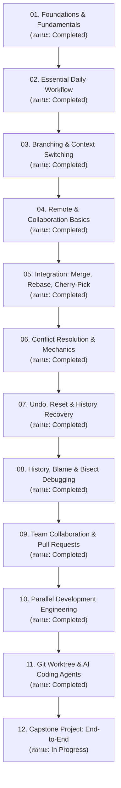

# Git Learning Roadmap

แผนผังการเรียนรู้ Git อย่างเป็นระบบ ครอบคลุมตั้งแต่มุมมองเชิงสถาปัตยกรรม การประยุกต์ใช้งานจริงในชีวิตประจำวัน จนถึงการจัดการเวิร์กโฟลว์ระดับองค์กรและการทำงานร่วมกับ AI Coding Agents

---

## 📊 ตารางติดตามสถานะการเรียนรู้ (Progress Tracker)

| Section | ชื่อหมวดหมู่ | หัวข้อสำคัญ | สถานะ | ลิงก์เข้าสู่เนื้อหา |
| :--- | :--- | :--- | :---: | :--- |
| **01** | Git Fundamentals | VCS, DVCS, Git Architecture, 3 States, Snapshot model | `Completed` | [[Git-Overview]], [[Git-Architecture]] |
| **02** | Essential Commands | init, clone, status, add, commit, diff, .gitignore | `Completed` | [[Daily-Git-Commands]], [[Git-Add-and-Staging]] |
| **03** | Branching & Switching | Branch pointers, HEAD, switch, branch, Detached HEAD | `Completed` | [[Branch-Concept]], [[Branch-Commands]], [[Detached-HEAD]] |
| **04** | Remote Operations | origin, remote-tracking branch, fetch, pull, push, upstream | `Completed` | [[Remote-Repository]], [[Fetch-Pull-Push]] |
| **05** | Integration | Fast-forward, Three-way merge, Rebase, Cherry-pick | `Completed` | [[Git-Merge]], [[Git-Rebase]], [[Merge-vs-Rebase]] |
| **06** | Conflict Resolution | Merge base, Conflict markers, manual resolution, abort | `Completed` | [[Merge-Conflict]], [[Conflict-Resolution-Workflow]] |
| **07** | Undo & Recovery | restore, reset (--soft, --mixed, --hard), revert, reflog | `Completed` | [[Git-Reset]], [[Git-Reflog]], [[Undo-Command-Comparison]] |
| **08** | History & Debugging | git log, git show, git blame, git bisect (binary search) | `Completed` | [[Git-Log]], [[Git-Bisect]] |
| **09** | Collaboration & PRs | Feature branch, PR, Code Review, GitHub merge strategies | `Completed` | [[Pull-Request-Workflow]], [[GitHub-Merge-Strategies]] |
| **10** | Parallel Development | Task boundaries, interface contracts, integration risks | `Completed` | [[Parallel-Development-Concept]], [[Integration-and-Coordination]] |
| **11** | Worktree & AI Agents | Worktree architecture, multi-agent concurrency, isolation | `Completed` | [[Worktree-Concept]], [[Worktree-with-AI-Agents]] |
| **12** | Capstone Project | End-to-End simulation, practical lab exercises | `In Progress` | [[End-to-End-Git-Workflow]], [[Practical-Exercises]] |
| **13** | References | Cheatsheet, Terminology glossary, Common mistakes | `Completed` | [[Git-Command-Cheatsheet]], [[Git-Terminology]] |

---

## 🎯 คำแนะนำการศึกษา
- หากต้องการใช้งานจริงแบบรวดเร็วที่สุดโดยไม่ต้องจำทฤษฎี ให้เปิด [[Git-Simple-Guide]]
- หากต้องการทำความเข้าใจ **Mental Model** ให้ศึกษา [[Git-Object-Model]] และ [[Git-Architecture]] เป็นอันดับแรก
- หากเกิดวิกฤตต้องการแก้ปัญหาด่วน ให้เปิด [[Troubleshooting-Scenarios]] หรือ [[Undo-Command-Comparison]]
- หากต้องการวางสถาปัตยกรรมการทำงานร่วมกับ AI Agents ให้ศึกษา [[Worktree-with-AI-Agents]] และ [[Parallel-Development-Concept]]\n