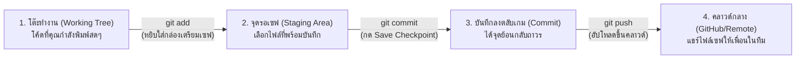
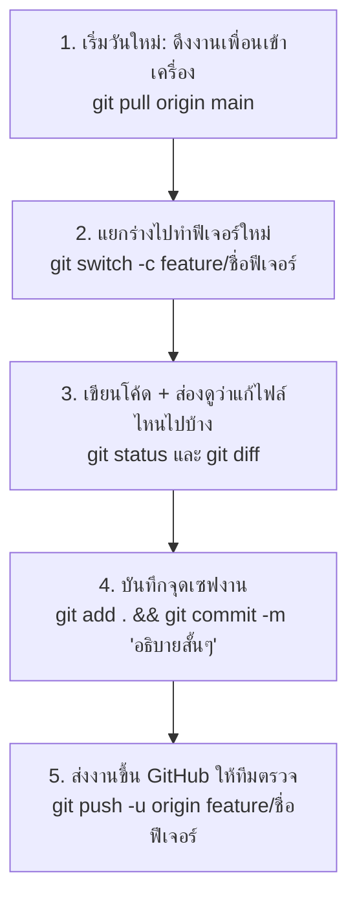

# Git Simple Guide: คู่มือ Git ฉบับเข้าใจง่ายที่สุด (ใช้จริงได้ทันที)

หากคุณรู้สึกว่า Git ในเอกสารทั่วไปเข้าใจยาก มีศัพท์เทคนิคเต็มไปหมด (ทั้ง Tree, Blob, DAG, Rebase, Detached HEAD) หน้านี้ออกแบบมาเพื่อสรุปให้คุณ **เข้าใจคอนเซ็ปต์ใน 1 นาที และหยิบคำสั่งไปใช้ทำงานได้ทันที โดยไม่ต้องท่องจำ**

> [!tip] ถ้ากำลังทำงานจริง
> เปิด [[Git-Daily-Playbook]] ก่อน หน้านี้เหมาะสำหรับอ่านทำความเข้าใจแนวคิดและกรณีฉุกเฉิน

---

## 💡 1. Git ทำงานยังไงใน 1 นาที (เปรียบเทียบเหมือนเล่นเกม RPG)

ไม่ต้องคิดว่า Git คือคณิตศาสตร์หรือสถาปัตยกรรมซับซ้อน ให้คิดภาพเหมือน **การเล่นเกมแล้วกดเซฟจุด Checkpoint**:



- **Working Tree (โต๊ะทำงาน):** ไฟล์ในโฟลเดอร์ที่คุณกำลังเปิดใน VS Code พิมพ์แก้โค้ดสดๆ (ยังไม่ปลอดภัย ถ้าคอมพังของหาย)
- **Staging Area (`git add`):** ตะกร้าพักของ คุณตรวจดูว่าไฟล์ไหนแต่งเสร็จแล้ว ก็หยิบใส่ตะกร้าเพื่อเตรียมกดเซฟ
- **Commit (`git commit`):** จุดเซฟเกมถาวร (Snapshot) ทุกครั้งที่กด commit คุณจะได้ "ตรายางบันทึกประวัติ" พร้อมรหัสประจำจุดเซฟนั้น สามารถย้อนเวลากลับมาจุดนี้ได้ตลอดชีวิต
- **Branch (`git branch` / `git switch`):** ร่างแยกหรือ Slot เซฟสำรอง อยากลองทำอะไรเสี่ยงๆ หรือเขียนฟีเจอร์ใหม่ ให้แยกกิ่งออกมาทำ ถ้าเจ๊งก็แค่ลบทิ้ง กิ่งหลัก (`main`) ไม่พังแน่นอน
- **Remote / GitHub (`git push` / `git pull`):** ตู้เซฟกลางบนอินเทอร์เน็ต เอาไว้ส่งงานและดึงงานเพื่อนมารวมกัน

---

## 🏃 2. เวิร์กโฟลว์ 5 สเต็ปในชีวิตประจำวัน (ใช้แค่นี้ 90% ของงาน)



### สเต็ปที่ 1: ดึงโค้ดล่าสุดของทีมเข้าเครื่องก่อนเริ่มงาน
```bash
git switch main
git pull origin main
```
*เหตุผล:* ป้องกันไม่ให้เราเขียนโค้ดทับบนเวอร์ชันเก่าของเพื่อน

### สเต็ปที่ 2: แยก Branch ใหม่เพื่อทำงานของเรา
```bash
git switch -c feature/login-page
```
*เหตุผล:* ห้ามเขียนโค้ดลงบน `main` ตรงๆ ให้แยกกิ่งออกมาเสมอ

### สเต็ปที่ 3: ระหว่างเขียนโค้ด ตรวจดูว่าแตะไฟล์อะไรไปบ้าง
```bash
# เช็กสถานะไฟล์ (แดง = ยังไม่ add, เขียว = add แล้ว)
git status

# ดูว่าพิมพ์แก้บรรทัดไหนไปบ้าง
git diff
```

### สเต็ปที่ 4: แพ็กของแล้วกดเซฟ (Commit)
```bash
# หยิบทุกไฟล์ที่แก้ใส่ตะกร้า
git add .

# กดชัตเตอร์บันทึกจุดเซฟ พร้อมข้อความบอกว่าแก้อะไร
git commit -m "feat: create login form and submit button"
```

### สเต็ปที่ 5: ส่งงานขึ้น GitHub เพื่อเปิด Pull Request
```bash
# ส่งขึ้นครั้งแรก (ใส่ -u เพื่อจำชื่อกิ่ง)
git push -u origin feature/login-page
```

---

## 🛠️ 3. รวมสูตรสำเร็จ: "จะทำสิ่งนี้ พิมพ์คำสั่งอะไร?"

| สิ่งที่คุณต้องการทำ | คำสั่งที่ต้องพิมพ์ | คำอธิบายสั้นๆ |
| :--- | :--- | :--- |
| **ดึงโปรเจกต์จาก GitHub ลงเครื่องครั้งแรก** | `git clone <url>` | โคลนทั้งโปรเจกต์มาไว้ในเครื่องเรา |
| **ดูว่าตอนนี้มีไฟล์ไหนแก้ค้างอยู่บ้าง** | `git status` | เรดาร์ตรวจจับไฟล์ แนะนำให้พิมพ์บ่อยๆ |
| **ดูความเปลี่ยนแปลงของโค้ด** | `git diff` | ดูว่าบรรทัดไหนเพิ่ม (+) หรือลบ (-) |
| **เอาทุกไฟล์ที่แก้เข้าเตรียมเซฟ** | `git add .` | นำไฟล์ทั้งหมดเข้าสู่ Staging Area |
| **กดเซฟจุด Checkpoint** | `git commit -m "ข้อความ"` | บันทึกประวัติอย่างถาวร |
| **ดูประวัติการเซฟย้อนหลังแบบสวยๆ** | `git log --oneline -n 5` | แสดง 5 จุดเซฟล่าสุดแบบกระชับ |
| **ดูว่าในเครื่องมี Branch อะไรบ้าง** | `git branch` | กิ่งที่มีดอกจัน `*` คือกิ่งที่เรายืนอยู่ |
| **สลับไปทำงานที่ Branch อื่น** | `git switch <ชื่อกิ่ง>` | สลับพื้นที่ทำงานไปที่กิ่งนั้น |
| **สร้าง Branch ใหม่แล้วสลับไปทันที** | `git switch -c <ชื่อกิ่งใหม่>` | สร้างกิ่งใหม่แล้วย้ายไปยืนทันที |
| **ดึงโค้ดล่าสุดจากเซิร์ฟเวอร์** | `git pull` | ดึงโค้ดของเพื่อนมารวมเข้าเครื่องเรา |
| **ส่งโค้ดของเราขึ้น GitHub** | `git push` | อัปโหลด Commit ของเราขึ้นออนไลน์ |

---

## 🚑 4. ชุดปฐมพยาบาล: แก้ปัญหาฉุกเฉินเมื่อทำพลาด (ไม่ต้องแพนิก)

### กรณี 1: เขียนโค้ดไปแล้วมั่ว อยากทิ้งทั้งหมดแล้วย้อนกลับไปตอนเซฟล่าสุด
```bash
# คืนค่าทุกไฟล์ในโฟลเดอร์ให้เหมือนจุดเซฟล่าสุดทันที
git restore .
```
*(ถ้าต้องการย้อนแค่ไฟล์เดียว: `git restore path/to/file.js`)*

---

### กรณี 2: เพิ่งกด commit ไปตะกี้ แต่พิมพ์ข้อความผิด หรือลืมเพิ่มไฟล์
```bash
# ถ้าลืมเพิ่มไฟล์ ให้ add ไฟล์นั้นก่อน
git add forgotten-file.js

# อัปเดตทับ Commit เดิมโดยไม่ต้องสร้าง Commit ใหม่
git commit --amend -m "ข้อความใหม่ที่ถูกต้อง"
```

---

### กรณี 3: งานด่วนเข้า! ต้องรีบสลับ Branch แต่โค้ดยังไม่เสร็จ ไม่อยากกด commit ขยะ
```bash
# เก็บโค้ดที่ค้างไว้เข้าลิ้นชักชั่วคราว
git stash

# สลับไปทำงานด่วนที่กิ่งอื่นได้ตามสบาย...
git switch hotfix-urgent

# พองานด่วนเสร็จ สลับกลับมา แล้วดึงงานในลิ้นชักออกมาทำต่อ
git switch feature/my-work
git stash pop
```

---

### กรณี 4: ดึงโค้ดเพื่อนแล้วติดตัวแดง `CONFLICT`! (ทำตาม 4 ขั้นตอนนี้)
ไม่ต้องตกใจ Conflict เกิดขึ้นเมื่อ **คุณกับเพื่อนแก้ไฟล์เดียวกัน ในบรรทัดเดียวกัน**:

1. เปิดไฟล์ที่มีปัญหาใน VS Code จะเห็นหน้าตาดังนี้:
   ```text
   <<<<<<< HEAD (โค้ดในเครื่องคุณ)
   const apiUrl = "https://my-api.com";
   =======
   const apiUrl = "https://team-api.com";
   >>>>>>> main (โค้ดของเพื่อนที่ดึงมา)
   ```
2. **เลือกสิ่งที่ถูกต้อง:** ลบเครื่องหมาย `<<<<<<<`, `=======`, `>>>>>>>` ออกให้หมด เหลือเฉพาะบรรทัดโค้ดที่คุณต้องการจริง (หรือกดปุ่ม Accept Incoming / Accept Current บน VS Code)
3. บันทึกไฟล์แล้วบอก Git ว่าเคลียร์เสร็จแล้ว:
   ```bash
   git add .
   ```
4. กด Commit ปิดงาน:
   ```bash
   git commit -m "fix: resolve merge conflict in config"
   ```
*(ถ้าแก้มั่วไปหมด อยากยกเลิกทุกอย่างกลับไปสภาพก่อน pull ให้พิมพ์ `git merge --abort`)*

---

### กรณี 5: เผลอกด Commit ไปแล้ว อยากยกเลิก แต่โค้ดยังต้องอยู่ครบ!
```bash
# ยกเลิก Commit ล่าสุด 1 ครั้ง แต่โค้ดที่เขียนไว้ทั้งหมดยังคงอยู่บนหน้าจอเหมือนเดิม
git reset --soft HEAD~1
```

---

## ⛔ 5. กฎเหล็ก 3 ข้อ เพื่อความปลอดภัยในชีวิตการทำงาน

1. **อย่าเขียนโค้ดและ Commit ลงบนกิ่ง `main` ตรงๆ:**
   ให้สร้าง Branch ใหม่เสมอ เช่น `feature/login`, `fix/navbar` เมื่องานเสร็จค่อยส่ง Pull Request
2. **ห้ามพิมพ์ `git push --force` ลงบนกิ่งส่วนรวม (`main`, `develop`):**
   เพราะมันจะไปเขียนทับประวัติศาสตร์ของเพื่อนร่วมทีมทั้งบริษัทจนงานคนอื่นหายได้
3. **พิมพ์ `git status` บ่อยๆ:**
   การเช็กสถานะก่อนพิมพ์คำสั่งต่อไป ช่วยป้องกันการ commit ไฟล์ส่วนตัว (เช่น `.env` หรือไฟล์ชั่วคราว) ได้ดีที่สุด

---

## 📚 6. ต้องการเจาะลึกเฉพาะเรื่อง? ศึกษาต่อได้ที่นี่

เมื่อคุณคล่องคำสั่งพื้นฐานแล้ว และต้องการเข้าใจสถาปัตยกรรมเชิงลึก สามารถคลิกลิงก์โน้ตเหล่านี้ในคลังความรู้ได้ทันที:
- [[Daily-Git-Commands]] — เจาะลึกคำสั่งประจำวันพร้อมตัวอย่างเจาะจง
- [[Git-Add-and-Staging]] — กลไกการทำงานของ Staging Area ทำไมต้องมีจุดพักไฟล์
- [[Git-Commit]] — มาตรฐานการเขียน Commit Message แบบมืออาชีพ
- [[Branch-Commands]] — คำสั่งจัดการ Branch และการผสานกิ่ง
- [[Conflict-Resolution-Workflow]] — กระบวนการแก้ Conflict แบบละเอียดในโปรเจกต์ใหญ่
- [[Undo-Command-Comparison]] — ตารางเปรียบเทียบคำสั่งยกเลิก (Restore vs Reset vs Revert)
- [[Git-Command-Cheatsheet]] — รวมคำสั่งลัดทุกหมวดหมู่แบบครบวงจร
- [[Common-Mistakes]] — 8 ข้อผิดพลาดสุดคลาสสิกที่มือใหม่มักเจอ พร้อมวิธีแก้
