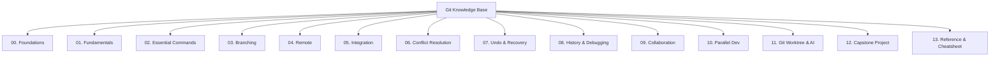

# Git Knowledge Base

> [!important] จุดเริ่มต้นใหม่
> ใช้งานจริงให้เปิด [[Git-Daily-Playbook]] ก่อน ส่วนหน้านี้เป็นสารบัญและแผนที่ความรู้สำหรับการเรียนต่อ
>
> กลับไปยังแผนที่รวมของ Vault: [[START-HERE]]

ยินดีต้อนรับสู่ **Git Knowledge Base** — คลังความรู้เชิงลึกด้านระบบควบคุมเวอร์ชัน (Version Control System: VCS) และ Git สถาปัตยกรรมภายใน กลไกการทำงาน การแก้ปัญหาขั้นสูง ไปจนถึงวิศวกรรมการทำงานแบบขนาน (Parallel Development) และการประยุกต์ใช้ **Git Worktree ร่วมกับ AI Coding Agents**

คลังความรู้นี้ออกแบบมาสำหรับนักพัฒนาซอฟต์แวร์และวิศวกรระบบที่ต้องการความเข้าใจในระดับ "กลไกการทำงาน (Under the Hood)" เพื่อให้สามารถวิเคราะห์ปัญหา เลือกคำสั่งที่เหมาะสม และออกแบบ Workflow การทำงานที่มีเสถียรภาพสูงในระดับทีม

---

## ⚡ เริ่มต้นใช้งานด่วน (Quick Start)
หากต้องการคู่มือที่ **กระชับ เข้าใจง่าย ไม่ซับซ้อน หยิบคำสั่งไปใช้งานได้ทันที**:
👉 อ่านได้ที่ **[[Git-Simple-Guide]]**: สรุปเวิร์กโฟลว์ 5 สเต็ป, สูตรสำเร็จคำสั่ง, วิธีรับมือ Conflict และชุดปฐมพยาบาลเมื่อเกิดข้อผิดพลาด

สำหรับการเปิดอ่านระหว่างทำงาน ให้ใช้ **[[Git-Daily-Playbook]]** ซึ่งจัดตามสถานการณ์และลดรายละเอียดที่ไม่จำเป็น

---

## 🗺️ แผนที่การเรียนรู้ (Roadmap)
เริ่มต้นทำความเข้าใจภาพรวมและติดตามสถานะความรู้ได้ที่ [[Git-Learning-Roadmap]]:
- **Sections 01–11:** เรียนรู้ทฤษฎี สถาปัตยกรรม คำสั่ง และการทำงานร่วมกันอย่างเป็นระบบ (สถานะ: Completed)
- **Section 12 (Capstone):** แบบฝึกหัดจำลองการทำงานจริงแบบ End-to-End Workflow (สถานะ: In Progress)

---

## 📂 โครงสร้างเนื้อหา (Knowledge Base Directory)

### 1. สถาปัตยกรรมและพื้นฐาน (Foundations & Architecture)
- [[Git-Overview]]: ที่มา ปรัชญาการออกแบบ Distributed Version Control และข้อแตกต่างระหว่าง Git กับ GitHub
- [[Git-Architecture]]: 3 สถานะของ Git, พื้นที่ทำงาน (Working Tree, Index/Staging, Object Store)
- [[Git-Object-Model]]: โครงสร้างภายใน 4 ออบเจกต์หลัก (Blob, Tree, Commit, Annotated Tag) และ SHA-1/SHA-256 Hashing
- [[Git-References-and-HEAD]]: กลไกของ References, Branch Pointers, Symbolic Reference และสถานะ HEAD
- [[Repository-and-Working-Tree]]: ส่วนประกอบของ Repository, ไดเรกทอรี `.git`, และ Working Directory
- [[Git-Configuration]]: ลำดับความสำคัญของคอนฟิก (System, Global, Local, Worktree)
- [[Git-Basic-Workflow]]: วงจรชีวิตของไฟล์ (Untracked, Unmodified, Modified, Staged)

### 2. คำสั่งประจำวันและกิ่งก้าน (Daily Workflow & Branching)
- [[Daily-Git-Commands]]: สรุปคำสั่งที่ใช้งานทุกวันในบริบทงานจริง
- [[Git-Add-and-Staging]]: เจาะลึก Staging Area ทำไม `git add` จึงเป็นการบันทึก Snapshot
- [[Git-Commit]]: ศาสตร์แห่งการ Commit แบบอะตอมิก (Atomic Commits) และข้อความ Commit ที่สื่อความหมาย
- [[Git-Diff]]: การเปรียบเทียบความต่างระหว่าง Working Tree, Index และ Commits
- [[Gitignore]]: กฎการละเว้นไฟล์ แพทเทิร์น และการแก้ปัญหาไฟล์ที่ถูก Track ไปแล้ว
- [[Branch-Concept]]: แนวคิด Branch ในฐานะ Pointer เคลื่อนที่ได้ (Lightweight movable pointer)
- [[Branch-Commands]]: การสร้าง สลับ เปลี่ยนชื่อ และลบ Branch ด้วย `switch` และ `branch`
- [[Detached-HEAD]]: ภาวะหัวขาด (Detached HEAD) สาเหตุ การสังเกต และวิธีเอาตัวรอด

### 3. รีโมตและการผสานโค้ด (Remote & Integration)
- [[Remote-Repository]]: โครงสร้างการเชื่อมต่อ Remote และชื่อดั้งเดิม `origin`
- [[Fetch-Pull-Push]]: ความแตกต่างเชิงลึกระหว่าง `git fetch`, `git pull` และ `git push`
- [[Upstream-and-Tracking-Branch]]: กลไก Remote-tracking branch (`origin/main`) และ Upstream mapping
- [[Git-Merge]]: Fast-forward Merge, Three-way Merge, Merge Base และ Merge Commit
- [[Git-Rebase]]: กลไกการ Replay commits บน Base ใหม่ และข้อห้ามในการ Rebase Shared History
- [[Git-Cherry-Pick]]: การเลือก Commit เฉพาะจุดมาใช้งานและความเสี่ยงต่อ Duplicate Patch
- [[Merge-vs-Rebase]]: ตารางเปรียบเทียบการเลือกใช้งานตามสถานการณ์และผลกระทบต่อ Commit Graph

### 4. การแก้ข้อขัดแย้งและการกู้คืน (Conflict & Recovery)
- [[Merge-Conflict]]: เจาะลึกสาเหตุของข้อขัดแย้ง และสัญลักษณ์ Conflict Markers (`<<<<<<<`, `=======`, `>>>>>>>`)
- [[Conflict-Resolution-Workflow]]: ขั้นตอนการระงับข้อขัดแย้งอย่างเป็นระบบ การตรวจสอบก่อนและหลังแก้งาน
- [[Git-Restore]]: การคืนค่าไฟล์ใน Working Tree และ Unstaging ไฟล์โดยไม่ทำลายประวัติ
- [[Git-Reset]]: ความแตกต่างขั้นวิกฤตระหว่าง `--soft`, `--mixed`, และ `--hard`
- [[Git-Revert]]: การยกเลิกการเปลี่ยนแปลงอย่างปลอดภัยด้วยการสร้าง Inverted Commit
- [[Git-Reflog]]: บันทึกนิรภัยกู้ชาติ (Safety Net) ที่บันทึกทุกการเคลื่อนไหวของ HEAD
- [[Undo-Command-Comparison]]: ตารางเปรียบเทียบคำสั่งยกเลิกเพื่อเลือกเครื่องมือที่ถูกต้องตามระดับความเสี่ยง

### 5. การตรวจสอบประวัติและการทำงานร่วมกัน (History & Collaboration)
- [[Git-Log]]: การสำรวจประวัติด้วย `--graph`, `--oneline`, `--stat` และการค้นหา Commit
- [[Git-Show-and-Blame]]: การตรวจดูเนื้อหา Commit และการสืบหาที่มาของโค้ดแต่ละบรรทัด
- [[Git-Bisect]]: การค้นหา Regression Bug ด้วย Binary Search อัตโนมัติ
- [[Pull-Request-Workflow]]: กระบวนการส่งมอบโค้ด Code Review และ CI/CD Pipeline
- [[Code-Review]]: แนวทางปฏิบัติการตรวจทานโค้ดอย่างสร้างสรรค์และปลอดภัย
- [[GitHub-Merge-Strategies]]: เปรียบเทียบ Create Merge Commit, Squash and Merge, และ Rebase and Merge

### 6. วิศวกรรมขั้นสูงและการทำงานแบบขนาน (Parallel Dev & Worktree)
- [[Parallel-Development-Concept]]: หลักการพัฒนาแบบคู่ขนาน การแบ่ง Task Boundary และการบริหาร Integration Risk
- [[Branching-Strategy]]: สรุปโมเดลยอดนิยม (Trunk-Based Development vs Git Flow vs GitHub Flow)
- [[Integration-and-Coordination]]: การป้องกันข้อขัดแย้งใน Shared Files, Database Schema และ API Contracts
- [[Worktree-Concept]]: สถาปัตยกรรม Git Worktree: Shared Object Database, Independent Index & HEAD
- [[Worktree-Commands]]: คู่มือคำสั่ง `git worktree add`, `list`, `remove`, `prune`
- [[Worktree-vs-Clone]]: การเปรียบเทียบประสิทธิภาพ ความเร็ว พื้นที่จัดเก็บ ระหว่าง Worktree กับ Clone
- [[Worktree-with-AI-Agents]]: การจัดสภาพแวดล้อมให้ AI Coding Agents (เช่น Agent A: Auth, Agent B: API, Agent C: Testing) ทำงานพร้อมกันบน Repository เดียวกันอย่างปลอดภัย

### 7. โครงการทดสอบและเอกสารอ้างอิง (Capstone & Reference)
- [[Git-Simple-Guide]]: คู่มือฉบับเข้าใจง่ายที่สุด สรุปคำสั่งและเวิร์กโฟลว์สำหรับใช้งานจริงทันที
- [[End-to-End-Git-Workflow]]: สถานการณ์จำลองกระบวนการพัฒนาตั้งแต่ต้นจนจบ (Section 12: In Progress)
- [[Practical-Exercises]]: แบบฝึกหัดทดลองทำจริงพร้อมผลลัพธ์ที่คาดหวัง
- [[Troubleshooting-Scenarios]]: กรณีศึกษาปัญหาที่พบบ่อยและแนวทางแก้ไขแบบเฉียบพลัน
- [[Git-Command-Cheatsheet]]: สรุปคำสั่งฉบับย่อพร้อมไวยากรณ์สำหรับเปิดค้นหาด่วน
- [[Git-Terminology]]: พจนานุกรมคำศัพท์เทคนิคและนิยามสำคัญของ Git
- [[Common-Mistakes]]: รวม 10 หลุมพรางที่นักพัฒนามักพลาดและวิธีป้องกัน

---

## 💡 วิธีการใช้งาน Knowledge Base นี้ใน Obsidian

1. **การค้นหาด้วย Graph View:** เปิด Graph View ใน Obsidian เพื่อดูการเชื่อมโยงของ Concept สำคัญ เช่น [[Git-Object-Model]] และ [[Git-Merge]]
2. **การนำทางแบบกระโดดข้าม (Hyperlink Navigation):** ใช้ `Ctrl + Click` หรือ `Cmd + Click` บนชื่อโน้ตที่มีการเชื่อมโยง (เช่น [[Git-Merge]]) เพื่ออ่านต่อในหัวข้อที่เกี่ยวข้องได้ทันที
3. **การอ่านตามระดับทักษะ:**
   - **เน้นใช้งานด่วน (ไม่เน้นทฤษฎี):** อ่าน [[Git-Daily-Playbook]] แล้วค่อยดู [[Git-Simple-Guide]]
   - **เริ่มต้นเรียนรู้ระบบ:** เริ่มจาก [[Git-Overview]] -> [[Git-Basic-Workflow]] -> [[Daily-Git-Commands]]
   - **ระดับกลาง (แก้งาน/กู้ประวัติ):** อ่าน [[Merge-Conflict]] -> [[Git-Reset]] -> [[Git-Reflog]]
   - **ระดับสูง (ระบบทีมและ AI):** ศึกษา [[Parallel-Development-Concept]] -> [[Worktree-Concept]] -> [[Worktree-with-AI-Agents]]