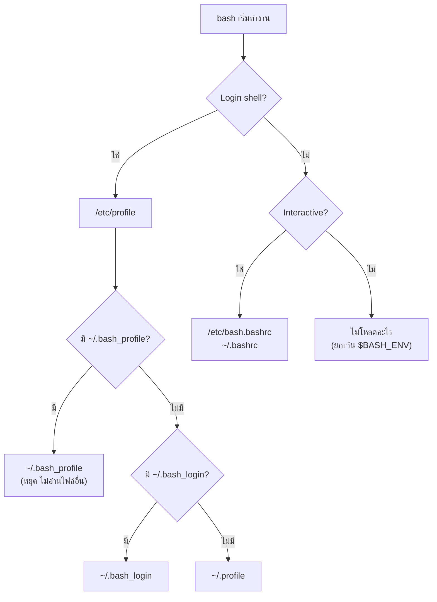

# Shell Startup Files

## สรุปสั้นที่สุด

| ไฟล์ | Shell | โหลดเมื่อ | ควรใส่อะไร |
|---|---|---|---|
| `~/.profile` | sh, bash (และ shell ตระกูล sh) | **Login** shell | ตัวแปร environment, `PATH` |
| `~/.bash_profile` | bash เท่านั้น | **Login** shell (ถ้ามีไฟล์นี้ จะ**ไม่อ่าน** `.profile`) | `source ~/.profile` + `source ~/.bashrc` |
| `~/.bashrc` | bash เท่านั้น | **Interactive non-login** shell | alias, function, prompt, completion |
| `~/.zshenv` | zsh | **ทุกครั้ง** รวม script | ตัวแปรที่ต้องมีเสมอ (ใส่น้อยๆ) |
| `~/.zprofile` | zsh | Login shell | `PATH`, Homebrew (`brew shellenv`) |
| `~/.zshrc` | zsh | Interactive shell (login หรือไม่ก็ได้) | alias, prompt, plugin |
| `~/.bash_logout` / `~/.zlogout` | | ตอนออกจาก login shell | ล้างหน้าจอ ฯลฯ |
| `/etc/profile`, `/etc/bash.bashrc`, `/etc/zshrc` | | เหมือนข้างบน แต่สำหรับ **ทุก user** | แก้ด้วย sudo เฉพาะเมื่อจำเป็น |

> **กฎจำ:** `profile` = ตอน login ครั้งแรก (ตัวแปร) · `rc` = ทุกครั้งที่เปิด shell ให้คนพิมพ์ (alias/หน้าตา)

## ลำดับการโหลดของ bash



สังเกต: login shell **ไม่อ่าน `.bashrc` เอง** — ที่ alias ใช้ได้หลัง ssh เพราะ `~/.profile` ของ Ubuntu มีโค้ดนี้อยู่:

```bash
if [ -n "$BASH_VERSION" ] && [ -f "$HOME/.bashrc" ]; then
    . "$HOME/.bashrc"
fi
```

> [!warning] กับดักที่เจอบ่อยบน Ubuntu
> สร้าง `~/.bash_profile` ขึ้นมาใหม่ (เช่น installer บางตัวสร้างให้) → bash จะ**เลิกอ่าน** `~/.profile` → PATH `~/.local/bin` และ `.bashrc` หายตอน ssh
> แก้: ใส่บรรทัดนี้ไว้ใน `~/.bash_profile`
> ```bash
> [ -f ~/.profile ] && . ~/.profile
> ```

และบรรทัดบนสุดของ `~/.bashrc` ใน Ubuntu:

```bash
case $- in *i*) ;; *) return;; esac   # ถ้าไม่ interactive ให้ออกเลย
```

ทุกอย่างที่อยู่**ใต้**บรรทัดนี้จะไม่มีผลกับ script / `ssh host 'cmd'`

## ลำดับการโหลดของ zsh (macOS default)

```text
.zshenv → .zprofile (ถ้า login) → .zshrc (ถ้า interactive) → .zlogin (ถ้า login)
```

- macOS Terminal.app / iTerm เปิดเป็น **login + interactive** → โหลดครบทุกไฟล์
- `/etc/zprofile` ของ macOS รัน `path_helper` ซึ่งจัดลำดับ PATH ใหม่ → ตั้ง PATH ใน `.zprofile` (โหลดหลัง) จะไม่ถูกทับ ดีกว่า `.zshenv`

## ตั้งค่าแนะนำ

**Ubuntu / bash:** ไม่ต้องสร้าง `.bash_profile` · ตัวแปร/PATH → `~/.profile` · alias → `~/.bashrc`
**macOS / zsh:** PATH, `brew shellenv` → `~/.zprofile` · alias/prompt → `~/.zshrc`

ลงมือทำ → [[Linux-Add-Alias-and-Env-Var]] · [[Linux-Add-to-PATH]]

## ต่อไป

- [[Shell-Types-Login-Interactive]]
- [[Environment-Variables-and-PATH]]
- อ้างอิง: `man bash` หัวข้อ INVOCATION · `man zsh` หัวข้อ STARTUP/SHUTDOWN FILES
