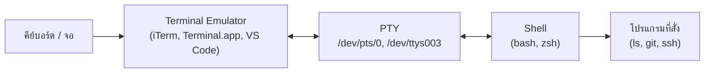

# Terminal vs Shell vs TTY

คนมักเรียกรวมกันว่า "Terminal" แต่จริงๆ เป็น 3 ชิ้นที่ทำงานต่อกัน:



| ชิ้น | คืออะไร | ตัวอย่าง |
|---|---|---|
| **Terminal (Emulator)** | แอปที่วาดตัวหนังสือบนจอและรับการพิมพ์ ไม่เข้าใจคำสั่งเลย | iTerm2, Terminal.app, GNOME Terminal, VS Code terminal |
| **TTY / PTY** | "สายไฟเสมือน" ระหว่าง Terminal กับ Shell (PTY = pseudo-terminal) | `/dev/pts/0` (Linux), `/dev/ttys003` (macOS) |
| **Shell** | โปรแกรมที่อ่านคำสั่ง แปลความ แล้วรันโปรแกรมให้ | `bash` (Ubuntu default), `zsh` (macOS default), `sh`/`dash` |
| **Console** | Terminal ที่ต่อตรงกับเครื่อง (จอจริง / Console ของ VM) | `/dev/tty1` |

ผลที่ตามมา:
- เปลี่ยน Theme/Font = ตั้งที่ **Terminal** · เปลี่ยน alias/prompt/PATH = ตั้งที่ **Shell** (ไฟล์ rc)
- `ssh` เข้า Server = Terminal ในเครื่องเรา คุยกับ **Shell บน Server** ผ่าน PTY ที่ sshd สร้างให้
- Script ที่รันโดย cron / systemd **ไม่มี Terminal เลย** → ไม่มี PTY และมักไม่โหลด rc file ดู [[Shell-Types-Login-Interactive]]

## ดูของตัวเอง

```bash
tty              # PTY ที่ใช้อยู่ เช่น /dev/pts/0 (script ที่ไม่มี terminal จะได้ "not a tty")
ps -p $$         # shell ที่กำลังรันอยู่จริง ($$ = PID ของ shell นี้)
echo $SHELL      # shell เริ่มต้นของ user (ตั้งใน /etc/passwd) — ไม่ใช่ shell ปัจจุบันเสมอไป
cat /etc/shells  # shell ที่ติดตั้งและใช้เป็น login shell ได้
chsh -s /bin/zsh # เปลี่ยน shell เริ่มต้น (มีผลเมื่อ login ใหม่)
```

> `$SHELL` ไม่เปลี่ยนตามเมื่อพิมพ์ `bash` ซ้อนใน zsh — ใช้ `ps -p $$` ถ้าอยากรู้ว่าตอนนี้อยู่ใน shell ไหน

## ต่อไป

- [[Shell-Types-Login-Interactive]] — Shell 4 แบบ และทำไม alias ใช้ไม่ได้ใน script
- [[Shell-Startup-Files]] — `.bashrc` `.bash_profile` `.profile` โหลดตอนไหน
