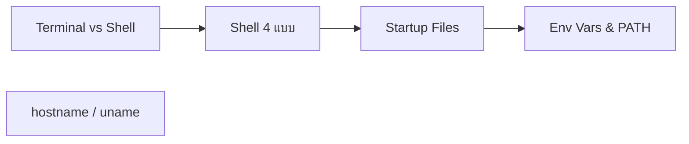

# Linux: แผนที่ความรู้

> จะ **ทำ** อะไร → ตาราง How-To ใน [[START-HERE]] · ค้นคำสั่ง → [[Linux-Command-Cheatsheet]]
> หน้านี้คือแผนที่ "มันทำงานยังไง"

## อ่านตามลำดับนี้

1. [[Terminal-Shell-and-TTY]] — Terminal, Shell, TTY คือคนละชิ้น
2. [[Shell-Types-Login-Interactive]] — login / interactive และทำไม script ไม่เห็น alias
3. [[Shell-Startup-Files]] — `.bashrc` `.bash_profile` `.profile` `.zshrc` โหลดตอนไหน
4. [[Environment-Variables-and-PATH]] — `export`, PATH หาโปรแกรมยังไง
5. [[System-Identity-hostname-uname]] — `hostname`, `uname`, `/etc/os-release`

## How-To

- [[Linux-Check-System-Info]] · [[Linux-Change-Hostname]]
- [[Linux-Check-Shell-Type]] · [[Linux-Add-Alias-and-Env-Var]] · [[Linux-Add-to-PATH]]
- [[Linux-Fix-Command-Not-Found-in-Script]]

## เกี่ยวข้อง

- [[SSH-Knowledge-Base/README|SSH]] — ssh เข้า Linux Server
