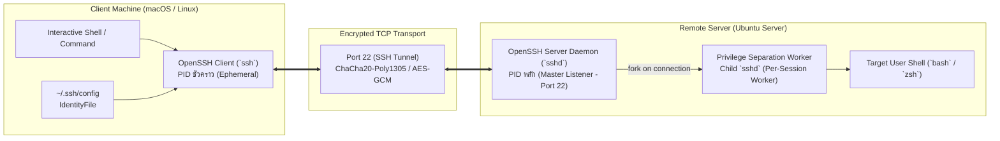
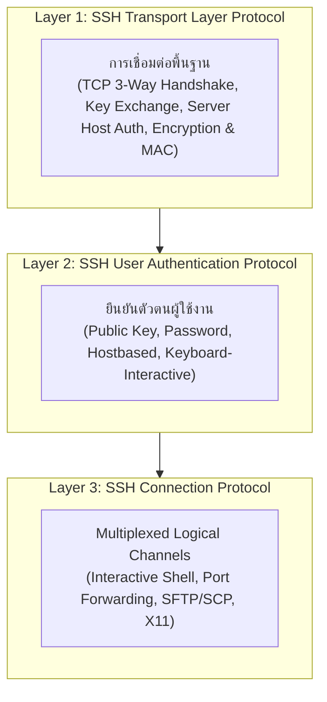

# SSH Architecture & Fundamentals

**Secure Shell (SSH)** คือโปรโตคอลเครือข่ายสำหรับเข้ารหัสข้อมูลในระดับ Application Layer (RFC 4251 - 4254) ออกแบบมาเพื่อทดแทนโปรโตคอลดั้งเดิมที่ไม่ปลอดภัยอย่าง Telnet, rlogin, และ RSH ซึ่งส่งข้อมูล Credentials และ Payload เป็น Plaintext ผ่านเครือข่าย

---

## 1. สถาปัตยกรรม Client-Server และ Process Boundary

SSH ทำงานตามรูปแบบ Client-Server Model โดยแบ่งแยกกระบวนการทำงานและหน้าที่ความรับผิดชอบอย่างชัดเจน:

### ความแตกต่างระหว่าง `ssh` และ `sshd`

| มิติการเปรียบเทียบ | `ssh` (SSH Client) | `sshd` (SSH Daemon / Server) |
| :--- | :--- | :--- |
| **บทบาทหน้าที่** | เริ่มต้นการเชื่อมต่อไปยังโฮสต์ปลายทาง ร้องขอ Channel | รอรับการเชื่อมต่อขาเข้า ตรวจสอบยืนยันสิทธิ์ และสร้าง Session |
| **อายุของ Process** | เกิดขึ้นเมื่อผู้ใช้รันคำสั่ง และสิ้นสุดลงเมื่อออกจาก Session | ทำงานเป็น Background Daemon ตลอดเวลา (Systemd Service) |
| **Port Binding** | สุ่มใช้ Ephemeral Port ขาออก (เช่น `52410`) | ผูกติดกับ Well-Known Port (Default คือ `22`) บน `0.0.0.0` |
| **สิทธิ์ผู้ใช้งาน** | รันด้วยสิทธิ์ของผู้ใช้คนนั้น (User-space) | Master Process เริ่มด้วย `root` ก่อนแตก Child Process ตามสิทธิ์ User |

---

## 2. โครงสร้าง 3 เลเยอร์ของโปรโตคอล SSH (RFC 4251)

โปรโตคอล SSH ไม่ได้เป็นบล็อกเนื้อหาชิ้นเดียว แต่ถูกแบ่งโครงสร้างเป็น 3 ชั้นย่อย (Layered Architecture):

1. **Transport Layer Protocol:** จัดการเรื่องการเชื่อมต่อ TCP, ต่อรองอัลกอริทึม, แลกเปลี่ยนกุญแจลับ (KEX), และรับรองตัวตนของเครื่องแม่ข่าย ([[SSH-Handshake-and-Authentication-Anatomy]])
2. **User Authentication Protocol:** จัดการการตรวจสอบสิทธิ์ของผู้ใช้เพื่อเข้าสู่ระบบ ([[Asymmetric-Cryptography-and-Key-Generation]])
3. **Connection Protocol:** ให้บริการ Multiplex ช่องทางการสื่อสารผ่านท่อเดียว เช่น การเปิด Terminal Shell, การรัน Command ทางไกล, และการทำ Tunneling ([[SSH-Local-Port-Forwarding]], [[SSH-Remote-Port-Forwarding]])

---

## 3. สภาพแวดล้อมที่ใช้ทดสอบในแล็บ (Learning Context)

> [!NOTE] 🔬 ผลการทดลองจริง (Verified in Lab)
> - **Client Host:** MacBook Air (Apple Silicon, macOS)
> - **Remote Host:** Ubuntu Server (`chubu-server`, IP: `192.168.64.8`, User: `chubu`)
> - **Network Gateway:** Virtual Bridge Network (`192.168.64.0/24`)

---

## 🔗 โหนดความรู้ที่เกี่ยวข้อง (Related Nodes)
- [[SSH-Handshake-and-Authentication-Anatomy]] — เจาะลึกลำดับ Handshake และ State Machine
- [[Asymmetric-Cryptography-and-Key-Generation]] — หลักการทางคณิตศาสตร์ของ Key Pair
- [[SSH-Client-Configuration-and-Aliases]] — การตั้งค่า `~/.ssh/config` เพื่อเชื่อมต่อแบบไร้รหัสผ่าน
- [[Foundational-Networking-and-Sockets]] — โครงสร้างพื้นฐานระดับ TCP และ Socket Sockets
