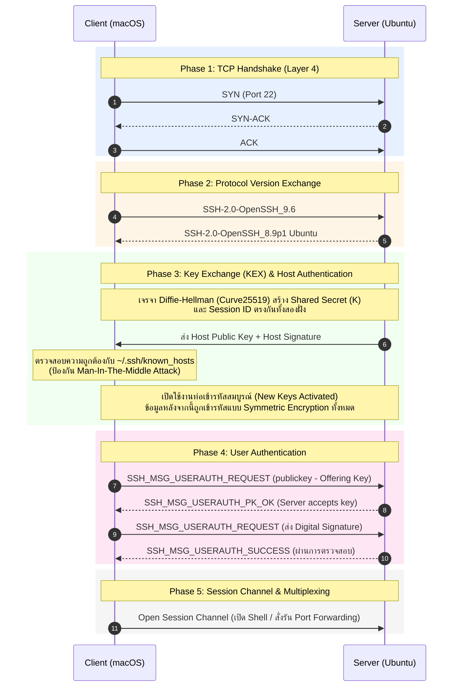
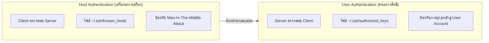

# SSH Handshake & Authentication Anatomy

เมื่อเรารันคำสั่ง `ssh chubu` ระบบไม่ได้เชื่อมต่อไปยังปลายทางแล้วส่งรหัสผ่านทันที แต่มีขั้นตอนการเจรจาระดับเครือข่ายและความปลอดภัยที่ซับซ้อนถึง 5 ขั้นตอนหลัก

---

## 1. ลำดับขั้นของ SSH Connection (The 5 Phases)

---

## 2. เจาะลึก Log จากคำสั่ง `ssh -v chubu`

> [!NOTE] 🔬 ผลการทดลองจริง (Verified in Lab)
> การรันด้วยโหมดตรวจสอบความผิดพลาด (`-v`) ช่วยให้เราเห็นเบื้องหลังการแลกเปลี่ยนแพ็กเก็ต:

### 1. `debug1: Offering public key: ... ED25519 SHA256:...`
- **ความหมาย:** Client แจ้ง Public Key ไปยัง Server เพื่อถามว่า *"คุณมีกุญแจสาธารณะดอกนี้บันทึกอยู่ใน authorized_keys หรือไม่?"*
- ในขั้นตอนนี้ **ยังไม่มีการนำ Private Key มาเซ็นชื่อใด ๆ ทั้งสิ้น**

### 2. `debug1: Server accepts key: ... ED25519 SHA256:...`
- **ความหมาย:** Server ค้นพบ Public Key ในไฟล์ `~/.ssh/authorized_keys` และตอบตกลงว่ารู้จัก
- **ข้อควรระวัง:** การที่ Server ยอมรับ Public Key **ยังไม่ใช่การล็อกอินสำเร็จ!** เป็นเพียงการตอบรับว่า "ฉันรู้จักคีย์นี้ กรุณาส่งหลักฐานลายเซ็นมายืนยันตัวตนว่าคุณเป็นเจ้าของจริง"

### 3. `debug1: Authenticated to 192.168.64.8 ([192.168.64.8]:22) using "publickey".`
- **ความหมาย:** Client นำ Challenge Data ที่ Server ส่งมา ไปให้ Private Key (หรือ `ssh-agent`) เซ็นชื่อ แล้วส่ง Signature กลับไป Server ตรวจสอบทางคณิตศาสตร์แล้วว่าถูกต้อง จึงเปิดทางให้เข้าใช้งานระบบ

---

## 3. Host Authentication vs User Authentication

| มิติการเปรียบเทียบ | Host Authentication | User Authentication |
| :--- | :--- | :--- |
| **ใครเป็นคนตรวจสอบ?** | **Client ตรวจสอบความถูกต้องของ Server** | **Server ตรวจสอบความถูกต้องของ Client** |
| **ไฟล์ที่จัดเก็บข้อมูล** | `~/.ssh/known_hosts` (บนเครื่อง Client) | `~/.ssh/authorized_keys` (บนเครื่อง Server) |
| **เป้าหมายความปลอดภัย** | มั่นใจว่าเราไม่ได้เชื่อมต่อกับเครื่องปลอมที่ Hacker ดักไว้ | มั่นใจว่าคนที่กำลังล็อกอินเข้ามามีสิทธิ์ในบัญชีนั้นจริง |
| **เกิดในขั้นตอนใด?** | เกิดขึ้นใน Phase 3 (Key Exchange) ก่อนส่งข้อมูลระบุตัวตน | เกิดขึ้นใน Phase 4 ภายใต้ท่อที่เข้ารหัสแล้วเรียบร้อย |

---

## 🔗 โหนดความรู้ที่เกี่ยวข้อง (Related Nodes)
- [[SSH-Architecture-and-Fundamentals]] — เลเยอร์ของโปรโตคอล SSH
- [[Asymmetric-Cryptography-and-Key-Generation]] — ทฤษฎีการสร้างและตรวจสอบ Digital Signature
- [[SSH-Agent-and-Memory-Security]] — การทำงานของ Agent ในขั้นตอนส่ง Signature
- [[Foundational-Networking-and-Sockets]] — กลไก TCP 3-Way Handshake
