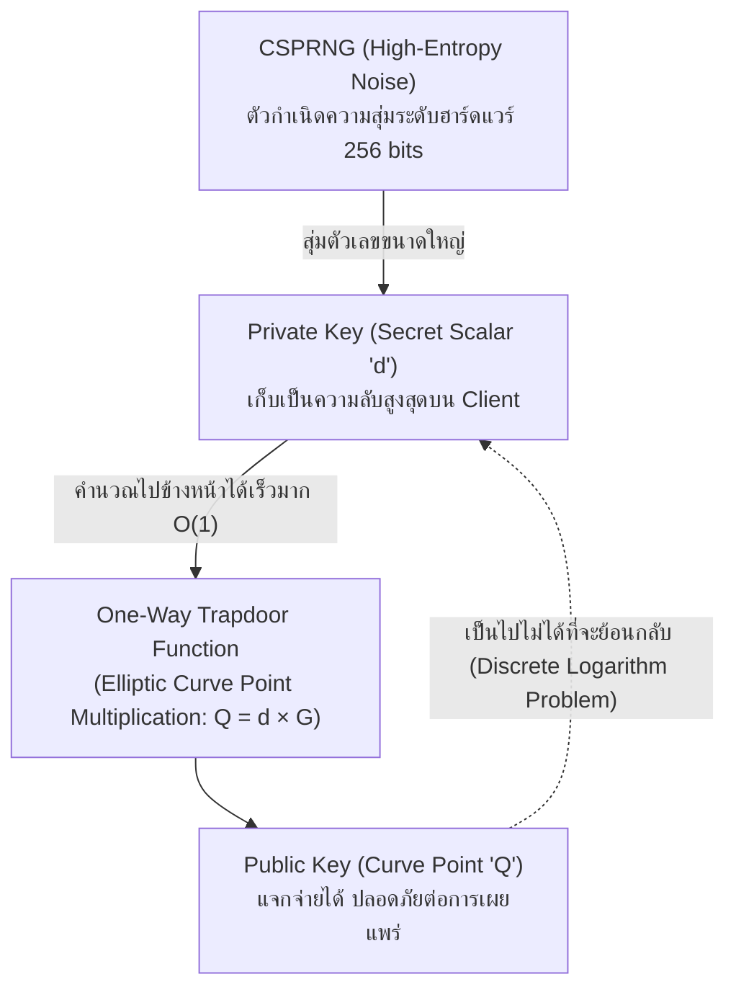
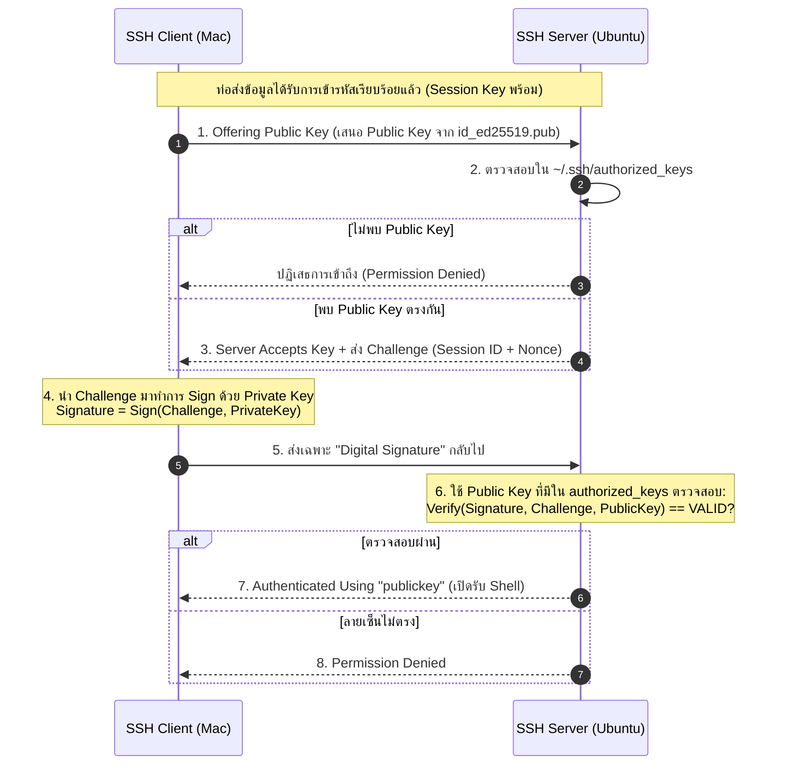

# Asymmetric Cryptography & Key Generation

ระบบยืนยันตัวตนของ SSH ขับเคลื่อนด้วยวิทยาการรหัสลับแบบกุญแจอสมมาตร (**Asymmetric Cryptography**) ซึ่งใช้คู่กุญแจที่สัมพันธ์กันทางคณิตศาสตร์: **Private Key** (กุญแจส่วนตัว) และ **Public Key** (กุญแจสาธารณะ)

---

## 1. ทำไม Private Key ต้องเกิดก่อน และทำไมถึงย้อนกลับไม่ได้?

คำถามสำคัญ: *เราสามารถสร้าง Private Key จาก Public Key ได้หรือไม่?* คำตอบคือ **"เป็นไปไม่ได้ในทางปฏิบัติ"**

> [!INFO] 📚 กลไกทางทฤษฎี: One-Way Trapdoor Function
> 1. **Private Key ($d$):** เริ่มต้นจากการดึงตัวเลขสุ่มระดับความปลอดภัยสูง (CSPRNG) ขนาด 256 บิตจากระบบปฏิบัติการ ตัวเลขนี้คือ Scalar ลับ
> 2. **Public Key ($Q$):** ถูกคำนวณผ่านฟังก์ชันทางเดียว (One-Way Function) โดยนำ $d$ ไปคูณกับจุดฐานที่ตกลงกันไว้ (Generator Point $G$) บนเส้นโค้งวงรี:
>    $$Q = d \times G$$
> 3. **ทำไมคำนวณย้อนกลับไม่ได้?** การหาค่า $d$ จาก $Q$ และ $G$ เรียกว่าปัญหา **Elliptic Curve Discrete Logarithm Problem (ECDLP)** ซึ่งในปัจจุบันไม่มีสูตรคณิตศาสตร์หรือคอมพิวเตอร์ใดในโลกที่สามารถแก้ได้ภายในเวลาช่วงอายุขัยมนุษย์

---

## 2. การทำงานของ Digital Signature: ความลับที่ไม่เคยออกจากเครื่อง

คำถามที่พบบ่อย: *ตอนต่อ SSH เครื่อง Client ส่ง Private Key ไปให้ Server ตรวจสอบหรือไม่?*

> [!IMPORTANT] 📚 Private Key ไม่เคยเดินทางผ่าน Network
> **Private Key ถูกเก็บรักษาและใช้งานเฉพาะใน Client เท่านั้น** สิ่งที่ถูกส่งผ่านท่อเครือข่ายมีเพียง **Digital Signature (ลายเซ็นดิจิทัล)**

---

## 3. ความปลอดภัยของไฟล์และการปกป้องกุญแจ
- ไฟล์ Private Key เช่น `~/.ssh/id_ed25519` จะต้องถูกตั้งสิทธิ์เคร่งครัดที่ `chmod 600` (เฉพาะเจ้าของเท่านั้นที่อ่าน/เขียนได้) หากเปิดสิทธิ์กว้างเกินไป OpenSSH Client จะปฏิเสธการใช้งานทันที
- เพื่อป้องกันกรณีไฟล์ถูกขโมยจากเครื่อง เราจะทำการเข้ารหัสไฟล์บนดิสก์ซ้ำอีกชั้นด้วย [[SSH-Passphrase-and-Key-Protection]]

---

## 🔗 โหนดความรู้ที่เกี่ยวข้อง (Related Nodes)
- [[SSH-Key-Types-and-Algorithms]] — เปรียบเทียบ ED25519, RSA, ECDSA, และ DSA
- [[SSH-Passphrase-and-Key-Protection]] — การเข้ารหัส Private Key at-rest ด้วย Passphrase
- [[SSH-Agent-and-Memory-Security]] — การแคชคีย์ใน RAM เพื่อเซ็น Digital Signature โดยไม่ต้องพิมพ์รหัสซ้ำ
- [[SSH-Handshake-and-Authentication-Anatomy]] — ถอดรหัสข้อความ `Offering public key` ใน Verbose Logs
