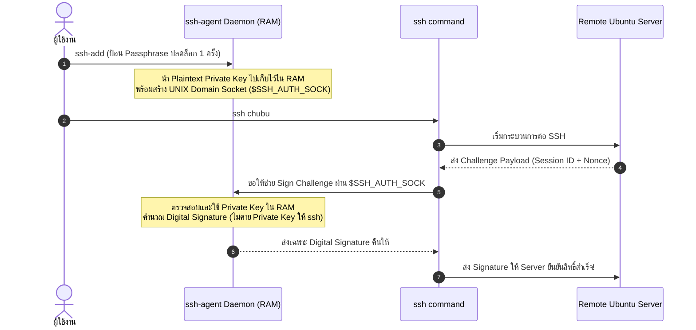

# SSH Agent & Memory Security

**`ssh-agent`** คือ Background Daemon ของ OpenSSH ที่ทำหน้าที่เป็น **"ผู้ดูแลกุญแจในหน่วยความจำ (In-Memory Key Custodian)"** และทำหน้าที่เป็น **Signature Oracle** เพื่อให้การทำงานสะดวกรวดเร็วโดยไม่ต้องสูญเสียความปลอดภัย

---

## 1. ทำไมไม่ต้องพิมพ์ Passphrase ซ้ำ? (สถาปัตยกรรม Signature Oracle)

เมื่อเราสั่ง `ssh-add ~/.ssh/id_ed25519` และพิมพ์ Passphrase สำเร็จ 1 ครั้ง:



> [!INFO] 📚 กลไกทางทฤษฎี: Signature Oracle Pattern
> - `ssh-agent` ไม่เคยส่งต่อ Private Key กลับคืนให้คำสั่ง `ssh` หรือแอปพลิเคชันอื่น
> - เมื่อต้องการยืนยันตัวตน คำสั่ง `ssh` จะโยนก้อน Challenge เข้าไปถามทาง UNIX Domain Socket แล้วตัว Agent จะทำหน้าที่ "ประทับตราลายเซ็น (Sign)" แล้วส่งเฉพาะผลลัพธ์กลับคืนมา

---

## 2. คำสั่งจัดการคีย์ใน `ssh-add`

```bash
# 1. แสดงรายการ Fingerprint ของกุญแจที่โหลดอยู่ใน RAM
ssh-add -l

# 2. แสดงตัว Public Key แบบสมบูรณ์ของกุญแจที่โหลดอยู่ใน RAM
ssh-add -L

# 3. ล้างกุญแจทั้งหมดออกจาก RAM ทันที
ssh-add -D

# 4. โหลดกุญแจพร้อมตั้งเวลาหมดอายุ (เช่น ให้จำได้เพียง 1 ชั่วโมง)
ssh-add -t 1h ~/.ssh/id_ed25519
```

| คำสั่ง | รูปแบบผลลัพธ์ | ประโยชน์การใช้งาน |
| :--- | :--- | :--- |
| **`ssh-add -l`** | `256 SHA256:XyZ... /Users/.../.ssh/id_ed25519 (ED25519)` | ตรวจสอบว่ามีกุญแจใดพร้อมใช้งานอยู่บ้าง โดยไม่เปิดเผย Public Key |
| **`ssh-add -L`** | `ssh-ed25519 AAAAC3Nz... user@macbook` | ดู Public Key ทั้งชุดเพื่อ Pipe ส่งออกไปใส่ `authorized_keys` |
| **`ssh-add -D`** | `All identities removed.` | **ล้างเฉพาะแคชใน RAM ทิ้ง** (ไฟล์บนดิสก์ปลอดภัย ไม่ถูกลบ) |

---

## 3. พฤติกรรมเฉพาะตัวของ `ssh-agent` บน macOS

บน macOS (รวมถึง Apple Silicon) ระบบปฏิบัติการมี **Apple Keychain** ช่วยจัดการ:

```sshconfig
Host *
    AddKeysToAgent yes
    UseKeychain yes
    IdentityFile ~/.ssh/id_ed25519
```

- **`UseKeychain yes`:** สั่งให้ macOS บันทึก Passphrase ลงใน Secure Enclave / Keychain ของ Mac
- **`AddKeysToAgent yes`:** เมื่อเปิดเครื่องหรือรันคำสั่ง SSH ครั้งแรก macOS จะดึง Passphrase จาก Keychain มาปลดล็อกคีย์เข้า `ssh-agent` ใน RAM ให้โดยอัตโนมัติ ทำให้ผู้ใช้ไม่ต้องสั่ง `ssh-add` เองทุกครั้งที่เปิดเครื่อง

---

## 🔗 โหนดความรู้ที่เกี่ยวข้อง (Related Nodes)
- [[SSH-Passphrase-and-Key-Protection]] — กลไกการเข้ารหัสคีย์ก่อนส่งเข้า Agent
- [[SSH-Client-Configuration-and-Aliases]] — การตั้งค่า `AddKeysToAgent` และ `UseKeychain` ในคอนฟิก
- [[SSH-Agent-Forwarding-and-Security]] — ความเสี่ยงจากการส่งต่อ Agent Socket ไปยังเครื่องอื่น (`-A`)
- [[SSH-Command-Reference-and-Cheatsheet]] — รวบรวมคำสั่ง `ssh-add` ทั้งหมด
