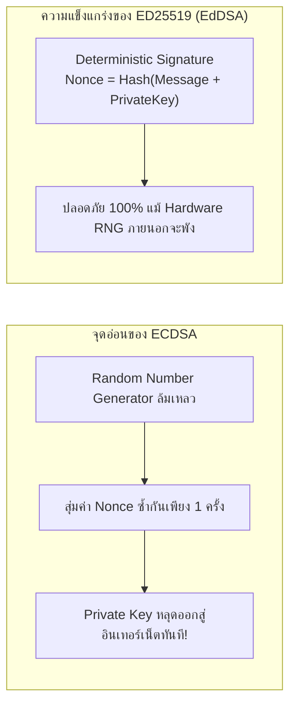

# SSH Key Types & Cryptographic Algorithms

OpenSSH รองรับอัลกอริทึมสำหรับสร้างกุญแจหลายประเภทตลอดประวัติศาสตร์การพัฒนา แต่ละประเภทมีพื้นฐานทางคณิตศาสตร์ ขนาดของกุญแจ และระดับความปลอดภัยที่แตกต่างกันอย่างมีนัยสำคัญ

---

## 1. ตารางเปรียบเทียบเชิงลึกของ Key Algorithms

| Algorithm | Key Size (bits) | Security Level (Symmetric Bits) | ความเร็วในการคำนวณ | ช่องโหว่ / ข้อจำกัดสำคัญ | คำแนะนำการใช้งาน |
| :--- | :--- | :--- | :--- | :--- | :--- |
| **ED25519** | **256 bits** | **~128 bits** | **เร็วที่สุด (O(1))** | ต้องใช้ OpenSSH 6.5+ (ปี 2014 เป็นต้นไป) | **Default Recommendation (แนะนำสูงสุด)** |
| **RSA** | 3072–4096 bits | 128–140 bits | ช้า, ใช้ CPU สูง | หากใช้ SHA-1 (`ssh-rsa`) จะถูกแบนใน OpenSSH 8.8+ | **Fallback Only (เฉพาะต่อกับระบบโบราณ)** |
| **ECDSA** | 256 / 384 / 521 bits | 128 / 192 / 256 bits | เร็วปานกลาง | พึ่งพา Hardware RNG สูงมาก หากสุ่มค่าซ้ำ Private Key หลุดทันที | **ไม่แนะนำ (เลี่ยงได้ควรเลี่ยง)** |
| **DSA** | 1024 bits | < 80 bits | ช้า | ขนาดกุญแจจำกัดที่ 1024 บิต สามารถถอดรหัสได้แล้ว | **Deprecated / ห้ามใช้เด็ดขาด** |

---

## 2. ทำไม ED25519 ถึงเป็นตัวเลือกที่แนะนำเป็นอันดับหนึ่ง?



1. **Deterministic Nonce (RFC 8032):** ED25519 ไม่พึ่งพาตัวเลขสุ่มในขั้นตอนการสร้างลายเซ็น แต่คำนวณ Nonce จากการ Hash เนื้อหาข้อมูลร่วมกับ Private Key ทำให้ปลอดจากปัญหา Nonce Reuse
2. **Key Size กะทัดรัด:** Public Key มีความยาวเพียง 68 ตัวอักษร (เทียบกับ RSA 4096 บิตที่มีขนาดยาวกว่า 700 ตัวอักษร) ทำให้ส่งผ่านเน็ตเวิร์กได้รวดเร็วและไม่เปลืองพื้นที่
3. **Resilience to Side-Channel Attacks:** โครงสร้างคณิตศาสตร์ถูกออกแบบมาให้เวลาในการประมวลผลคงที่ (Constant Time) ป้องกันการดักจับข้อมูลจากการวัดเวลาของ CPU

---

## 3. Hardware-backed Security Keys (`ed25519-sk`)

OpenSSH 8.2 ขึ้นไปเพิ่มการรองรับกุญแจชนิด **FIDO2 / U2F Security Key** (เช่น YubiKey) ด้วยตัวเลือก `-sk`:

```bash
ssh-keygen -t ed25519-sk -O resident -C "yubikey-primary"
```

- **กลไกการทำงาน:** กุญแจส่วนตัวถูกสร้างและกักขังอยู่ภายใน Secure Enclave ของ Hardware Token โดยไม่มีวันถูก Export ออกมาสู่ RAM หรือดิสก์ของคอมพิวเตอร์
- **User Presence:** ทุกครั้งที่มีการล็อกอิน ตัวอุปกรณ์จะกะพริบไฟและบังคับให้ผู้ใช้ใช้นิ้วสัมผัสตัว USB เพื่อยืนยันว่ามีมนุษย์อยู่หน้าเครื่องจริง

> [!WARNING] ⏳ ยังไม่ได้ทดลองในแล็บ (Unverified / Knowledge Gap)
> การสร้างและทดสอบกุญแจตระกูล `-sk` จำเป็นต้องมีอุปกรณ์ FIDO2 Token ซึ่งยังไม่ได้เชื่อมต่อและทดลองใน Session นี้

---

## 🔗 โหนดความรู้ที่เกี่ยวข้อง (Related Nodes)
- [[Asymmetric-Cryptography-and-Key-Generation]] — หลักการทำงานของ Asymmetric Keys
- [[SSH-Passphrase-and-Key-Protection]] — การป้องกันคีย์บนดิสก์ด้วย Passphrase
- [[SSH-Command-Reference-and-Cheatsheet]] — ตัวเลือกคำสั่ง `ssh-keygen` ในทางปฏิบัติ
- [[SSH-Knowledge-Gaps-and-Future-Labs]] — รายการการทดลองที่รอการยืนยันเกี่ยวกับ Hardware Keys
