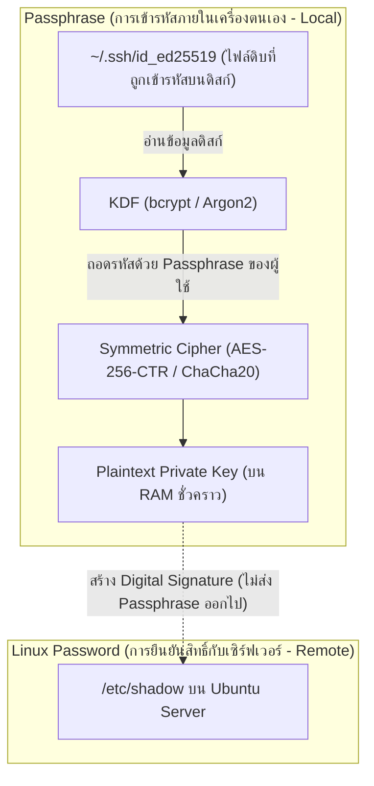

# SSH Passphrase & Key Protection

เมื่อเราสร้างคู่กุญแจด้วย `ssh-keygen` ระบบจะแจ้งเตือนให้ตั้ง **Passphrase** สำหรับป้องกันตัวไฟล์ Private Key ซึ่งมีกลไกทางความปลอดภัยที่แตกต่างจากการใช้ Password ของระบบปฏิบัติการอย่างสิ้นเชิง

---

## 1. Passphrase vs Linux User Password



| มิติการเปรียบเทียบ | SSH Key Passphrase | Linux User Password |
| :--- | :--- | :--- |
| **ขอบเขตการทำงาน** | **Local Only:** อยู่เฉพาะในเครื่อง Client เพื่อปลดล็อกไฟล์คีย์ | **Remote:** ตรวจสอบกับฐานข้อมูลผู้ใช้บนเครื่อง Server |
| **เป้าหมายความปลอดภัย** | ป้องกันกรณีไฟล์ Private Key หลุด หรือเครื่องถูกขโมยฮาร์ดดิสก์ | ป้องกันไม่ให้ผู้อื่นล็อกอินเข้าบัญชี User บน Linux OS |
| **ส่งผ่าน Network หรือไม่?** | **ไม่ส่งออกไปเด็ดขาด (0%)** เซิร์ฟเวอร์ไม่เคยรู้ว่าตั้งอะไรไว้ | มีการ Hash และส่งไปตรวจสอบกับระบบ PAM ของ Server |

---

## 2. การเปลี่ยน Passphrase ด้วย `ssh-keygen -p`

หากคุณสร้างคีย์ไว้โดยไม่ได้ตั้ง Passphrase หรือต้องการเปลี่ยนรหัสใหม่ สามารถทำได้ทันทีโดยไม่ต้องสร้างคู่กุญแจใหม่:

```bash
ssh-keygen -p -f ~/.ssh/id_ed25519
```

> [!NOTE] 🔬 ผลการทดลองจริง (Verified in Lab)
> - เมื่อเรารันคำสั่ง `ssh-keygen -p` ระบบจะทำการถอดรหัส Private Key เดิม แล้วเข้ารหัสทับด้วย Passphrase ใหม่อีกครั้ง
> - **สิ่งที่ไม่เปลี่ยนเลยคือตัว Asymmetric Private Key และ Public Key ด้านใน**
> - **ผลลัพธ์:** คุณไม่ต้องนำ Public Key ไปหยอดใส่ `~/.ssh/authorized_keys` บนเซิร์ฟเวอร์ใหม่ ทุกเซิร์ฟเวอร์ยังคงเข้าได้เหมือนเดิมทันที

---

## 3. จะเกิดอะไรขึ้นถ้าลืม Passphrase?

ระบบรหัสลับของ OpenSSH ใช้มาตรฐาน **Key Derivation Function (KDF)** ชั้นสูง (เช่น bcrypt KDF) ทำให้:
1. **ไม่มีระบบ "Forgot Password":** ไม่มีระบบหลังบ้าน ไม่มี Recovery Key
2. **Brute Force ยากมหาศาล:** KDF ถูกออกแบบมาให้กินทรัพยากร CPU และ Memory หน่วงเวลาการคำนวณ ทำให้การใช้คอมพิวเตอร์สุ่มถอดรหัสทำได้ช้ามาก
3. **ผลลัพธ์:** หากลืม Passphrase ไฟล์ Private Key นั้นจะกลายเป็นขยะดิจิทัลทันที ทางออกเดียวคือ **สร้าง Key Pair ชุดใหม่ แล้วนำ Public Key ใหม่ไปหยอดใส่เซิร์ฟเวอร์ปลายทางทั้งหมด**

---

## 🔗 โหนดความรู้ที่เกี่ยวข้อง (Related Nodes)
- [[Asymmetric-Cryptography-and-Key-Generation]] — โครงสร้างคณิตศาสตร์ของกุญแจ
- [[SSH-Agent-and-Memory-Security]] — การใช้ Agent จดจำ Passphrase ใน RAM เพื่อไม่ต้องพิมพ์ซ้ำ
- [[SSH-Command-Reference-and-Cheatsheet]] — ตัวอย่างคำสั่งเปลี่ยนและจัดการกุญแจ
- [[SSH-Common-Misconceptions-and-Troubleshooting]] — ความเข้าใจผิดเกี่ยวกับ Passphrase และ Network
