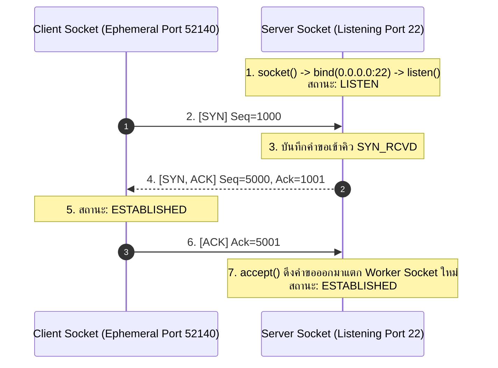
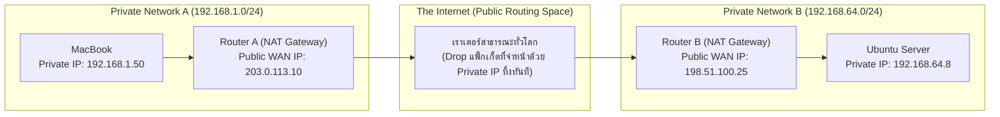

# Foundational Networking & Sockets

การทำความเข้าใจ SSH และ Port Forwarding ในระดับลึก จำเป็นต้องเข้าใจกลไกเครือข่ายพื้นฐานระดับล่าง (Layer 3 และ Layer 4) ซึ่งเป็นรากฐานที่โปรโตคอล SSH อาศัยทำงานอยู่

---

## 1. TCP 3-Way Handshake & Socket Lifecycle

ก่อนที่โปรแกรมจะเริ่มแลกเปลี่ยนข้อมูลผ่านโปรโตคอล SSH ได้ ตัว Kernel ต้องเจรจาสร้างท่อเชื่อถือได้ (Reliable Stream) ตามมาตรฐาน TCP:

### นิยามของ Socket และ 4-Tuple
การเชื่อมต่อหนึ่งท่อจะถูกระบุเอกลักษณ์ด้วย **4-Tuple (Socket Quadruple)**:
$$\text{Connection ID} = (\text{Source IP}, \text{Source Port}, \text{Destination IP}, \text{Destination Port})$$

---

## 2. NAT (Network Address Translation) & Private IP Isolation

ทำไมเครื่องภายในบ้านหรือ Virtual Machine ส่วนใหญ่จึงไม่สามารถรับ Connection ตรง ๆ จากภายนอกอินเทอร์เน็ตได้?

- **RFC 1918 Private Ranges:** บล็อก IP ได้แก่ `10.0.0.0/8`, `172.16.0.0/12`, และ `192.168.0.0/16` ถูกสงวนไว้ใช้ภายในเท่านั้น
- **NAT Table:** เราเตอร์จะทำการแปลง Source IP และ Port ของแพ็กเก็ตขาออกให้กลายเป็น Public IP ของเราเตอร์
- **ข้อจำกัด:** เมื่อมีแพ็กเก็ตจากภายนอกพยายามยิงเข้ามาหา Server โดยที่เราเตอร์ไม่มีกฎ Port Forwarding หรือไม่ได้เปิด Connection รอไว้ก่อน เราเตอร์จะ Drop แพ็กเก็ตนั้นทิ้งทันที
- **ทางแก้ด้วย SSH:** การใช้ **SSH Remote Port Forwarding (`-R`)** เป็นเทคนิคทรงพลังในการเจาะทะลุ NAT (NAT Traversal) เพราะเครื่องหลัง NAT เป็นผู้เปิดท่อขาออกไปหา Server ก่อนด้วยตนเอง

---

## 3. Network Namespace ในระบบปฏิบัติการ

ใน Linux Kernel และเทคโนโลยี Container (เช่น Docker, LXC, Podman):
- แต่ละ **Network Namespace** จะมี Network Stack เป็นของตนเอง: มี Loopback Interface แยกเด็ดขาด, ตาราง Routing แยก, Firewall แยก, และพื้นที่หมายเลข Port แยก
- นี่คือเหตุผลที่ Container หนึ่งสามารถรันโปรแกรมบนพอร์ต `80` ได้โดยไม่ชนกับโปรเซสอื่นบนเครื่อง Host

---

## 🔗 โหนดความรู้ที่เกี่ยวข้อง (Related Nodes)
- [[Localhost-Loopback-and-Port-Binding]] — ความเข้าใจเรื่อง Loopback และการ Bind Port
- [[SSH-Handshake-and-Authentication-Anatomy]] — ลำดับขั้น Handshake หลังเปิด TCP
- [[SSH-Remote-Port-Forwarding]] — การเจาะทะลุ NAT ด้วย Reverse Tunnel
- [[SSH-Dynamic-Port-Forwarding-and-SOCKS5]] — การส่งข้อมูลข้ามเน็ตเวิร์กด้วย SOCKS5
