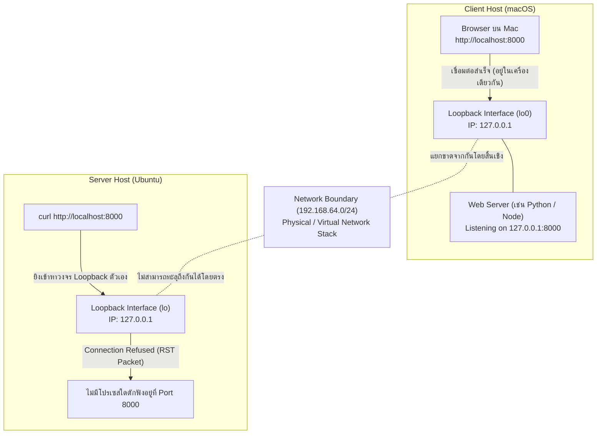
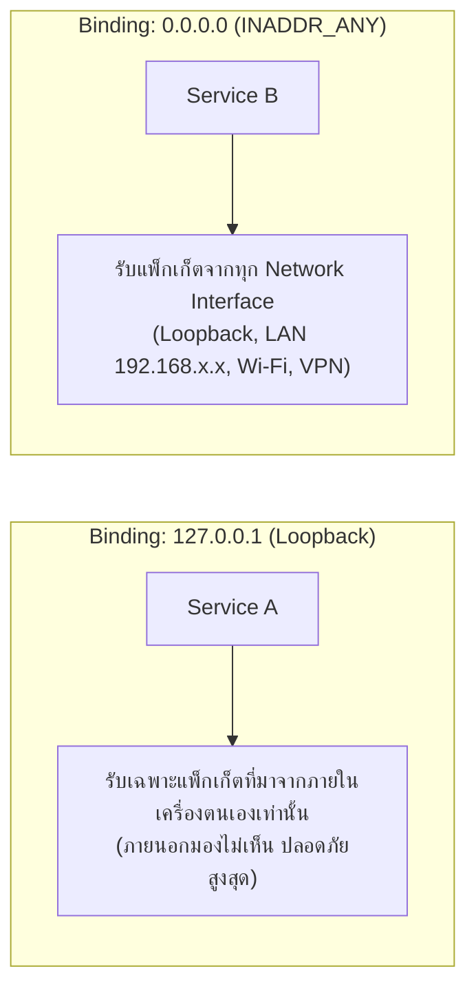

# Localhost, Loopback & Port Binding Isolation

หนึ่งในข้อผิดพลาดเชิงมโนทัศน์ (Mental Model Confusion) ที่พบบ่อยที่สุดในการทำแล็บเครือข่ายคือคำถาม: **"ทำไมรัน Web Server บน Mac ไว้ที่พอร์ต 8000 แล้วพอ SSH เข้าไปใน Ubuntu สั่ง `curl http://localhost:8000` ถึงไม่ขึ้น (Connection Refused)?"**

---

## 1. ความจริงของ `localhost` และ Loopback Interface

`localhost` ไม่ใช่สายเคเบิลวิเศษที่เชื่อมทุกเครื่องเข้าหากัน แต่เป็นเพียง **ชื่อโดเมนเสมือน (Local Domain Name)** ที่ระบบปฏิบัติการทำ Name Resolution ชี้ตรงไปที่ **Loopback Interface (`lo`)** ของเครื่องตนเองเสมอ

> [!IMPORTANT] 📚 Loopback ของใครของมัน
> - เมื่อคุณอยู่บนเครื่อง Mac: `localhost` หมายถึง Loopback Interface ของ **Mac**
> - เมื่อคุณพิมพ์คำสั่งใน Shell ของ Ubuntu: `localhost` ย่อมหมายถึง Loopback Interface ของ **Ubuntu**
> - การสั่ง `curl http://localhost:8000` บน Ubuntu จึงไม่มีทางรู้ได้เลยว่าบน Mac มี Web Server เปิดอยู่ เว้นแต่จะมีการสร้างสะพานเชื่อมด้วย [[SSH-Remote-Port-Forwarding]]

---

## 2. การ Bind Address: `127.0.0.1` vs `0.0.0.0`

เมื่อพัฒนาเซอร์วิสหรือรันคำสั่งเปิดพอร์ต เช่น `python3 -m http.server 8000` ค่า Address ที่โปรแกรมเลือกผูก (Bind) ส่งผลกระทบอย่างยิ่งต่อการมองเห็นในเครือข่าย:

| Binding Target | ความหมายทางเทคนิค | ขอบเขตการเข้าถึง |
| :--- | :--- | :--- |
| **`127.0.0.1`** (Loopback) | ผูกติดกับ Loopback Socket เท่านั้น | เฉพาะแอปพลิเคชันบนเครื่องเดียวกันเท่านั้นที่เรียกใช้งานได้ |
| **`0.0.0.0`** (INADDR_ANY) | สั่งให้ Kernel ดักฟังทุก Interface ของเครื่อง | เครื่องอื่นในวง LAN หรืออุปกรณ์ภายนอกสามารถยิงตรงเข้ามาได้ |
| **`192.168.64.8`** (Specific IP) | ผูกเฉพาะการ์ดแลนใบนั้น | เข้าถึงได้จากวงแลนนั้นเท่านั้น Loopback หรือการ์ดอื่นเข้าไม่ได้ |

---

## 3. วิธีการแก้ปัญหาการเข้าถึงข้ามเครื่อง

หากต้องการให้ Ubuntu เข้าถึง Web Server บน Mac ที่ผูกอยู่กับ `127.0.0.1:8000` มี 2 ทางเลือก:
1. **แก้ Binding เป็น `0.0.0.0` บน Mac:** แล้วให้ Ubuntu เรียกผ่าน IP ของ Mac ตรง ๆ (เช่น `http://192.168.64.1:8000`) — *แต่วิธีนี้ทำให้ใครในวงแลนก็เข้าถึงได้ ไม่ปลอดภัย*
2. **ใช้ SSH Remote Port Forwarding (`-R`):** ยิงท่อ SSH จาก Mac ไปเปิดพอร์ตบน Ubuntu เพื่อส่งข้อมูลกลับมายัง Mac แบบปลอดภัย ([[SSH-Remote-Port-Forwarding]])

---

## 🔗 โหนดความรู้ที่เกี่ยวข้อง (Related Nodes)
- [[SSH-Remote-Port-Forwarding]] — วิธีแก้ปัญหา Localhost ข้ามเครื่องด้วย Reverse Tunnel
- [[SSH-Local-Port-Forwarding]] — การส่ง Traffic จาก Client ไปเข้า Localhost ของ Server
- [[Foundational-Networking-and-Sockets]] — โครงสร้าง Socket และการทำงานของ Network Namespaces
- [[SSH-Common-Misconceptions-and-Troubleshooting]] — รวมความเข้าใจผิดเกี่ยวกับ Loopback
